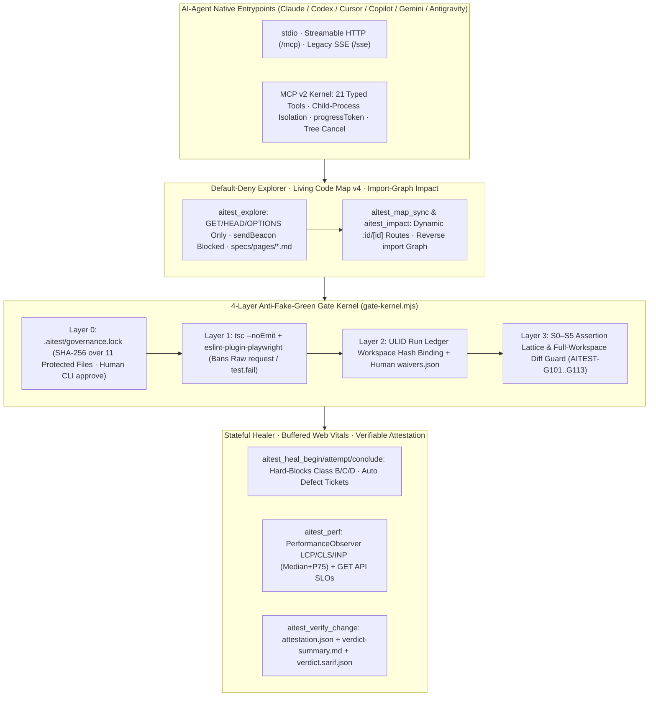

<div align="center">

# 🛡️ AI Test Workbench (`v5.0`)

**Trustworthy Verification Kernel, Multi-Protocol MCP Server & Living Code Map for AI Coding Agents**

Powered by **One-Call `verify_change` Attestation** · **4-Layer Anti-Fake-Green Gate + `S0–S5` Assertion Lattice + Governance Lock (`FGER=0%`)** · **Native MCP v2 (`stdio` / `/mcp` / `/sse` · 21 Tools · Async Jobs)** · **Stateful Healer** · **Import-Graph Impact v2** · **Buffered `PerformanceObserver` Web Vitals**

[简体中文文档 (默认)](./README.md) · [Governance & 4-Layer Gate](./docs/governance.en.md) · [v5.0 Scorecard](./docs/review/v5-verification-scorecard.en.md) · [AI Agent Quickstart](./docs/ai-agent-quickstart.en.md) · [AGENTS.en.md](./AGENTS.en.md) · [Architecture](./ARCHITECTURE.en.md) · [ADR-0001](./docs/adr/0001-mcp-protocol-stack-and-zero-dep-kernel.en.md) · [Changelog](./CHANGELOG.en.md)

[](https://github.com/seaworld008/ai-test-workbench/actions/workflows/ci.yml)
[](https://github.com/seaworld008/ai-test-workbench/releases)
[](./LICENSE)
[](./VERSION.en.md)
[-16a34a?style=flat-square)](./docs/review/v5-verification-scorecard.en.md)
[](./skills/ai-test-workbench/references/mcp-server-protocol.en.md)
[](https://playwright.dev/)

</div>

---

## Why AI Test Workbench v5.0?

When coding agents (`Claude Code`, `Codex CLI`, `Antigravity`, `Cursor`, `VS Code Copilot`, `Gemini CLI`) write and "self-heal" tests at high speed, the primary failure mode is no longer low velocity—it is **untrustworthy "Fake-Green" test results**:
1. **Subtle assertion weakening**: Agents replace `toHaveText('49/50')` with `toBeVisible()` or `expect(true).toBe(true)`, add `test.fail()`, swallow errors via `.catch(() => null)`, use `expect.soft()`, inject `testIgnore` into `playwright.config.ts`, disable ESLint rules, or replay stale green `results.json` artifacts.
2. **Prompt-only rules get ignored**: Without tamper locks and a persisted state machine, agents routinely mask Class-C backend `500` regressions by rewriting specs.
3. **MCP timeouts & serialization**: Long Playwright runs block fast read-only queries and get killed without progress notifications or process-tree cancellation.
4. **Measurement & egress blind spots**: `getEntriesByType` leaves `LCP` null and `CLS` zero; unguarded crawlers send mutating POSTs or leak JSON passwords and JWTs.

**AI Test Workbench v5.0** serves as an **independent Trustworthy Verification Kernel** with tool-enforced governance:

| North-Star Metric | `v5.0.0` Measured Benchmark (`npm run bench`) | Enforcing Mechanism |
|---|---|---|
| **Fake-Green Escape Rate (`FGER`)** | **`0.0%` (`26/26` cheating patches blocked)** | 4-Layer Gate Kernel + `S0–S5` Assertion Lattice + `.aitest/governance.lock` |
| **Seeded-Defect Detection Rate (`SDDR`)** | **`100.0%` (`7/7` full-stack defects caught)** | Zero-dep JSON Schema validator + RBAC/concurrency + WCAG 2.1/2.2 scans |
| **Triage Accuracy / Mis-Heal Rate** | **`100.0%` (`45/45`) / `0.0%` Mis-Heal** | Structured runtime guard telemetry + `aitest_heal_*` state machine |
| **Secret Redaction Recall** | **`100.0%` (`35/35` secret patterns scrubbed)** | Redaction v2 across JSON keys, JWTs, cloud tokens, PEM keys, DB URLs |

---

## Core v5.0 Architecture



---

## 30-Second AI Agent Setup (Zero Runtime Dependencies)

- **Claude Code**:
  ```bash
  claude mcp add ai-test-workbench -- npx -y ai-test-workbench mcp-serve
  ```
- **Codex CLI** (`.codex/config.toml`):
  ```toml
  [mcp_servers.ai-test-workbench]
  command = "npx"
  args = ["-y", "ai-test-workbench", "mcp-serve"]
  ```
- **Cursor / Windsurf / Antigravity / Gemini CLI** (`.mcp.json`):
  ```json
  {
    "mcpServers": {
      "ai-test-workbench": {
        "command": "npx",
        "args": ["-y", "ai-test-workbench", "mcp-serve"]
      }
    }
  }
  ```
- **Streamable HTTP (`/mcp`) & Legacy SSE (`/sse`)**:
  ```bash
  npx ai-test-workbench mcp-serve --transport http --port 3847 --target /path/to/your-repo
  ```

---

## CLI Quick Start & Reproducible Benchmark

Requires **Node.js `>= 22.12.0`** (`24 LTS` or `26 LTS` recommended).

```bash
# Project onboarding & one-call change verdict
npx ai-test-workbench doctor
npx ai-test-workbench init --name my-app --target "/path/to/your-repo" --loop codex
npx ai-test-workbench verify-change --target "/path/to/your-repo" --base origin/main

# Clone & reproduce all v5.0 unit tests, live demo, and seeded-defect benchmark locally
git clone https://github.com/seaworld008/ai-test-workbench.git
cd ai-test-workbench
cd templates/playwright-qa && npm ci && npx playwright install chromium && cd ../..
npm run lint:docs && npm run typecheck && npm test && npm run smoke && npm run demo:verify && npm run bench
```

---

## CLI Commands & 21 MCP Tools Matrix

| CLI Command | MCP Tool | Responsibility |
|---|---|---|
| `verify-change` | `aitest_verify_change` | **One-call verdict**: governance check → transitive impact → ledger run → 4-layer gate → `attestation.json` & `verdict.sarif.json` |
| `doctor` | `aitest_doctor` | Inspect Node/npm, Git, Codex/Claude, Chromium cache & Gate Kernel drift |
| `init` | `aitest_init` | Idempotently scaffold `<repo>/qa` and seal `.aitest/governance.lock` |
| `governance` | `aitest_governance_status` *(RO)* | `verify \| status \| approve` (`approve` is **human-CLI-only**, never exposed on MCP) |
| `auth-login` | *(Interactive CLI)* | Headed login capture for SMS OTP / SSO / QR flows |
| `explore` | `aitest_explore` | Default-deny read-only crawler (`GET/HEAD/OPTIONS` only) emitting `specs/pages/*.md` |
| `map` | `aitest_map_sync` | Living Code Map v4 preserving `:id`/`[id]` routes and converging defects |
| `impact` | `aitest_impact` | Transitive reverse `import` graph spec selection with `why` provenance |
| `run` | `aitest_run` | Execute Playwright suites bound to ULID `Run Ledger` + W3C `Trace-ID` |
| `audit` | `aitest_audit` | 4-layer gate (`governance.lock` + `tsc/eslint` + `Run Ledger/waivers` + `S0–S5` Diff Guard) |
| `heal` | `aitest_heal_begin` / `attempt` / `conclude` | Stateful Healer blocking Class B/C/D test edits (`0%` mis-heal) & writing Class C defect tickets |
| `diagnose` | `aitest_diagnose` | Structured runtime-first `A/B/C/D` triage (`45/45`), Redaction v2, and observability queries |
| `perf` | `aitest_perf` | Buffered `PerformanceObserver` Web Vitals (`LCP/CLS/INP` median & P75) + GET API SLOs |
| `trace-matrix` | `aitest_trace_matrix` | Map `REQ-xxx` IDs across `specs/*.md`, `tests/**/*.spec.ts`, and run results |
| `flaky` | `aitest_flaky_status` | Rolling flaky telemetry & `.aitest/quarantine.json` (`<= 7d` TTL) status |
| `mcp` | `aitest_mcp_hub` | Exact-pinned 7-pillar MCP presets + `.aitest/mcp.lock` hash & poisoning audit |
| `mcp-serve` | `aitest_job_status` / `result` / `cancel` | Multi-protocol MCP v2 server with background child-process job controls |
| `report` | `aitest_report` | Index HTML, JUnit, JSON, Attestation, SARIF, System Map, Perf & Traces |
| `update-agents` | *(CLI Sync)* | SHA-256 protected Playwright `init-agents` updates |
| `skill-install` | `aitest_skill_install` | Install `SKILL.md` to `.codex`, `.claude`, `.gemini`, `.github`, `.agents`, or `qa` |

---

## Verification Scope & License

Always keep **Local Workbench Verified (`local-workbench`)** strictly distinct from **Business E2E Verified (`business-e2e`)**. Automated `@axe-core/playwright` checks cover machine-detectable WCAG 2.0/2.1/2.2 A/AA issues and do not constitute full compliance certification.

Licensed under the [MIT License](./LICENSE).
