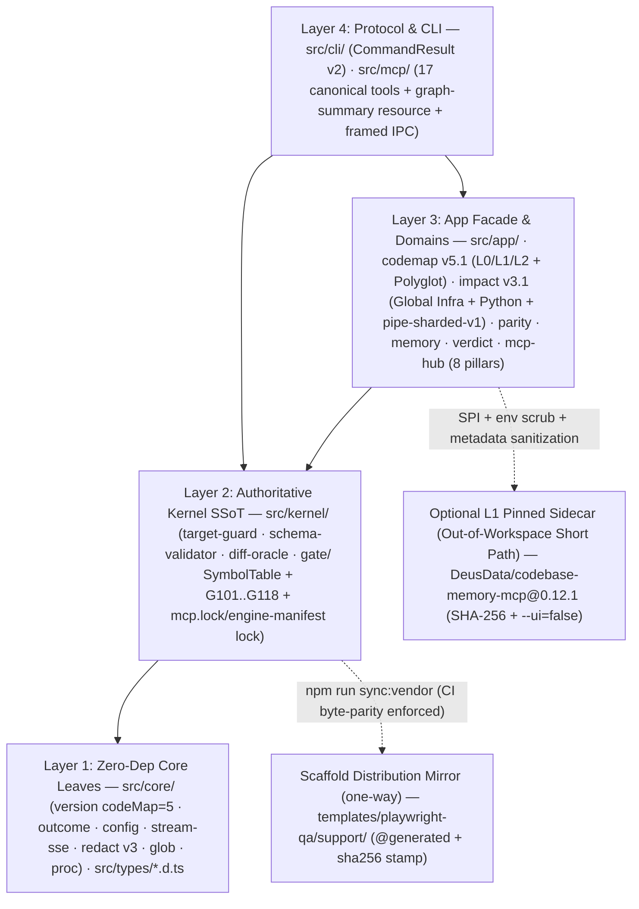

<div align="center">

# AI Test Workbench (`v6.7.0`)

**Trustworthy Verification Kernel & Native Multi-Protocol MCP Server for AI Coding Agents**

Provides **Polyglot Monorepo Auto-Discovery + CodeMap v5.1 Three-Tier Graph Fusion (Vue 3/TS Generic HTTP + Python Multi-Framework + Spring/MyBatis) + Decoupled Pinned Sidecar (`codebase-memory-mcp@0.12.1`) + Additive-Only Fail-Closed Diff-Impact v3.1 (`pipe-sharded-v1` `<20ms` + Python Reverse Graph)** · **8-Pillar Pinned MCP Hub (with `code-intelligence`, Targetless `engine-status`, & Governance-Sealed `.aitest/mcp.lock` / `engine-manifest.json`)** · **4-Layer Fail-Closed AST Anti-Fake-Green Gate (`S0–S5` + `AITEST-G101..G118` + SymbolTable + Dieselgate & Cross-Directory Lockstep Guard)** · **One-Call Change Verdict (`verify-change` · in-toto v1 + `scope.graphEngine` + `T0/T1/T2` + Human Seam Gatekeeper Card)** · **5-Checkpoint Differential Parity Oracle (`aitest_parity` + Zero-Plaintext Shape Fingerprints)** · **Zero-Dep Native MCP Server (`stdio` / `/mcp` / `/sse` · 17 Canonical Tools · Framed Subprocess IPC)**

[简体中文文档 (默认)](./README.md) · [v5→v6.7 Upgrade Guide](./docs/upgrade.en.md) · [Governance & 4-Layer Gate](./docs/governance.en.md) · [ADR-0007 Graph Sidecar](./docs/adr/0007-external-code-graph-engine.en.md) · [AI Agent Quickstart](./docs/ai-agent-quickstart.en.md) · [AGENTS.en.md](./AGENTS.en.md) · [Architecture](./ARCHITECTURE.en.md) · [Changelog](./CHANGELOG.en.md)

[](https://github.com/seaworld008/ai-test-workbench/actions/workflows/ci.yml)
[](https://github.com/seaworld008/ai-test-workbench/releases)
[](./LICENSE)
[](./VERSION.en.md)
[-6.1%25%20%5B2.1%25--16.5%25%5D-0ea5e9?style=flat-square)](./bench/real-world/results/SUMMARY-v6-holdout.en.md)
[](./skills/ai-test-workbench/references/mcp-server-protocol.en.md)
[](https://playwright.dev/)

</div>

---

## 1. Scope & Verified Benchmarks

When AI coding agents (Claude Code, Codex CLI, Cursor, VS Code Copilot, Gemini CLI) generate or edit Playwright tests at high velocity, the primary risk is **fake-green passes**: tests turn green not because the application is correct, but because assertions were weakened (`toHaveText('49/50')` → `toBeVisible()` or `expect(true).toBe(true)`), errors were swallowed (`.catch(() => null)` / `expect.soft()` / `test.fail()`), governance configs were altered (`testIgnore` / disabled ESLint rules), or stale `results.json` artifacts were replayed. At million-LOC multi-repo microservice scale, file-level diff-impact also suffers from fan-in fallback cliffs and unguarded global infrastructure edits.

`ai-test-workbench v6.7.0` moves anti-fake-green invariants, polyglot monorepo full-stack code-graph intelligence (CodeMap v5.1 + decoupled `codebase-memory-mcp@0.12.1` sidecar), and fail-closed symbol-level test selection (Diff-Impact v3.1) into a **zero-runtime-dependency, tool-enforced verification kernel**:

| Metric | Verified Measurement (Corpus-Qualified & Reproducible) | Enforcing Mechanism |
|---|---|---|
| **Fake-Green Escape Rate (`FGER-internal` / `FGER-holdout`)** | Internal corpus **`0.0%` (`26/26`)** · Red-Team holdout **`0.0%` (`24/24`)** (`npm run bench`) | 4-Layer fail-closed AST Gate (`AITEST-G101..G118`) + Sticky T1 MAC Governance Lock |
| **Benign Refactoring FPR (Internal Corpus)** | **`0.0%` (`12/12`)** (Prettier wraps, locator renames, ARIA consolidation; `npm run bench`) | Full-file TypeScript Compiler API semantic AST comparison |
| **Gate FPR (Real-World Unseen Holdout, `v6.0` Frozen Blind Eval, `n=50`, `seed=20261125`)** | **`6.1%` (`3/49` normal commits, Wilson 95% CI `[2.1%, 16.5%]`)**; raw alert rate `8.0%` (`4/50`, `1/1` TP retained); down 50% from v5.1.1's `12.2%` (`6/49`, CI `[5.7%, 24.2%]`) | Frozen first-run blind evaluation across 5 permissive OSS repos (preserved unmodified); see [v6 Holdout Summary](./bench/real-world/results/SUMMARY-v6-holdout.en.md) |
| **Gate FPR (100-Commit Real-World Regression Corpus, `v6.4.0+` Post-Hoc Re-Evaluation, `n=100`)** | Pilot **`4.2%` (`2/48`, CI `[1.2%, 14.0%]`)** · Holdout corpus post-hoc **`4.1%` (`2/49`, CI `[1.1%, 13.7%]`)** · Combined **`4.1%` (`4/97`, Wilson 95% CI `[1.6%, 10.1%]`, `3/3` TP retained)**; **`>=200` formal eval: `pending` (no extrapolation)** | AST Gate v2.2: cross-file title pooling + lexical scope stack + pre-existing `if`-block conservation (`G110`) + governance-locked `customMatchers` / structured domain matchers ([ADR-0004](./docs/adr/0004-pluggable-ast-gate-and-fp-governance.en.md)) |
| **Agentic Red-Team Escape Rate (`FGER-agentic`)** | Scripted multi-step baseline (`n=22`, incl. Class E Dieselgate & Class F Parity/Copy/Cassette/Lockstep, `npm run bench:agentic`): **Local T1 `13.6%` (`3/22`, CI `[4.7%, 33.3%]` — only documented boundary probes `AG-B4`/`AG-C4`/`AG-F1`)** · **CI T2 Merge-Grade `0.0%` (`0/22`, CI `[0.0%, 14.9%]`)** · `honest-fix` control `4/4` T2 pass; **live LLM runs: `pending` (no extrapolation)** | Isolated sandbox + hidden business oracles + live Baseline `Parity-Oracle` + Ephemeral Fulcio T2 CA; see [Red-Team Design](./bench/agentic/DESIGN.en.md) & [Baseline Summary](./bench/agentic/results/SUMMARY.en.md) |
| **Enterprise 1.01M-LOC Multi-Repo Benchmark (`v6.6.0` CodeMap v5 + Diff-Impact v3)** | Enterprise 1.01M-LOC Vue 2 + Spring Cloud multi-tenant SaaS benchmark (12,889 files, 12 microservices, 692 controllers, 360 MyBatis XMLs, 129 Feign clients; zero edits to target repos): cross-portal route collisions **`0 / 3,512 (0%)`** (down from `46/46`), controller DB tables **`262 → 10/11` (-96.2% / -95.8%)**, `pipe-sharded-v1` load **`8.76 ms` med / `4.11 MB`** (Builtin **`2.17 ms` / `1.29 MB`**), deep Service/Feign/MyBatis XML narrowing **`-98.78% to -99.78%`**, dynamic menu view hit rate **`79/80 (98.75%)`**, live sidecar conformance **`8/8 PASS`** | L0 zero-dep full-stack extractors + L1 pinned `codebase-memory-mcp@0.12.1` sidecar + L2 anti-corruption fusion + Global Infra Guard + `>65` high-fan-in fail-closed sentinel ([ADR-0007](./docs/adr/0007-external-code-graph-engine.en.md)) |
| **Seeded-Defect Detection Rate (`SDDR`)** | Single demo target `demo-campus` **`100.0%` (`7/7`)** (`npm run bench`) | Zero-dep JSON Schema validator + RBAC/concurrency + WCAG 2.0/2.1/2.2 |
| **Triage Accuracy / C→A Misclassification / Mis-Heal** | `45/45` internal + `12/12` real Playwright stacks: **`100%` · C→A `0.0%` · Mis-Heal `0.0%`** | Structured runtime guard signals + C-before-A precedence + tamper-evident healer + v5 `serviceChains` & `tenantAuthHints` |
| **Secret Redaction Recall** | Internal adversarial corpus **`100.0%` (`35/35`)** (`npm run bench`) | Redaction v3 (structured parse-before-redact preserving `heal_*`/`job_*`/`pinnedVersion` while redacting `pin`/`pincode`) |
| **Verdict Trust Levels (`T0 / T1 / T2`)** | **T0** = Unverified local run · **T1** = Local Run Ledger + MAC (proves integrity, not provenance) · **T2** = Re-run from a clean checkout on a GitHub-hosted runner, keylessly signed with Sigstore, and verified for issuer identity | **Only T2 is a merge-grade green**; `in-toto v1` attestations also bind `scope.graphEngine` |

### Trust Levels & Reusable CI Workflow (Only T2 Is Merge-Grade Green)

- **T0**: Unverified local run (not a merge-grade green).
- **T1**: Local Run Ledger + MAC (proves integrity, not provenance; not a merge-grade green).
- **T2**: Re-run from a clean checkout on a GitHub-hosted runner, keylessly signed with Sigstore, and verified for issuer identity. **Only T2 is a merge-grade green**.

Adopt T2 verification via [examples/workflows/use-aitest-verify.yml](./examples/workflows/use-aitest-verify.yml):

```yaml
jobs:
  aitest-t2-verdict:
    uses: seaworld008/ai-test-workbench/.github/workflows/aitest-verify.yml@v6.7.0
    permissions:
      id-token: write
      attestations: write
      contents: read
      security-events: write
    with:
      qa-dir: qa
      suite: impact
      node-version: '22'
      signer: github-attest # default; optional: cosign
```

Verify a T2 attestation bundle offline (fail-closed by default: missing signature, T1-only MAC, digest tampering, or workflow identity mismatch exits non-zero with `trustLevel <= T1`):

```bash
npx ai-test-workbench@6.7.0 attest verify \
  --file attestation.json \
  --bundle attestation.sigstore.json \
  --expect-repo owner/repo \
  --expect-workflow .github/workflows/aitest-verify.yml \
  --expect-ref refs/heads/main
```

> **Private Repository Signing Tradeoffs**: Default `signer: github-attest` uses GitHub Artifact Attestations (`actions/attest`), which requires **GitHub Enterprise Cloud** for private repositories. Optional `signer: cosign` uses public Sigstore keyless signing, publishing repository and workflow identity to the **public Rekor transparency log**; private repositories should assess that disclosure before opting in.

---

## 2. v6.7.0 Layered Architecture & Three-Tier Code-Graph Fusion

`v6.7.0` extends the acyclic four-layer, zero-runtime-dependency core with **Polyglot Monorepo Auto-Discovery** (depth-1 and `src|apps|packages|services|modules` depth-2 plus Python `FastAPI`/`aiohttp`/`Flask`/`Starlette`/`Django`/`Pytest`), **CodeMap v5.1** (L0 adding Vue 3 single-object routers/TS generic HTTP/cross-file prefix helpers/`.cjs` and Python polyglot/TypeORM/DDL + L1 decoupled pinned `codebase-memory-mcp@0.12.1` sidecar with `AITEST_DATA_DIR`/tmpdir leak prevention + L2 anti-corruption fusion), **Additive-Only Fail-Closed Diff-Impact v3.1** (shared-`.git` monorepo diff remapping + Python `.py` reverse-import graph + Global Infra Guard + `<20ms` `pipe-sharded-v1` lazy-hydrated index), an **8-Pillar MCP Hub** (adding `code-intelligence` and targetless `mcp engine-status`), and governance-sealed `.aitest/mcp.lock` / `.aitest/engine-manifest.json`, keeping every `src/**/*.mjs <= 450` LOC (see [ARCHITECTURE.en.md](./ARCHITECTURE.en.md) and [ADR-0007](./docs/adr/0007-external-code-graph-engine.en.md)):



---

## 3. Quick Setup (MCP & CLI)

### Requirements & Supply-Chain Security

- **Node.js**: `>= 22.12.0` (`24 LTS` or `26 LTS` recommended) on Windows PowerShell (`pwsh`), macOS, or Linux.
- **Zero Runtime Dependencies**: Root `package.json` carries zero runtime `dependencies`. Always invoke pinned `npx ai-test-workbench@6.7.0 <cmd>`, global short alias `aitw <cmd>` (`npm i -g ai-test-workbench@6.7.0`), or local source `node tools/aitest.mjs <cmd>`.
- **Optional Graph Sidecar Engine**: L0 zero-dep indexing works out of the box. For million-LOC symbol-level call-graph narrowing, a human installs the pinned sidecar via local CLI `mcp install-engine --engine codebase-memory-mcp` (supports offline `--from-file` / `--mirror-url` / `--expected-sha256`, `AITEST_DATA_DIR` migration, and `N-1` rollback; never auto-downloaded; `mcp engine-status` works targetlessly too).

### Register Native MCP Server (`stdio` / `/mcp` / `/sse`)

- **Claude Code**:
  ```bash
  claude mcp add ai-test-workbench -- npx --package=ai-test-workbench@6.7.0 ai-test-workbench mcp-serve --workspace-root /path/to/your-repo
  ```
- **Codex CLI** (`.codex/config.toml`):
  ```toml
  [mcp_servers.ai-test-workbench]
  command = "npx"
  args = ["--package=ai-test-workbench@6.7.0", "ai-test-workbench", "mcp-serve"]
  ```
- **Cursor / Windsurf / Antigravity / Gemini CLI** (`.mcp.json`):
  ```json
  {
    "mcpServers": {
      "ai-test-workbench": {
        "command": "npx",
        "args": ["--package=ai-test-workbench@6.7.0", "ai-test-workbench", "mcp-serve"]
      }
    }
  }
  ```
- **Streamable HTTP (`/mcp`) & Legacy SSE (`/sse`)**:
  ```bash
  npx ai-test-workbench@6.7.0 mcp-serve --transport http --port 3847 --target /path/to/your-repo --workspace-root /path/to/your-repo
  ```

### Official MCP & External Graph Sidecar Conformance

- Rationale and re-evaluation triggers live in [ADR-0001](./docs/adr/0001-mcp-protocol-stack-and-zero-dep-kernel.en.md) and [ADR-0007](./docs/adr/0007-external-code-graph-engine.en.md).
- Isolated under `conformance/` (excluded from the npm tarball, enforced by CI):
  - **`@modelcontextprotocol/conformance@0.1.16`** (Streamable HTTP `/mcp`, `active` suite — 30 scenarios): `8/8` protocol-level scenarios pass; `22` inapplicable/deferred scenarios are recorded in [`conformance/expected-failures.json`](./conformance/expected-failures.json) with `0` unlisted failures.
  - **`@modelcontextprotocol/sdk@1.32.2` Reference `Client`** (`5/5` suites pass): covers `stdio`, Streamable HTTP (`/mcp`), and Legacy SSE (`/sse` + `/messages`), verifying `2024-11-05`..`2025-11-25` version negotiation, exact 17 canonical tools with valid JSON Schemas, `structuredContent`, `notifications/progress`, and `AbortController` cancellation.
  - **`conformance/graph-engine/`** (`8/8` live pass): verifies `DeusData/codebase-memory-mcp@0.12.1` against a CJK-path multi-repo fixture covering `Controller → Service → ServiceImpl → Mapper/XML + Feign` chains with byte-identical repeatability.

### Standard CLI Workflow & Local Verification

```bash
# 1. Readiness check, initialization, and hash-safe template / graph-engine pin checks
npx ai-test-workbench@6.7.0 doctor
npx ai-test-workbench@6.7.0 mcp engine-status
npx ai-test-workbench@6.7.0 init --name my-app --target "/path/to/your-repo" --loop codex
npx ai-test-workbench@6.7.0 upgrade --target "/path/to/your-repo" --dry-run
npx ai-test-workbench@6.7.0 upgrade --target "/path/to/your-repo" --scope engines --dry-run

# 2. Session capture -> read-only exploration -> CodeMap v5.1 sync/query -> 8-pillar MCP & sidecar install
npx ai-test-workbench@6.7.0 auth-login --target "/path/to/your-repo" --base-url https://staging.example.internal
npx ai-test-workbench@6.7.0 explore --target "/path/to/your-repo" --base-url https://staging.example.internal --max-pages 30
npx ai-test-workbench@6.7.0 mcp install-engine --target "/path/to/your-repo" --engine codebase-memory-mcp
npx ai-test-workbench@6.7.0 map --target "/path/to/your-repo" --engine auto
npx ai-test-workbench@6.7.0 map --target "/path/to/your-repo" --query OrderController
npx ai-test-workbench@6.7.0 mcp add --target "/path/to/your-repo" --profile full-link && npx ai-test-workbench@6.7.0 mcp doctor --target "/path/to/your-repo" --lock

# 3. Performance SLOs, dual-target parity, memory distiller/sweeper, and one-call pre-merge verdict
npx ai-test-workbench@6.7.0 perf --target "/path/to/your-repo" --concurrency 4 --iterations 12 --enforce-budget
npx ai-test-workbench@6.7.0 parity --target "/path/to/your-repo" --baseline-url http://127.0.0.1:4100 --candidate-url http://127.0.0.1:4200 --privacy-mode shape-only
npx ai-test-workbench@6.7.0 learn --target "/path/to/your-repo" --action distill --json
npx ai-test-workbench@6.7.0 verify-change --target "/path/to/your-repo" --base origin/main
```

Reproduce the full repository gate locally (zero external servers):

```bash
git clone https://github.com/seaworld008/ai-test-workbench.git
cd ai-test-workbench
npm ci && (cd templates/playwright-qa && npm ci && npx playwright install chromium)
npm run check:vendor && npm run lint:docs && npm run typecheck && npm test && npm run smoke && npm run demo:verify && npm run bench
```

---

## 4. MCP Tools Matrix (Auto-Generated) & CLI-Only Commands

The table below is auto-generated from `src/mcp/registry.mjs` by `scripts/generate-docs.mjs` and verified for drift by `npm run lint:docs`:

<!-- BEGIN:GENERATED_MCP_TOOLS lang="en" -->
| Tool Name | Category | Read-Only Hint | Responsibility |
|---|---|---|---|
| `aitest_doctor` | Discovery & Setup | Yes | Environment, Browser & Gate Kernel Readiness Check |
| `aitest_init` | Discovery & Setup | No | Initialize Isolated QA Workspace & Governance Lock |
| `aitest_bootstrap` | Discovery & Setup | No | Zero-to-One Autonomous Loopback Bootstrapper |
| `aitest_explore` | Discovery & Setup | No | Zero-to-One Default-Deny Read-Only Explorer |
| `aitest_map_sync` | Discovery & Setup | No | Sync Convergent Living Code Map v5 |
| `aitest_mcp_hub` | Discovery & Setup | No | Manage Pinned 8-Pillar MCP Presets & Supply-Chain Doctor |
| `aitest_skill_install` | Discovery & Setup | No | Install Portable Agent Skill into Project |
| `aitest_verify_change` | Verification & Gates | No | One-Call Agent Change Verification & Attested Verdict |
| `aitest_impact` | Verification & Gates | Yes | Compute Dependency-Graph Diff-Impact Scope (v2) |
| `aitest_run` | Verification & Gates | No | Execute Ledger-Bound Deterministic Playwright Suite |
| `aitest_audit` | Verification & Gates | Yes | Run 4-Layer Fail-Closed Anti-Fake-Green Quality Gate |
| `aitest_diagnose` | Verification & Gates | No | Generate Redacted Evidence-First A/B/C/D Diagnostics Report |
| `aitest_perf` | Verification & Gates | No | Run PerformanceObserver Web Vitals & Read-Only API SLO Benchmark |
| `aitest_report` | Verification & Gates | Yes | Query Reports Index, Flaky Telemetry, Traceability & Lessons |
| `aitest_parity` | Verification & Gates | No | Run Dual-Target 5-Checkpoint Differential Parity Oracle |
| `aitest_heal` | Stateful Control | No | Stateful A/B/C/D Heal Governance State Machine (begin \| attempt \| conclude \| discard) |
| `aitest_job` | Stateful Control | No | Inspect, Await, or Cancel Async Background MCP Jobs (status \| result \| cancel) |

> Auto-generated from `src/mcp/registry.mjs` (`17` canonical tools; `governance approve` is human-CLI-only and never registered; 8 legacy v5/v6.1 tool names remain as deprecated forwarding aliases in `v6.x`, see `docs/upgrade.en.md`).
<!-- END:GENERATED_MCP_TOOLS -->

The following privileged or interactive commands are **local CLI only and never registered as MCP tools**:

| CLI Command | Responsibility & Security Boundary |
|---|---|
| `governance status \| verify \| approve --by <human>` | Inspect or human-approve `.aitest/governance.lock` (sealing `.aitest/mcp.lock` and `.aitest/engine-manifest.json`; blocks MCP subprocesses and bot approvers) |
| `mcp install-engine --engine codebase-memory-mcp` | Human-CLI installer for pinned local graph sidecars (verifies 6-platform SHA-256, blocks Zip-Slip, supports offline `--from-file` / `--mirror-url` / `--expected-sha256` & `N-1` rollback) |
| `attest verify --file <attestation.json>` | Offline zero-dep verification of in-toto Statement v1, SHA-256 bindings, `scope.graphEngine`, and Sigstore T2 issuer identity |
| `auth-login [--cdp-url <http://127.0.0.1:9222>]` | Headed human login capture for OTP / SSO / QR flows (never bypasses CAPTCHAs), stored at `0o600` |
| `upgrade [--scope engines\|all] [--dry-run] [--force]` | Three-way hash-safe upgrade via `.aitest/template-manifest.json` and graph-engine pin check (never auto-resigns `governance.lock`) |
| `update-agents` | SHA-256 manifest-protected update of official Playwright Test Agents definitions |

---

## 5. Documentation & Architecture Decision Records (ADRs)

| Topic | Simplified Chinese (Default) | English |
|---|---|---|
| **v5 → v6.7 Upgrade & Migration Guide** | [docs/upgrade.md](./docs/upgrade.md) | [docs/upgrade.en.md](./docs/upgrade.en.md) |
| **Governance & 4-Layer Gate Kernel** | [docs/governance.md](./docs/governance.md) | [docs/governance.en.md](./docs/governance.en.md) |
| **v6 Refactor Assessment & Benchmarks** | [v6-refactor-assessment.md](./docs/review/v6-refactor-assessment.md) · [v6 Holdout (ZH)](./bench/real-world/results/SUMMARY-v6-holdout.md) · [Pilot (ZH)](./bench/real-world/results/SUMMARY.md) · [Pre-Reg (ZH)](./bench/real-world/PREREGISTRATION.md) | [v6-refactor-assessment.en.md](./docs/review/v6-refactor-assessment.en.md) · [v6 Holdout Summary](./bench/real-world/results/SUMMARY-v6-holdout.en.md) · [Pilot Summary](./bench/real-world/results/SUMMARY.en.md) · [Pre-Registration](./bench/real-world/PREREGISTRATION.en.md) |
| **Architecture Decision Records (ADR-0001..0007)** | [ADR-0001](./docs/adr/0001-mcp-protocol-stack-and-zero-dep-kernel.md) · [ADR-0002](./docs/adr/0002-kernel-ssot-vendor-mirror-and-upgrade.md) · [ADR-0003](./docs/adr/0003-strict-checkjs-type-safety.md) · [ADR-0004](./docs/adr/0004-pluggable-ast-gate-and-fp-governance.md) · [ADR-0005](./docs/adr/0005-mcp-surface-outcome-and-config.md) · [ADR-0006](./docs/adr/0006-differential-parity-oracle-and-shape-fingerprints.md) · [ADR-0007](./docs/adr/0007-external-code-graph-engine.md) | [ADR-0001 Zero-Dep MCP](./docs/adr/0001-mcp-protocol-stack-and-zero-dep-kernel.en.md) · [ADR-0002 Kernel SSoT & Upgrade](./docs/adr/0002-kernel-ssot-vendor-mirror-and-upgrade.en.md) · [ADR-0003 Strict checkJs](./docs/adr/0003-strict-checkjs-type-safety.en.md) · [ADR-0004 AST Gate & FPR](./docs/adr/0004-pluggable-ast-gate-and-fp-governance.en.md) · [ADR-0005 MCP/Outcome/Config](./docs/adr/0005-mcp-surface-outcome-and-config.en.md) · [ADR-0006 Differential Parity Oracle](./docs/adr/0006-differential-parity-oracle-and-shape-fingerprints.en.md) · [ADR-0007 Graph Sidecar & Diff-Impact v3](./docs/adr/0007-external-code-graph-engine.en.md) |
| **AI Agent Onboarding & Protocol** | [quickstart](./docs/ai-agent-quickstart.md) · [AGENTS.md](./AGENTS.md) · [CLAUDE.md](./CLAUDE.md) · [MCP Protocol (ZH)](./skills/ai-test-workbench/references/mcp-server-protocol.md) · [llms.txt](./llms.txt) | [quickstart.en](./docs/ai-agent-quickstart.en.md) · [AGENTS.en.md](./AGENTS.en.md) · [MCP Protocol](./skills/ai-test-workbench/references/mcp-server-protocol.en.md) |
| **Architecture, Versions & History** | [ARCHITECTURE.md](./ARCHITECTURE.md) · [VERSION.md](./VERSION.md) · [v5 Historical Scorecard](./docs/history/v5-verification-scorecard.md) · [Agentic Design (ZH)](./bench/agentic/DESIGN.md) | [ARCHITECTURE.en.md](./ARCHITECTURE.en.md) · [VERSION.en.md](./VERSION.en.md) · [v5 Historical Scorecard (EN)](./docs/history/v5-verification-scorecard.en.md) · [Agentic Design](./bench/agentic/DESIGN.en.md) |
| **Adapter / Security / Troubleshooting / Demo / Community** | [adapter](./docs/project-adapter.md) · [security](./docs/security.md) · [troubleshooting](./docs/troubleshooting.md) · [demo](./examples/demo-webapp/README.md) · [CONTRIBUTING](./CONTRIBUTING.md) · [SECURITY](./SECURITY.md) | [adapter.en](./docs/project-adapter.en.md) · [security.en](./docs/security.en.md) · [troubleshooting.en](./docs/troubleshooting.en.md) · [demo.en](./examples/demo-webapp/README.en.md) · [CONTRIBUTING.en](./CONTRIBUTING.en.md) · [SECURITY.en](./SECURITY.en.md) |

---

## 6. Verification Scope & License

Always keep **Local Workbench Verified (`local-workbench`)** strictly distinct from **Business E2E Verified (`business-e2e`)**. Automated `@axe-core/playwright` scans detect machine-checkable WCAG 2.0/2.1/2.2 A/AA issues and do not constitute full accessibility compliance certification.

Licensed under the [MIT License](./LICENSE).
