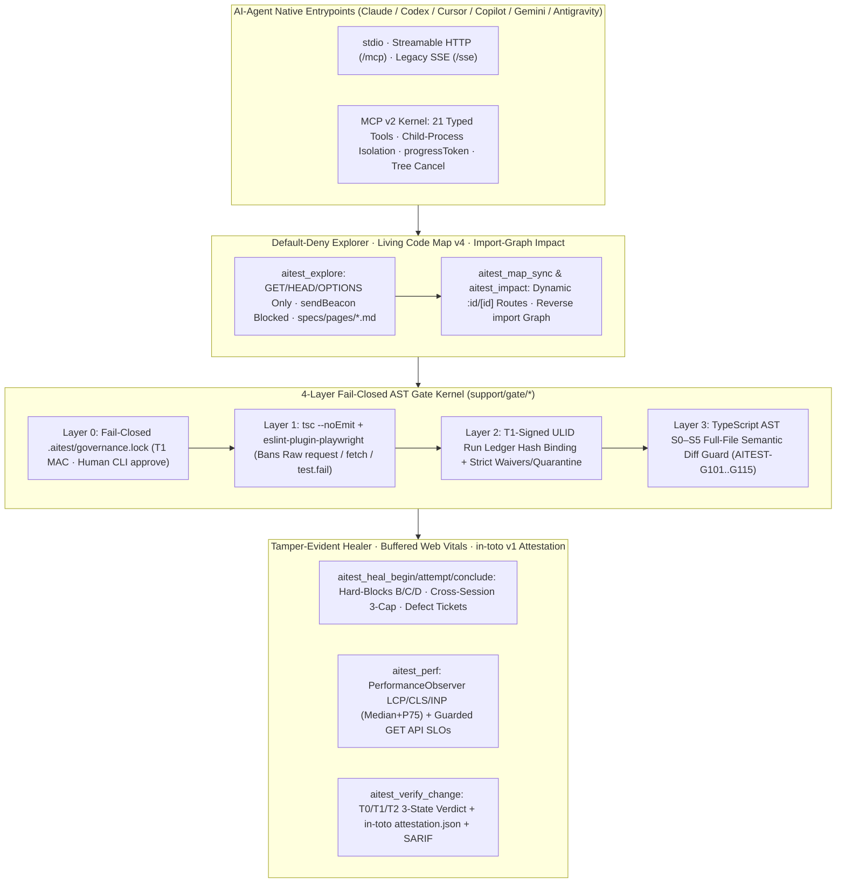

<div align="center">

# 🛡️ AI Test Workbench (`v5.0`)

**Trustworthy Verification Kernel, Multi-Protocol MCP Server & Living Code Map for AI Coding Agents**

Powered by **One-Call `verify_change` (in-toto v1 + `T0/T1/T2` Trust Tiers)** · **4-Layer Fail-Closed AST Gate (`S0–S5` + `AITEST-G101..G115`)** · **Native MCP v2 (`stdio` / `/mcp` / `/sse` · 21 Tools · Async Jobs)** · **Tamper-Evident Healer** · **Import-Graph Impact v2** · **Buffered `PerformanceObserver` Web Vitals**

[简体中文文档 (默认)](./README.md) · [Governance & 4-Layer Gate](./docs/governance.en.md) · [v5.0 Scorecard](./docs/review/v5-verification-scorecard.en.md) · [AI Agent Quickstart](./docs/ai-agent-quickstart.en.md) · [AGENTS.en.md](./AGENTS.en.md) · [Architecture](./ARCHITECTURE.en.md) · [ADR-0001](./docs/adr/0001-mcp-protocol-stack-and-zero-dep-kernel.en.md) · [Changelog](./CHANGELOG.en.md)

[](https://github.com/seaworld008/ai-test-workbench/actions/workflows/ci.yml)
[](https://github.com/seaworld008/ai-test-workbench/releases)
[](./LICENSE)
[](./VERSION.en.md)
[](./docs/review/v5-verification-scorecard.en.md)
[](./skills/ai-test-workbench/references/mcp-server-protocol.en.md)
[](https://playwright.dev/)

</div>

---

## Why AI Test Workbench v5.0?

When coding agents (`Claude Code`, `Codex CLI`, `Antigravity`, `Cursor`, `VS Code Copilot`, `Gemini CLI`) write and "self-heal" tests at high speed, the primary failure mode is no longer low velocity—it is **untrustworthy "Fake-Green" test results**:
1. **Subtle assertion weakening**: Agents replace `toHaveText('49/50')` with `toBeVisible()` or `expect(true).toBe(true)`, add `test.fail()`, swallow errors via `.catch(() => null)`, use `expect.soft()`, inject `testIgnore` into `playwright.config.ts`, disable ESLint rules, or replay stale green `results.json` artifacts.
2. **Prompt-only rules get ignored**: Without tamper locks and a persisted state machine, agents routinely mask Class-C backend `500` regressions by rewriting specs.
3. **MCP timeouts & serialization**: Long Playwright runs block fast read-only queries and get killed without progress notifications or process-tree cancellation.
4. **Measurement & egress blind spots**: `getEntriesByType` leaves `LCP` null and `CLS` zero; unguarded crawlers send mutating POSTs or leak JSON passwords and JWTs.

**AI Test Workbench v5.0** serves as an **independent Trustworthy Verification Kernel** with tool-enforced governance:

| North-Star Metric | Measured Benchmark (`npm run bench`, Corpus-Qualified) | Enforcing Mechanism |
|---|---|---|
| **Fake-Green Escape Rate (`FGER-internal` / `FGER-holdout`)** | Internal Regression **`0.0%` (`26/26`)** · Red-Team Holdout **`0.0%` (`24/24`)** | Fail-closed 4-Layer AST Gate (`AITEST-G101..G115`) + T1 MAC Governance Lock |
| **Benign Refactoring FPR (`Gate FPR`)** | Benign Refactor Corpus **`0.0%`** (Prettier wraps, locator renames, ARIA consolidation) | Full-file TypeScript Compiler API AST comparison |
| **Seeded-Defect Detection Rate (`SDDR`)** | Single Demo Target **`100.0%` (`7/7`)** | Zero-dep JSON Schema validator + RBAC/concurrency + WCAG 2.1/2.2 scans |
| **Triage Accuracy / C→A Misclassification / Mis-Heal** | Internal + Real Playwright Stack Corpus **`100%` · C→A `0.0%` · Mis-Heal `0.0%`** | Structured runtime guard telemetry + C-before-A precedence + tamper-evident healer |
| **Secret Redaction Recall** | Internal Adversarial Corpus **`100.0%` (`35/35`)** | Redaction v2 (structured parse-before-redact preserving typed `heal_*`/`job_*` IDs) |
| **Verdict Trust Levels (`T0 / T1 / T2`)** | **T0** = Unverified local run · **T1** = Local Run Ledger + MAC (proves integrity, not provenance) · **T2** = Re-run from a clean checkout on a GitHub-hosted runner, keylessly signed with Sigstore, and verified for issuer identity | **Only T2 is a merge-grade green**; see [reusable workflow example](./examples/workflows/use-aitest-verify.yml) & `attest verify` |

### 🔒 Trust Levels & Reusable CI Workflow (Only T2 Is a Merge-Grade Green)

- **T0**: Unverified local run (not a merge-grade green).
- **T1**: Local Run Ledger + MAC (proves integrity, not provenance; not a merge-grade green).
- **T2**: Re-run from a clean checkout on a GitHub-hosted runner, keylessly signed with Sigstore, and verified for issuer identity. **Only T2 is a merge-grade green**.

Adopt T2 verification in one job via [examples/workflows/use-aitest-verify.yml](./examples/workflows/use-aitest-verify.yml):

```yaml
jobs:
  aitest-t2-verdict:
    uses: seaworld008/ai-test-workbench/.github/workflows/aitest-verify.yml@v5.1.0
    permissions:
      id-token: write
      attestations: write
      contents: read
      security-events: write
    with:
      qa-dir: qa
      suite: impact
      node-version: '22'
      signer: github-attest # default; optional: cosign
```

Verify a T2 bundle offline (fail-closed by default: missing signature, T1-only MAC, digest tamper, or workflow identity mismatch always returns non-zero with `trustLevel <= T1`):

```bash
npx ai-test-workbench@5.1.0 attest verify \
  --file attestation.json \
  --bundle attestation.sigstore.json \
  --expect-repo owner/repo \
  --expect-workflow .github/workflows/aitest-verify.yml \
  --expect-ref refs/heads/main
```

> **Private Repository Signing Tradeoffs**: The default `signer: github-attest` uses GitHub Artifact Attestations (`actions/attest`), which requires **GitHub Enterprise Cloud** for private repositories. The optional `signer: cosign` path uses public Sigstore keyless signing, which publishes the repository and workflow identity into the **public Rekor transparency log**; private repositories should evaluate that disclosure risk before opting in.

---

## Core v5.0 Architecture



---

## 30-Second AI Agent Setup (Zero Runtime Dependencies)

> **CLI & Supply-Chain Security**: Run pinned `npx ai-test-workbench@5.1.0 <cmd>`, global short alias `aitw <cmd>` (after `npm i -g ai-test-workbench@5.1.0`), or local source `node tools/aitest.mjs <cmd>`. Always pin an exact version rather than unpinned `npx -y`.

- **Claude Code**:
  ```bash
  claude mcp add ai-test-workbench -- node /path/to/ai-test-workbench/tools/aitest.mjs mcp-serve --workspace-root /path/to/your-repo
  ```
- **Codex CLI** (`.codex/config.toml`):
  ```toml
  [mcp_servers.ai-test-workbench]
  command = "npx"
  args = ["--package=ai-test-workbench@5.1.0", "ai-test-workbench", "mcp-serve"]
  ```
- **Cursor / Windsurf / Antigravity / Gemini CLI** (`.mcp.json`):
  ```json
  {
    "mcpServers": {
      "ai-test-workbench": {
        "command": "npx",
        "args": ["--package=ai-test-workbench@5.1.0", "ai-test-workbench", "mcp-serve"]
      }
    }
  }
  ```
- **Streamable HTTP (`/mcp`) & Legacy SSE (`/sse`)**:
  ```bash
  node tools/aitest.mjs mcp-serve --transport http --port 3847 --target /path/to/your-repo --workspace-root /path/to/your-repo
  ```

### Official MCP Conformance & 3-Transport Interoperability

- **Zero-Dependency Decision**: Root `package.json` keeps zero runtime `dependencies` with no separate SDK wrapper package; see [ADR: Zero-Dependency MCP Layer](./docs/adr/mcp-zero-dependency.en.md) for rationale and re-evaluation triggers (conformance gaps, OAuth, Elicitation, Tasks).
- **Verified with Official Conformance Suite (`@modelcontextprotocol/conformance@0.1.16`) & Official SDK Client (`@modelcontextprotocol/sdk@1.32.2`)** (isolated under `conformance/`, excluded from the npm tarball, enforced by CI `mcp-conformance`):
  - **Official `conformance server` (Streamable HTTP `/mcp`, `active` suite — 30 scenarios)**: **8/8 protocol-level scenarios passed** (`server-initialize`, `logging-set-level`, `ping`, `tools-list`, `server-sse-multiple-streams`, `resources-list`, `prompts-list`, `dns-rebinding-protection`; 9/9 checks passed), **22 expected failures** documented with rationale & reference links in [`conformance/expected-failures.json`](./conformance/expected-failures.json) (3 undeclared optional capabilities, 4 deferred Sampling/Elicitation scenarios per ADR-001, 15 upstream Everything-Server hardcoded `test_*` fixture scenarios), **0 unexpected failures, 0 stale baselines** (note: official `conformance server` tests HTTP only).
  - **Official `@modelcontextprotocol/sdk@1.32.2` Reference `Client` (5/5 suites passed)**: verified across **`stdio`**, **Streamable HTTP (`/mcp`)**, and **Legacy SSE (`/sse` + `/messages`)** for `2024-11-05`..`2025-11-25` version negotiation, exact 21 tools with valid JSON schemas, read-only `tools/call` (`aitest_doctor` / `aitest_mcp_hub`) returning `structuredContent`, `notifications/progress`, and `AbortController` cancellation (`notifications/cancelled`).
  - Reproduce locally: `cd conformance && npm ci && npm test`.

---

## CLI Quick Start & Reproducible Benchmark

Requires **Node.js `>= 22.12.0`** (`24 LTS` or `26 LTS` recommended).

```bash
# Project onboarding & one-call change verdict
npx ai-test-workbench@5.1.0 doctor
npx ai-test-workbench@5.1.0 init --name my-app --target "/path/to/your-repo" --loop codex
npx ai-test-workbench@5.1.0 verify-change --target "/path/to/your-repo" --base origin/main

# Clone & reproduce all v5.0 unit tests, live demo, and seeded-defect benchmark locally
git clone https://github.com/seaworld008/ai-test-workbench.git
cd ai-test-workbench
cd templates/playwright-qa && npm ci && npx playwright install chromium && cd ../..
npm run lint:docs && npm run typecheck && npm test && npm run smoke && npm run demo:verify && npm run bench
```

---

## CLI Commands & 21 MCP Tools Matrix

| CLI Command | MCP Tool | Responsibility |
|---|---|---|
| `verify-change` | `aitest_verify_change` | **One-call verdict**: governance check → transitive impact → ledger run → 4-layer gate → `attestation.json` & `verdict.sarif.json` |
| `doctor` | `aitest_doctor` | Inspect Node/npm, Git, Codex/Claude, Chromium cache & Gate Kernel drift |
| `init` | `aitest_init` | Idempotently scaffold `<repo>/qa` and seal `.aitest/governance.lock` |
| `governance` | *(Human CLI Only)* | `verify \| status \| approve` — **all governance lock operations stay CLI-only, never exposed on MCP** |
| `attest` | *(CLI Verifier)* | `attest verify --file <attestation.json>` offline verification of in-toto Statement v1 & SHA-256 bindings |
| `auth-login` | *(Interactive CLI)* | Headed login capture for SMS OTP / SSO / QR flows saved with `0o600` permissions |
| `explore` | `aitest_explore` | Default-deny read-only crawler (`GET/HEAD/OPTIONS` only, WS blocked) emitting `<untrusted-data>` `specs/pages/*.md` |
| `map` | `aitest_map_sync` | Living Code Map v4 preserving `:id`/`[id]` routes and converging defects |
| `impact` | `aitest_impact` | Transitive reverse `import` graph spec selection with `why` provenance (falls back to full suite on unmapped dependents) |
| `run` | `aitest_run` | Execute Playwright suites bound to T1-signed ULID `Run Ledger` + W3C `Trace-ID` |
| `audit` | `aitest_audit` | Fail-closed 4-layer AST gate (`governance.lock` + `tsc/eslint` + `Run Ledger/waivers` + `S0–S5` AST Diff Guard `AITEST-G101..G115`) |
| `heal` | `aitest_heal_begin` / `attempt` / `conclude` | Tamper-evident Healer blocking Class B/C/D test edits (`0%` mis-heal), 3-attempt cross-session cap, Class C defect tickets |
| `diagnose` | `aitest_diagnose` | Structured runtime-first & C-before-A `A/B/C/D` triage, Redaction v2, and observability queries |
| `perf` | `aitest_perf` | Buffered `PerformanceObserver` Web Vitals (`LCP/CLS/INP` median & P75) + guarded GET API SLOs |
| `trace-matrix` | `aitest_trace_matrix` | Map `REQ-xxx` IDs across `specs/*.md`, `tests/**/*.spec.ts`, and run results |
| `flaky` | `aitest_flaky_report` | Rolling flaky telemetry & `.aitest/quarantine.json` (`<= 7d` TTL + ledger flaky evidence) status |
| `mcp` | `aitest_mcp_hub` | Exact-pinned 7-pillar MCP presets + `.aitest/mcp.lock` hash & poisoning audit |
| `mcp-serve` | `aitest_job_status` / `result` / `cancel` | Multi-protocol MCP v2 server with background child-process job controls |
| `report` | `aitest_report` | Index HTML, JUnit, JSON, Attestation, SARIF, System Map, Perf & Traces |
| `update-agents` | *(CLI Sync)* | SHA-256 protected Playwright `init-agents` updates |
| `skill-install` | `aitest_skill_install` | Install `SKILL.md` to `.codex`, `.claude`, `.gemini`, `.github`, `.agents`, or `qa` |

---

## Verification Scope & License

Always keep **Local Workbench Verified (`local-workbench`)** strictly distinct from **Business E2E Verified (`business-e2e`)**. Automated `@axe-core/playwright` checks cover machine-detectable WCAG 2.0/2.1/2.2 A/AA issues and do not constitute full compliance certification.

Licensed under the [MIT License](./LICENSE).
