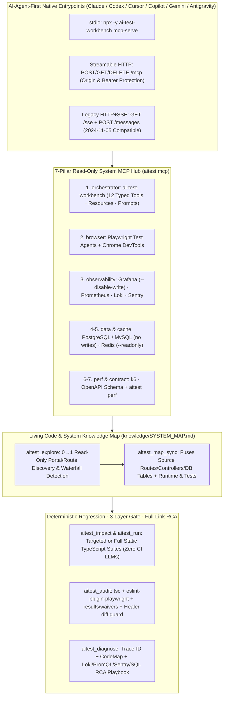

<div align="center">

# 🛡️ AI Test Workbench

**AI-Agent-First Multi-Protocol MCP Testing Workbench, Living Code Map & Standard Agent Skill**

Built on **Native MCP Server (`stdio` / Streamable HTTP `/mcp` / Legacy SSE `/sse`)** · **Official Playwright Test Agents** · **0→1 Living Code Map** · **7-Pillar System MCP Hub** · **CDP/API Perf SLOs** · **3-Layer Anti-Fake-Green Gates**

[简体中文文档 (默认)](./README.md) · [AI Agent Quickstart](./docs/ai-agent-quickstart.en.md) · [AGENTS.en.md](./AGENTS.en.md) · [Architecture](./ARCHITECTURE.en.md) · [Blueprint (EN)](./docs/architecture-and-prompts-blueprint.en.md) · [Changelog](./CHANGELOG.en.md)

[](https://github.com/seaworld008/ai-test-workbench/actions/workflows/ci.yml)
[](https://github.com/seaworld008/ai-test-workbench/releases)
[](./LICENSE)
[](./VERSION.en.md)
[](./skills/ai-test-workbench/references/mcp-server-protocol.md)
[](https://playwright.dev/)

</div>

---

## Why AI Test Workbench (v4.0)?

When coding agents (`Claude Code`, `Codex CLI`, `Antigravity`, `Cursor`, `VS Code Copilot`, `Gemini CLI`) accelerate code authoring, traditional QA breaks in four ways:
1. **Agents lack a native typed MCP tool interface**, forcing fragile shell quoting and unstructured text scraping.
2. **Cold-start blindness**: Unfamiliar multi-tenant apps hide portal switchers, routes, controllers, and DB entities.
3. **AI "Fake-Green" Drift**: `@playwright/test@1.65.1`'s default generated Healer prompt tells models to mark persistent failures as `test.fixme()`; unchecked agents delete assertions, inject `waitForTimeout()`, or pass `{ force: true }`.
4. **Slow regression & environment leakage**: Running full E2E on tiny diffs slows iteration, while unguarded targets risk hitting production or leaking credentials.

**AI Test Workbench v4.0** is engineered **AI-Agent-First**: it embeds a **zero-dependency multi-protocol MCP Server (`mcp-serve`)**, **0→1 Read-Only Explorer + Living Code Map**, **7-Pillar Read-Only MCP Hub**, **CDP/API Performance SLOs**, and a **3-Layer Anti-Fake-Green Gate**.

---

## Core v4.0 Architecture



---

## 30-Second AI Agent Setup

- **Claude Code**:
  ```bash
  claude mcp add ai-test-workbench -- npx -y ai-test-workbench mcp-serve
  ```
- **Codex CLI** (`.codex/config.toml`):
  ```toml
  [mcp_servers.ai-test-workbench]
  command = "npx"
  args = ["-y", "ai-test-workbench", "mcp-serve"]
  ```
- **Cursor / Windsurf / Antigravity / Gemini CLI**:
  ```json
  {
    "mcpServers": {
      "ai-test-workbench": {
        "command": "npx",
        "args": ["-y", "ai-test-workbench", "mcp-serve"]
      }
    }
  }
  ```
- **Streamable HTTP (`/mcp`) & Legacy SSE (`/sse`)**:
  ```bash
  npx ai-test-workbench mcp-serve --transport http --port 3847 --target /path/to/your-repo
  ```

See **[docs/ai-agent-quickstart.en.md](./docs/ai-agent-quickstart.en.md)** and [`prompts/first-time-ai-agent.en.md`](./prompts/first-time-ai-agent.en.md) for copy-paste first-time prompts and VS Code Copilot configuration.

---

## CLI Quick Start & Local Full-Stack Demo

Requires **Node.js `>= 22.12.0`** (`24 Maintenance LTS` or `26 Active LTS` recommended; Node 20 is EOL).

```bash
# Quick project onboarding
npx ai-test-workbench doctor
npx ai-test-workbench init --name my-app --target "/path/to/your-repo" --loop codex
npx ai-test-workbench run --target "/path/to/your-repo" --suite smoke --audit

# Or clone & verify full v4.0 stack locally with zero external dependencies
git clone https://github.com/seaworld008/ai-test-workbench.git
cd ai-test-workbench
cd templates/playwright-qa && npm ci && npx playwright install chromium && cd ../..
npm run lint:docs && npm test && npm run smoke && npm run demo:verify
```

---

## CLI Commands & Native MCP Tools Matrix

| CLI Command | MCP Tool | Purpose |
|---|---|---|
| `doctor` | `aitest_doctor` | Inspect OS, Node/npm, Git, Codex/Claude, Docker & Chromium cache |
| `init` | `aitest_init` | Idempotently scaffold `<repo>/qa` with host ESLint/TS overlap warnings |
| `auth-login` | *(Interactive CLI)* | Headed login capture for SMS OTP / SSO / QR flows (never bypasses CAPTCHAs) |
| `explore` | `aitest_explore` | Zero-to-one read-only crawl with multi-portal switcher & API waterfall detection |
| `map` | `aitest_map_sync` | Fuse static repo source + runtime topology + results into `SYSTEM_MAP.md` |
| `mcp` | `aitest_mcp_hub` | Manage 7-pillar read-only MCP presets (`presets \| add \| doctor \| serve`) |
| `mcp-serve` | *(MCP Server)* | Run native multi-protocol MCP Server (`stdio`, `/mcp`, `/sse`) |
| `perf` | `aitest_perf` | Chromium CDP Web Vitals & concurrent GET API P50/P95/P99/RPS SLO benchmark |
| `run` | `aitest_run` | Run deterministic Playwright suites with passive distributed Trace-ID capture |
| `impact` | `aitest_impact` | Select targeted specs via Git diff + `impact-map.json` |
| `audit` | `aitest_audit` | Enforce `tsc`, `eslint-plugin-playwright`, `waivers.json`, and Healer diff guard |
| `diagnose` | `aitest_diagnose` | Redacted A/B/C/D diagnostics + Trace-ID + CodeMap + Loki/PromQL/Sentry/SQL queries |
| `report` | `aitest_report` | Index HTML, JUnit, JSON, System Overview, Living Code Map, Perf & Traces |
| `update-agents` | *(CLI Sync)* | SHA-256 protected Playwright `init-agents` updates (`*.aitest-new` conflicts) |
| `skill-install` | `aitest_skill_install` | Install `SKILL.md` to `.codex`, `.claude`, `.gemini`, `.github`, `.agents`, or `qa` |

---

## Verification Scope & License

Always keep **Local Workbench Verified** (CLI, MCP Server, multi-project isolation, offline smoke, 3-layer gate, demo target) strictly distinct from **Business E2E Verified** (live non-production staging URL + business assertions). Automated `@axe-core/playwright` checks cover machine-detectable WCAG issues and do not constitute full compliance certification.

Licensed under the [MIT License](./LICENSE).
