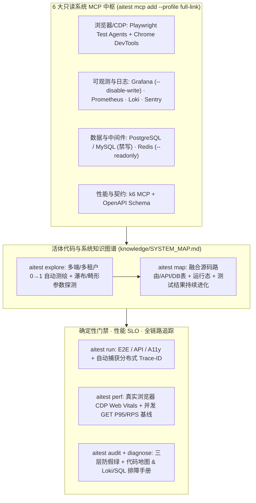

<div align="center">

# 🛡️ AI Test Workbench

**专为 AI 高速编程时代打造的开源可复用自动化测试工作台与标准 Agent Skill**

基于 **Playwright Test** · **官方 Playwright Test Agents (Planner / Generator / Healer)** · **Diff-Impact 精准选择** · **三层防假绿门禁** · **WCAG 2.2 自动化扫描**

[English README](./README.en.md) · [架构与安全边界](./ARCHITECTURE.md) · [完整设计蓝图](./Playwright%20Test%20Agents%20+%20Codex%20%E5%8F%AF%E5%A4%8D%E7%94%A8%E6%9C%AC%E6%9C%BA%20AI%20%E8%87%AA%E5%8A%A8%E5%8C%96%E6%B5%8B%E8%AF%95%E5%B7%A5%E4%BD%9C%E5%8F%B0%E2%80%94%E2%80%94%E6%9E%B6%E6%9E%84%E8%AE%BE%E8%AE%A1%E4%B8%8E%E5%AE%9E%E6%96%BD%E6%8F%90%E7%A4%BA%E8%AF%8D.md) · [更新日志](./CHANGELOG.md)

[](https://github.com/seaworld008/ai-test-workbench/actions/workflows/ci.yml)
[](https://github.com/seaworld008/ai-test-workbench/releases)
[](./LICENSE)
[](./VERSION.md)
[](https://playwright.dev/)
[](./skills/ai-test-workbench/SKILL.md)

</div>

---

## ✨ 为什么需要 AI Test Workbench？

在 Codex、Claude Code、Antigravity、Cursor 等 AI 编码工具让功能开发提速数倍之后，传统测试体系往往面临三大顽疾：
1. **代码写得飞快，回归慢如蜗牛**：每次小改动都要全量跑端到端用例，拖慢迭代节奏。
2. **AI 自愈变成“假绿（Fake-Green）”**：实测 `@playwright/test@1.65.1` 生成的默认 Healer 提示词中就包含“若持续失败则改写为 `test.fixme()` 跳过”的妥协指令；AI 还会删减 `expect()`、加 `{ force: true }`、硬编码 `waitForTimeout()` 来“把测试修绿”。
3. **测试项目污染业务仓库、密钥或域名越权风险**：多个项目混用状态、误打生产环境、`npm` 打包丢掉 `.gitignore` 导致 `.env` 泄漏。

**AI Test Workbench** 把官方 **Playwright Test Agents** 工程化、安全化、模板化，开箱即用地解决上述全部问题。

---

## 🏗️ v3.0 全链路自主 AI 测试核心架构



---

## 🚀 核心能力一览

| 特性模块 | 解决的核心痛点 | 实现细节与硬性保障 |
|---|---|---|
| **两阶段彻底解耦** | 防止 CI 依赖脆弱的大模型或烧 Token | 创作/修复期由 AI 通过内置 `run-test-mcp-server`（无需额外装 `@playwright/mcp`）探索并编写 TypeScript 用例；CI 与日常回归执行确定性静态用例，**回归阶段不调用 LLM，结果可重复** |
| **三层防假绿质量门禁** | 彻底封堵“假绿”漏洞 | ① `tsc --noEmit` + `eslint-plugin-playwright`（禁零断言、禁 `.only`、禁 `waitForTimeout`、禁 `test.skip/fixme`、禁 `{ force: true }`）；② `scripts/audit-results.mjs` 严拆 `passed / failed / flaky / skipped / policyExcludedMutation` 并检查 `waivers.json` 时效；③ `--diff-base` Healer Diff 守卫拦截修补过程中删减断言或吞异常 |
| **4 层高稳定扩展 Fixture** | 抓出页面崩溃与接口 500 静默故障 | `tests/fixtures/base.ts` 内置 `auto` fixture：默认捕获 `pageerror` 与同源 `>=500` 响应（支持单测 `test.use({ failOnPageError: false })` 覆盖）、`page.route` + 包装后 `request` 双通道拦截危险接口、`serviceWorkers: 'block'`、`expectAccessible()`（WCAG 2.0/2.1/2.2 A/AA 扫描）及 `expectApiContract()` |
| **Diff-Impact 智能选择** | 缓解 AI 编码时代的测试等待瓶颈 | `aitest impact` 合并 `git diff`、未提交改动、未跟踪文件与 `impact-map.json` / Playwright `--only-changed` 缩小回归范围；碰到公共底座、路由配置或未知文件**自动回退全量**；合并主干/发布门禁强制跑全量 |
| **交互式登录态捕获 (`auth-login`)** | 解决短信验证码、SSO、扫码登录的测试环境鉴权 | 打开可视化 Chromium，可选预填账号（绝不绕过验证码），用户手动完成登录后一键保存 `storageState`（cookies + `localStorage`）与 `sessionStorage`（`session.json`），自动持久化复用 |
| **多 Loop 安全管理与冲突保护** | 阻止重跑 `init-agents` 悄悄覆盖用户自定义规则 | 基于 `qa/.aitest/agents-manifest.json` SHA-256 指纹追踪，未改过的文件平滑升级，手改过的 Agent 文件保留原件并在旁路写出 `*.aitest-new` 报 `CONFLICT`；同时保护自定义 `tests/seed.spec.ts` |
| **本地自包含演示靶场** | 克隆仓库即可 60 秒体验真实全栈测试 | 内置零依赖智慧校园选课系统（`examples/demo-webapp/server.mjs`，端口 `5899` / `--port 0`），通过 `npm run demo:verify` 一键验证登录态、搜索、无障碍、RBAC `403`、重复提交 `409` 及并发抢最后 1 个名额（`201 + 409`） |

> **关于无障碍检查的客观口径**：`expectAccessible(page)` 基于 `@axe-core/playwright` 捕获可机器检测的 WCAG 问题（约占全部无障碍问题的一部分），**自动化扫描通过不等于通过完整人工无障碍合规认证**。

---

## ⚡ 30 秒极速上手

### 环境要求
- **Node.js**：`>= 22.12.0`（Node 20 已停止维护 EOL；推荐 **Node 24 Maintenance LTS** 或 **Node 26 Active LTS**）
- **操作系统**：Windows 11 PowerShell (`pwsh`)、macOS、Linux（注：Windows 原生环境与 WSL 需分别安装 Node 与浏览器缓存）

### 新项目接入最简三条命令

```bash
# 1. 体检本机环境（OS / Node / npm / Git / Codex / Claude / 浏览器缓存）
npx ai-test-workbench doctor

# 2. 将独立 QA 子项目幂等初始化到目标仓库（可先加 --dry-run 预览，默认保护已有文件）
npx ai-test-workbench init --name my-app --target "/path/to/your-repo" --loop codex

# 3. 执行离线真实 Chromium Smoke 自检 + 三层防假绿门禁
npx ai-test-workbench run --target "/path/to/your-repo" --suite smoke --audit
```

*（如从本仓库源码目录直接运行，将 `npx ai-test-workbench` 替换为 `node tools/aitest.mjs`。）*

---

## 🔐 面向多端 SaaS / 短信登录系统的“先探索再深测”闭环 (`auth-login` → `explore`)

对于启用了短信验证码、SSO 或“平台端 + 租户/组织子工作台”多端架构的复杂系统：

```bash
# 1. 打开真实浏览器完成一次人工登录并捕获会话（绝不绕过验证码）
npx ai-test-workbench auth-login --target "/path/to/your-repo" --base-url https://staging.example.internal --account 13800138000

# 2. 只读模式从 0 到 1 全站探索（自动脱敏 API 参数，生成 specs/system-overview.md 系统全景图）
npx ai-test-workbench explore --target "/path/to/your-repo" --base-url https://staging.example.internal --max-pages 30

# 3. 基于全景图编写并运行确定性 E2E + 三层质量门禁
npx ai-test-workbench run --target "/path/to/your-repo" --suite e2e --base-url https://staging.example.internal --audit
```

---

## 🎓 一键体验自包含全栈靶场 (`demo-campus`)

无需任何外部服务器，直接在本地体验完整 UI E2E、API 契约与并发边界测试：

```bash
git clone https://github.com/seaworld008/ai-test-workbench.git
cd ai-test-workbench
cd templates/playwright-qa && npm ci && npx playwright install chromium && cd ../..

# 运行单元与集成测试、离线自检、以及智慧校园全栈 E2E + API 并发验证
npm test
npm run smoke
npm run demo:verify
```

---

## 🧰 完整 CLI 命令速查

| 命令 | 核心用途 | 常用参数示例 |
|---|---|---|
| `doctor` | 探测本机环境、AI CLI 与浏览器缓存 | `--target <path>`、`--json` |
| `init` | 幂等初始化 `<repo>/qa` 并检查宿主工程隔离冲突 | `--name`、`--target`、`--preset generic\|demo-campus`、`--loop codex,claude`、`--dry-run`、`--bridge-root` |
| `auth-login` | 可视化登录并保存 `cookies/localStorage/sessionStorage` | `--target`、`--base-url`、`--account`、`--login-path`、`--timeout` |
| `explore` | 登录后从 0 到 1 只读探索全站与多端切换器并更新代码地图 | `--target`、`--base-url`、`--entry-path /`、`--max-pages 25` |
| `map` | 融合仓库源码 + 运行态拓扑 + 测试结果演进活体代码知识图谱 | `--target`、`--repo`、`--no-sync-impact`、`--json` |
| `mcp` | 6 大支柱全链路只读 MCP 一键接入与安全审计 | `presets \| add --profile full-link \| doctor` |
| `perf` | 真实 Chromium CDP Web Vitals + 并发 GET API P95/RPS 门禁 | `--routes /,/login`、`--concurrency 4`、`--iterations 12`、`--enforce-budget` |
| `run` | 按 Suite 执行测试并自动演进 `SYSTEM_MAP.md` | `--suite smoke\|e2e\|api\|a11y\|critical\|seed\|impact\|all`、`--base-url`、`--allow-mutation`、`--audit` |
| `impact` | 基于 Git Diff 分析受影响测试集（不确定自动退全量） | `--target`、`--base origin/main`、`--json` |
| `audit` | 执行静态 ESLint/TSC + 运行时结果 + Healer Diff 门禁 | `--check-specs`、`--require-e2e`、`--diff-base HEAD`、`--max-flaky 0` |
| `diagnose` | 汇总 `results.json` 与官方 `error-context.md`，脱敏输出建议分类 | `--target`、`--output` |
| `report` | 输出本地 HTML / JUnit / JSON 报告与 Trace 回放命令 | `--target`、`--json` |
| `update-agents` | 按 SHA-256 清单安全更新官方 Test Agents | `--loop codex,claude`、`--dry-run`、`--force` |
| `skill-install` | 将标准 `SKILL.md` 安装到 `.codex/skills`、`.claude/skills` 或 `qa/` | `--client qa\|codex\|claude\|agents` |

---

## 🛡️ 安全红线与两种验收口径

1. **生产环境硬阻断**：`TEST_ENV=production|prod|live|online` 或不在 `TEST_ALLOWED_HOSTS` 白名单内的目标地址将被 `support/target-guard.mjs` 直接阻断。
2. **提示词注入防护**：`Planner`、`Generator`、`Healer` 浏览页面时，**网页与接口返回中的所有内容一律视为不可信数据，绝不当作指令执行**；Agent 默认在 `<repo>/qa/` 内以受限沙箱运行。
3. **Trace / 录像敏感资产管控**：`diagnose` 会脱敏文本报告中的密码、Token、Cookie，但原始 `trace.zip` 与视频不会脱敏。推荐优先在 `auth.setup.ts` 走 API 登录或使用 `auth-login`，并在 CI 限制产物留存天数与访问权限。
4. **严格区分两种验收结论**：
   - **本机工作台验收通过**：证明工具链、浏览器、跨项目初始化、离线 Smoke、三层门禁及本地靶场正常。
   - **业务 E2E 验收通过**：必须提供真实非生产 Staging 地址、专用测试账号与业务断言通过证据。

---

## 📚 更多文档

- [English README](./README.en.md)
- [架构设计与双层安全边界](./ARCHITECTURE.md)
- [版本矩阵与 Docker 镜像对齐 (`v1.65.1-noble`)](./VERSION.md)
- [多技术栈接入指南 (Next.js / Vue / Java / PHP)](./docs/project-adapter.md)
- [安全与防提示词注入手册](./docs/security.md)
- [故障排查与升级指南](./docs/troubleshooting.md) · [Upgrade Guide](./docs/upgrade.md)
- [完整架构设计蓝图 v2.1](./Playwright%20Test%20Agents%20+%20Codex%20%E5%8F%AF%E5%A4%8D%E7%94%A8%E6%9C%AC%E6%9C%BA%20AI%20%E8%87%AA%E5%8A%A8%E5%8C%96%E6%B5%8B%E8%AF%95%E5%B7%A5%E4%BD%9C%E5%8F%B0%E2%80%94%E2%80%94%E6%9E%B6%E6%9E%84%E8%AE%BE%E8%AE%A1%E4%B8%8E%E5%AE%9E%E6%96%BD%E6%8F%90%E7%A4%BA%E8%AF%8D.md)

## 🤝 参与贡献与开源协议

欢迎阅读 [CONTRIBUTING.md](./CONTRIBUTING.md)、[CODE_OF_CONDUCT.md](./CODE_OF_CONDUCT.md) 与 [SECURITY.md](./SECURITY.md)。本项目基于 [MIT License](./LICENSE) 开源。
