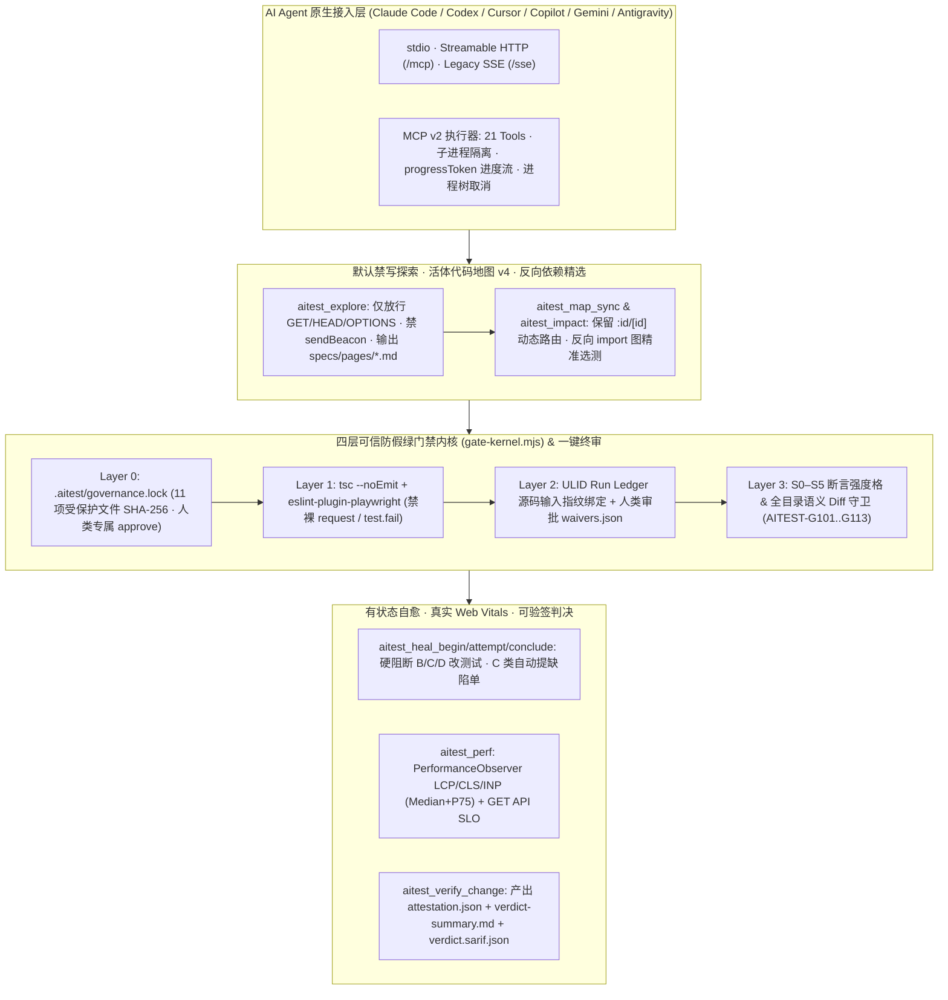

<div align="center">

# 🛡️ AI Test Workbench (`v5.0`)

**AI 编码 Agent 的独立可信验证内核、原生多协议 MCP 服务端与活体代码知识图谱**

支持 **一键变更判决 (`verify_change`)** · **四层防假绿门禁 + `S0–S5` 断言强度格 + 治理锁 (`FGER=0%`)** · **原生 MCP v2 (`stdio` / `/mcp` / `/sse` · 21 Tools · 异步 Jobs)** · **有状态自愈状态机** · **Import-Graph 精准回归** · **真实 `PerformanceObserver` Web Vitals**

[English README](./README.en.md) · [四层门禁与治理指南](./docs/governance.md) · [v5.0 验证评分卡](./docs/review/v5-verification-scorecard.md) · [AI Agent 快速上手](./docs/ai-agent-quickstart.md) · [AGENTS.md](./AGENTS.md) · [架构与安全边界](./ARCHITECTURE.md) · [ADR-0001](./docs/adr/0001-mcp-protocol-stack-and-zero-dep-kernel.md) · [更新日志](./CHANGELOG.md)

[](https://github.com/seaworld008/ai-test-workbench/actions/workflows/ci.yml)
[](https://github.com/seaworld008/ai-test-workbench/releases)
[](./LICENSE)
[](./VERSION.md)
[-16a34a?style=flat-square)](./docs/review/v5-verification-scorecard.md)
[](./skills/ai-test-workbench/references/mcp-server-protocol.md)
[](https://playwright.dev/)

</div>

---

## ✨ 为什么升级到 AI Test Workbench v5.0？

当 Claude Code、Codex CLI、Antigravity、Cursor、VS Code Copilot、Gemini CLI 大幅提速编码后，最大的工程风险不再是“写不出测试”，而是 **“测试结果不可信（假绿）”**：
1. **AI 自愈作弊套路极深**：把精确断言 `toHaveText('49/50')` 偷偷换成 `toBeVisible()` 或 `expect(true).toBe(true)`、加 `test.fail()`、`.catch(() => null)`、`expect.soft()`、改 `playwright.config.ts` 加 `testIgnore`、关掉 ESLint 规则，甚至拿上次绿色的旧 `results.json` 交差。
2. **治理规则仅停留在提示词里**：缺少防篡改锁与状态机强执，Agent 容易把真实后端 `500` 缺陷当成脚本问题强行“修绿”。
3. **长耗时工具易超时阻塞**：单把全局锁阻塞只读查询，缺少进度心跳与子进程树取消信号。
4. **性能与安全存在盲区**：传统 `getEntriesByType` 测不出真实 `LCP/CLS`；探索爬虫默认放行写请求或漏脱敏 JSON 密码与 JWT。

**AI Test Workbench v5.0** 将定位彻底收敛为 **“AI 编码 Agent 的独立可信验证内核（Trustworthy Verification Kernel）”**——不比谁“修得多”，只确保每一次绿灯 **“修得可信”**：

| 北极星可信度指标 | `v5.0.0` 本机基准实测 (`npm run bench`) | 核心保障机制 |
|---|---|---|
| **假绿逃逸率 (`FGER`)** | **`0.0%`（`26/26` 种作弊补丁全部拦截）** | 四层防假绿门禁 + `S0–S5` 断言强度格 + `.aitest/governance.lock` |
| **种子缺陷检出率 (`SDDR`)** | **`100.0%`（`7/7` 类全栈真实缺陷检出）** | JSON Schema 契约校验 + RBAC/并发竞态 + WCAG 2.1/2.2 扫描 |
| **诊断分类准确率 / 误修率** | **`100.0%` (`45/45`) / 误修率 `0.0%`** | 结构化运行时守卫信号 + `aitest_heal_*` 有状态自愈状态机 |
| **凭据脱敏召回率** | **`100.0%`（`35/35` 类凭据零泄露）** | Redaction v2（覆盖 JSON 密码、JWT、云 Token、私钥、DB 串） |

---

## 🏗️ v5.0 可信验证内核架构



---

## 🚀 30 秒接入 AI Agent（零运行时第三方依赖）

### 方式一：一键注册原生 MCP Server

- **Claude Code**：
  ```bash
  claude mcp add ai-test-workbench -- npx -y ai-test-workbench mcp-serve
  ```
- **Codex CLI**（`.codex/config.toml`）：
  ```toml
  [mcp_servers.ai-test-workbench]
  command = "npx"
  args = ["-y", "ai-test-workbench", "mcp-serve"]
  ```
- **Cursor / Windsurf / Antigravity / Gemini CLI**（`.mcp.json`）：
  ```json
  {
    "mcpServers": {
      "ai-test-workbench": {
        "command": "npx",
        "args": ["-y", "ai-test-workbench", "mcp-serve"]
      }
    }
  }
  ```
- **Streamable HTTP (`/mcp`) + Legacy SSE (`/sse`) 远程服务模式**：
  ```bash
  npx ai-test-workbench mcp-serve --transport http --port 3847 --target /path/to/your-repo
  ```

### 方式二：复制即用的首次提示词

> ```text
> 请使用 ai-test-workbench MCP 工具为当前仓库建立可信自动化测试闭环：
> 1. 调用 aitest_doctor 检查 Node >= 22.12、Chromium 与 Gate Kernel 状态；
> 2. 先传 dryRun=true 调用 aitest_init 预览，再正式初始化 qa/ 与 governance.lock；
> 3. 调用 aitest_verify_change(base="HEAD") 跑通一键可信验证并生成 attestation.json；
> 4. 调用 aitest_map_sync 构建活体代码地图，严格区分「本机工作台验收」与「真实业务 E2E 验收」向我汇报。
> ```

---

## 💻 CLI 极速工作流与本地基准复现

### 环境要求
- **Node.js**：`>= 22.12.0`（推荐 **Node 24 LTS** 或 **Node 26 LTS**）
- **操作系统**：Windows 11 PowerShell (`pwsh`)、macOS、Linux

### 标准业务接入与一键终审

```bash
# 1. 体检与幂等初始化（自动创建 <repo>/qa/.aitest/governance.lock）
npx ai-test-workbench doctor
npx ai-test-workbench init --name my-app --target "/path/to/your-repo" --loop codex

# 2. 登录态捕获 -> 0→1 默认禁写探索 -> 活体代码地图 v4 -> 锁版本全链路 MCP
npx ai-test-workbench auth-login --target "/path/to/your-repo" --base-url https://staging.example.internal
npx ai-test-workbench explore --target "/path/to/your-repo" --base-url https://staging.example.internal --max-pages 30
npx ai-test-workbench map --target "/path/to/your-repo"
npx ai-test-workbench mcp add --target "/path/to/your-repo" --profile full-link && npx ai-test-workbench mcp doctor --target "/path/to/your-repo" --lock

# 3. 性能 SLO 评测与提交前一键可信变更判决（产出 attestation + SARIF）
npx ai-test-workbench perf --target "/path/to/your-repo" --concurrency 4 --iterations 12 --enforce-budget
npx ai-test-workbench verify-change --target "/path/to/your-repo" --base origin/main
```

### 本机全量自检与公开基准复现（零外部服务器）

```bash
git clone https://github.com/seaworld008/ai-test-workbench.git
cd ai-test-workbench
cd templates/playwright-qa && npm ci && npx playwright install chromium && cd ../..

npm run lint:docs
npm run typecheck
npm test
npm run smoke
npm run demo:verify
npm run bench
```

---

## 🧰 完整 CLI 命令与 21 个 MCP 工具矩阵

| CLI 命令 | 对应 MCP 工具 | 核心职责与可信治理能力 |
|---|---|---|
| `verify-change` | `aitest_verify_change` | **一键终审闭环**：治理锁 → 反向依赖选测 → 账本运行 → 四层门禁 → 产出 `attestation.json` & `verdict.sarif.json` |
| `doctor` | `aitest_doctor` | 探测 Node/npm、Git、Codex/Claude、Chromium 缓存与 Gate Kernel 版本一致性 |
| `init` | `aitest_init` | 幂等初始化 `<repo>/qa` 并签发初始 `.aitest/governance.lock` |
| `governance` | `aitest_governance_status` *(只读)* | `verify \| status \| approve`；其中 **`approve` 仅限人类本地 CLI 执行，永不暴露给 MCP** |
| `auth-login` | *(交互式 CLI)* | 有头浏览器人工完成短信验证码 / SSO（绝不绕过门禁），保存会话状态 |
| `explore` | `aitest_explore` | 默认禁写 0→1 探索（禁 POST/变更/sendBeacon），产出 `system-overview.md` 与 `specs/pages/*.md` |
| `map` | `aitest_map_sync` | 融合静态/动态路由（`:id`/`[id]`）、Controller、DB 表并自动收敛历史缺陷（Schema v4） |
| `impact` | `aitest_impact` | 基于 Git Diff + 静态 `import` 反向依赖图精选传递受影响测试并附 `why` 证据链 |
| `run` | `aitest_run` | 运行确定性套件并写入 ULID `Run Ledger`，注入/捕获 W3C `Trace-ID` |
| `audit` | `aitest_audit` | 四层防假绿门禁：`governance.lock` + `tsc/eslint` + `Run Ledger/waivers` + `S0–S5` 语义 Diff 守卫 |
| `heal` | `aitest_heal_begin` / `attempt` / `conclude` | 有状态自愈状态机：B/C/D 类硬阻断改测试（`0%` 误修率），A 类限 3 轮，C 类自动产缺陷工单 |
| `diagnose` | `aitest_diagnose` | 结构化守卫信号优先定责（`100%` 语料准确率）、Redaction v2 脱敏与可观测查询生成 |
| `perf` | `aitest_perf` | 预注入 `PerformanceObserver` 采集真实 `LCP/CLS/INP`（Median+P75）与并发 GET API P95/RPS |
| `trace-matrix` | `aitest_trace_matrix` | 审计 `specs/*.md` ↔ `tests/**/*.spec.ts` ↔ 运行结果的 `REQ-xxx` 需求追溯覆盖率 |
| `flaky` | `aitest_flaky_status` | 统计近 20 次运行历史抖动率与 `.aitest/quarantine.json`（`<= 7 天` TTL）隔离状态 |
| `mcp` | `aitest_mcp_hub` | 7 大支柱锁版本 MCP 配置、`.aitest/mcp.lock` 哈希漂移与提示词投毒审计 |
| `mcp-serve` | `aitest_job_status` / `result` / `cancel` | 启动全协议 MCP v2 服务端，支持子进程异步后台作业状态查询、结果拉取与进程树强杀 |
| `report` | `aitest_report` | 索引 HTML、JUnit、JSON、Attestation、SARIF、全景图、代码地图与 `.zip` Trace |
| `update-agents` | *(CLI 同步命令)* | 基于 SHA-256 清单安全更新官方 Test Agents，保护手改文件 |
| `skill-install` | `aitest_skill_install` | 安装标准 `SKILL.md` 到 `.codex` / `.claude` / `.gemini` / `.github` / `.agents` / `qa` |

---

## 📚 全站双语文档导航（默认中文，均配英文 `.en.md`）

| 文档主题 | 简体中文（默认） | English |
|---|---|---|
| **四层防假绿门禁与治理指南 (v5.0)** | [docs/governance.md](./docs/governance.md) | [docs/governance.en.md](./docs/governance.en.md) |
| **v5.0 验证评分卡与审查路线图** | [scorecard](./docs/review/v5-verification-scorecard.md) · [review](./docs/review/architecture-code-review-2026-11.md) · [roadmap](./docs/review/optimization-roadmap-2026-2027.md) | [scorecard.en](./docs/review/v5-verification-scorecard.en.md) · [review.en](./docs/review/architecture-code-review-2026-11.en.md) · [roadmap.en](./docs/review/optimization-roadmap-2026-2027.en.md) |
| **架构决策记录 (ADR)** | [ADR-0001 零依赖 MCP 内核 v2](./docs/adr/0001-mcp-protocol-stack-and-zero-dep-kernel.md) | [ADR-0001 (EN)](./docs/adr/0001-mcp-protocol-stack-and-zero-dep-kernel.en.md) |
| **AI Agent 快速上手与规范** | [quickstart](./docs/ai-agent-quickstart.md) · [AGENTS.md](./AGENTS.md) · [CLAUDE.md](./CLAUDE.md) · [llms.txt](./llms.txt) | [quickstart.en](./docs/ai-agent-quickstart.en.md) · [AGENTS.en.md](./AGENTS.en.md) |
| **系统架构、版本矩阵与蓝图** | [ARCHITECTURE.md](./ARCHITECTURE.md) · [VERSION.md](./VERSION.md) · [架构蓝图](./Playwright%20Test%20Agents%20+%20Codex%20%E5%8F%AF%E5%A4%8D%E7%94%A8%E6%9C%AC%E6%9C%BA%20AI%20%E8%87%AA%E5%8A%A8%E5%8C%96%E6%B5%8B%E8%AF%95%E5%B7%A5%E4%BD%9C%E5%8F%B0%E2%80%94%E2%80%94%E6%9E%B6%E6%9E%84%E8%AE%BE%E8%AE%A1%E4%B8%8E%E5%AE%9E%E6%96%BD%E6%8F%90%E7%A4%BA%E8%AF%8D.md) | [ARCHITECTURE.en.md](./ARCHITECTURE.en.md) · [VERSION.en.md](./VERSION.en.md) · [Blueprint (EN)](./docs/architecture-and-prompts-blueprint.en.md) |
| **适配 / 安全 / 排查 / 升级 / 靶场** | [adapter](./docs/project-adapter.md) · [security](./docs/security.md) · [troubleshooting](./docs/troubleshooting.md) · [upgrade](./docs/upgrade.md) · [demo](./examples/demo-webapp/README.md) | [adapter.en](./docs/project-adapter.en.md) · [security.en](./docs/security.en.md) · [troubleshooting.en](./docs/troubleshooting.en.md) · [upgrade.en](./docs/upgrade.en.md) · [demo.en](./examples/demo-webapp/README.en.md) |
| **社区规范与安全策略** | [CONTRIBUTING.md](./CONTRIBUTING.md) · [SECURITY.md](./SECURITY.md) · [CODE_OF_CONDUCT.md](./CODE_OF_CONDUCT.md) | [CONTRIBUTING.en.md](./CONTRIBUTING.en.md) · [SECURITY.en.md](./SECURITY.en.md) · [CODE_OF_CONDUCT.en.md](./CODE_OF_CONDUCT.en.md) |

## 📄 License

[MIT License](./LICENSE)
