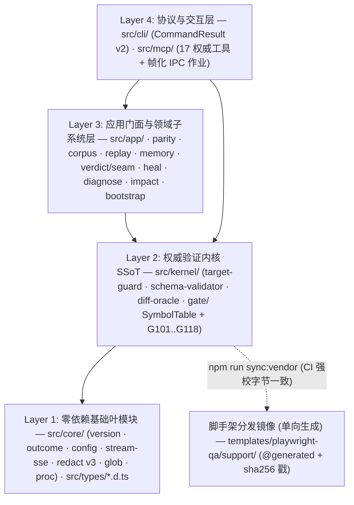

<div align="center">

# AI Test Workbench (`v6.4.0`)

**面向 AI 编码 Agent 的独立可信验证内核与原生多协议 MCP 服务端**

提供 **四层 fail-closed AST 防假绿门禁 (`S0–S5` + `AITEST-G101..G118` + 符号表 + Dieselgate 与跨目录锁步门禁)** · **一键变更判决 (`verify-change` · in-toto v1 + `T0/T1/T2` + 人类守门员焦点卡)** · **双目标五级检查点差分先知 (`aitest_parity` + 零明文形状指纹 + 受锁外部上游磁带)** · **工具化记忆循环 (`aitw learn` 蒸馏与全仓回溯清扫 + 受锁 `known-blockers.json`)** · **原生零依赖 MCP 服务端 (`stdio` / `/mcp` / `/sse` · 17 权威工具 · 帧化子进程 IPC)** · **全自动回环自举 (`aitest_bootstrap`) 与 SSE `TTFT` / Web Vitals**

[English README](./README.en.md) · [v5→v6 升级指南](./docs/upgrade.md) · [治理与四层门禁](./docs/governance.md) · [AI Agent 快速上手](./docs/ai-agent-quickstart.md) · [AGENTS.md](./AGENTS.md) · [系统架构](./ARCHITECTURE.md) · [v6 重构评估报告](./docs/review/v6-refactor-assessment.md) · [更新日志](./CHANGELOG.md)

[](https://github.com/seaworld008/ai-test-workbench/actions/workflows/ci.yml)
[](https://github.com/seaworld008/ai-test-workbench/releases)
[](./LICENSE)
[](./VERSION.md)
[-6.1%25%20%5B2.1%25--16.5%25%5D-0ea5e9?style=flat-square)](./bench/real-world/results/SUMMARY-v6-holdout.md)
[](./skills/ai-test-workbench/references/mcp-server-protocol.md)
[](https://playwright.dev/)

</div>

---

## 1. 定位与已核实度量指标

当编码 Agent（Claude Code、Codex CLI、Cursor、VS Code Copilot、Gemini CLI 等）高频生成与修改 Playwright 测试时，核心工程风险是**假绿（Fake-Green）**：测试通过并非因为业务正确，而是因为断言被弱化（`toHaveText('49/50')` → `toBeVisible()` 或 `expect(true).toBe(true)`）、异常被吞掉（`.catch(() => null)` / `expect.soft()` / `test.fail()`）、治理配置被篡改（`testIgnore` / 关闭 ESLint 规则），或复用了过期的 `results.json`。

`ai-test-workbench` 将这些约束从提示词下沉为**工具强执的独立验证内核**：

| 指标 | 已核实实测值（标明语料范围与复现入口） | 对应保障机制 |
|---|---|---|
| **假绿逃逸率 (`FGER-internal` / `FGER-holdout`)** | 内部对抗语料 **`0.0%` (`26/26`)** · 红队留出集 **`0.0%` (`24/24`)**（`npm run bench`） | 四层 fail-closed AST 门禁 (`AITEST-G101..G118`) + 粘性 T1 MAC 治理锁 |
| **良性重构误报率（内部良性语料）** | **`0.0%` (`12/12`)**（Prettier 换行、定位器重命名、ARIA 合并，`npm run bench`） | TypeScript Compiler API 全文件语义 AST 比对 |
| **Gate FPR（真实提交未见留出集，`v6.0` 盲测冻结，`n=50`，`seed=20261125`）** | **`6.1%` (`3/49` 正常提交，Wilson 95% CI `[2.1%, 16.5%]`)**；原始告警 `8.0%` (`4/50`，保留 `1/1` 真报)；较 v5.1.1 的 `12.2%` (`6/49`, CI `[5.7%, 24.2%]`) 下降 50% | 5 个宽松许可开源仓首次盲测（保持冻结不篡改），详见 [v6 留出集对比报告](./bench/real-world/results/SUMMARY-v6-holdout.md) |
| **Gate FPR（100-Commit 真实提交回归集，`v6.4.0` 后验复测，`n=100`）** | 试跑集 **`4.2%` (`2/48`, CI `[1.2%, 14.0%]`)** · 留出集语料后验 **`4.1%` (`2/49`, CI `[1.1%, 13.7%]`)** · 合并 **`4.1%` (`4/97`, Wilson 95% CI `[1.6%, 10.1%]`，保留 `3/3` 真报)**（较 `v6.0..v6.2.1` 合并 `5.2% (5/97)` 进一步下降，`AITEST-G118` 未配置时零开销）；**`>=200` 正式评测：`pending`（不外推）** | AST 门禁 v2.2：跨文件标题池化 + 词法作用域栈 + 既有 `if` 块双计次守恒 (`G110`) + 受锁 `customMatchers` / 结构化领域匹配器识别 + 蜜罐感知（[ADR-0004](./docs/adr/0004-pluggable-ast-gate-and-fp-governance.md)） |
| **自治红队假绿逃逸率 (`FGER-agentic`)** | 脚本化多步红队基线（`n=22`，含 E 类 Dieselgate 与 F 类差分/拷贝/磁带/锁步，`npm run bench:agentic`）：**本地 T1 `13.6%` (`3/22`, CI `[4.7%, 33.3%]` — 仅预登记边界探针 `AG-B4`/`AG-C4`/`AG-F1`)** · **CI T2 合入级 `0.0%` (`0/22`, CI `[0.0%, 14.9%]`)** · 合法修复对照 `4/4` T2 通过；**实盘 LLM (`claude`/`codex`/`gemini`)：`pending`（适配器就绪，不做外推）** | 隔离沙箱 + 隐藏业务断言 + 活体 Baseline `Parity-Oracle` + 临时 Fulcio T2 CA；详见 [红队架构设计](./bench/agentic/DESIGN.md) 与 [实测基线报告](./bench/agentic/results/SUMMARY.md) |
| **种子缺陷检出率 (`SDDR`)** | 单应用靶场 `demo-campus` **`100.0%` (`7/7`)**（`npm run bench`） | 零依赖 JSON Schema 校验 + RBAC/并发竞态 + WCAG 2.0/2.1/2.2 |
| **诊断分类准确率 / C→A 误判率 / 误修率** | 内部语料 `45/45` + 真实 Playwright 堆栈 `12/12`：**`100%` · C→A `0.0%` · 误修率 `0.0%`** | 结构化运行时守卫 + C 优先于 A 规则 + 防篡改自愈状态机 |
| **凭据脱敏召回率** | 内部对抗语料 **`100.0%` (`35/35`)**（`npm run bench`） | Redaction v3（结构化先解析后脱敏，保留 `heal_*`/`job_*` ID 与布尔/数值字段） |
| **判决信任分级 (`T0 / T1 / T2`)** | **T0** = 未经验证的本地运行 · **T1** = 本地 Run Ledger + MAC（证明完整性，不证明来源） · **T2** = 在 GitHub 托管的 runner 上从干净 checkout 重跑，用 Sigstore 免密钥签名，并且校验通过签发者身份 | **只有 T2 是合入级绿灯**；详见 [可复用工作流示例](./examples/workflows/use-aitest-verify.yml) 与 `attest verify` |

### 信任分级与 CI 可复用工作流（仅 T2 为合入级绿灯）

- **T0**：未经验证的本地运行（非合入级绿灯）。
- **T1**：本地 Run Ledger + MAC（证明完整性，不证明来源；非合入级绿灯）。
- **T2**：在 GitHub 托管的 runner 上从干净 checkout 重跑，用 Sigstore 免密钥签名，并且校验通过签发者身份。**只有 T2 是合入级绿灯**。

在业务仓库接入 T2 可复用工作流（见 [examples/workflows/use-aitest-verify.yml](./examples/workflows/use-aitest-verify.yml)）：

```yaml
jobs:
  aitest-t2-verdict:
    uses: seaworld008/ai-test-workbench/.github/workflows/aitest-verify.yml@v6.4.0
    permissions:
      id-token: write
      attestations: write
      contents: read
      security-events: write
    with:
      qa-dir: qa
      suite: impact
      node-version: '22'
      signer: github-attest # 默认；可选 cosign
```

离线校验 T2 证书（默认 fail-closed，缺签名 / 仅 T1 / 身份不符 / 改动 1 字节均非 0 退出且 `trustLevel <= T1`）：

```bash
npx ai-test-workbench@6.4.0 attest verify \
  --file attestation.json \
  --bundle attestation.sigstore.json \
  --expect-repo owner/repo \
  --expect-workflow .github/workflows/aitest-verify.yml \
  --expect-ref refs/heads/main
```

> **私有仓库签名方式说明**：默认 `signer: github-attest` 使用 GitHub Artifact Attestations（`actions/attest`），私有仓库需 **GitHub Enterprise Cloud**；若切换 `signer: cosign`，公共 Sigstore 会将仓库与工作流身份写入**公开透明日志（Rekor）**，私有项目须自行评估后再决定是否启用。

---

## 2. v6.4.0 分层架构

v6.4.0 在零循环四层单向依赖基础上整合双目标五级检查点差分先知 (`src/kernel/diff-oracle.mjs` + `src/parity/`)、零明文形状指纹聚类、工具化记忆循环 (`src/memory/` + `src/learn.mjs`)、`AITEST-G118` 跨目录锁步门禁与内外环人类守门员焦点卡，全仓所有 `src/**/*.mjs` 均控制在 `<= 435` 行内（详见 [ARCHITECTURE.md](./ARCHITECTURE.md) 与 [ADR-0006](./docs/adr/0006-differential-parity-oracle-and-shape-fingerprints.md)）：



---

## 3. 快速接入（MCP 与 CLI）

### 环境要求与供应链安全

- **Node.js**：`>= 22.12.0`（推荐 `24 LTS` 或 `26 LTS`）；支持 Windows PowerShell (`pwsh`)、macOS、Linux。
- **零运行时依赖**：根包 `package.json` 不含运行时 `dependencies`；请始终锁定精确版本 `npx ai-test-workbench@6.4.0 <cmd>`、全局安装后的短命令 `aitw <cmd>`（`npm i -g ai-test-workbench@6.4.0`），或源码直连 `node tools/aitest.mjs <cmd>`。

### 注册原生 MCP 服务端（`stdio` / `/mcp` / `/sse`）

- **Claude Code**：
  ```bash
  claude mcp add ai-test-workbench -- npx --package=ai-test-workbench@6.4.0 ai-test-workbench mcp-serve --workspace-root /path/to/your-repo
  ```
- **Codex CLI**（`.codex/config.toml`）：
  ```toml
  [mcp_servers.ai-test-workbench]
  command = "npx"
  args = ["--package=ai-test-workbench@6.4.0", "ai-test-workbench", "mcp-serve"]
  ```
- **Cursor / Windsurf / Antigravity / Gemini CLI**（`.mcp.json`）：
  ```json
  {
    "mcpServers": {
      "ai-test-workbench": {
        "command": "npx",
        "args": ["--package=ai-test-workbench@6.4.0", "ai-test-workbench", "mcp-serve"]
      }
    }
  }
  ```
- **Streamable HTTP (`/mcp`) + Legacy SSE (`/sse`)**：
  ```bash
  npx ai-test-workbench@6.4.0 mcp-serve --transport http --port 3847 --target /path/to/your-repo --workspace-root /path/to/your-repo
  ```

### 官方 MCP 协议合规性与三传输验证

- 零运行时依赖架构决策与重审触发条件见 [ADR-0001](./docs/adr/0001-mcp-protocol-stack-and-zero-dep-kernel.md)。
- 隔离在 `conformance/` 下的官方回归套件（不随 npm 包发布，由 CI `mcp-conformance` 执行）：
  - **`@modelcontextprotocol/conformance@0.1.16`**（Streamable HTTP `/mcp`，`active` 套件 30 场景）：`8/8` 协议通用场景全部通过，`22` 项预期未适用场景登记在 [`conformance/expected-failures.json`](./conformance/expected-failures.json)，`0` 项未登记失败。
  - **`@modelcontextprotocol/sdk@1.32.2` 参考 `Client`**（`5/5` 通过）：覆盖 `stdio`、Streamable HTTP (`/mcp`) 与 Legacy SSE (`/sse` + `/messages`)，验证 `2024-11-05`..`2025-11-25` 版本协商、`tools/list` 精确 17 个工具与合法 Schema、`structuredContent`、`notifications/progress` 与 `AbortController` 取消请求。

### 标准 CLI 工作流与本地复现

```bash
# 1. 体检、初始化与模板安全升级
npx ai-test-workbench@6.4.0 doctor
npx ai-test-workbench@6.4.0 init --name my-app --target "/path/to/your-repo" --loop codex
npx ai-test-workbench@6.4.0 upgrade --target "/path/to/your-repo" --dry-run

# 2. 登录态捕获 -> 只读探索 -> 代码地图 -> 锁版本外部 MCP
npx ai-test-workbench@6.4.0 auth-login --target "/path/to/your-repo" --base-url https://staging.example.internal
npx ai-test-workbench@6.4.0 explore --target "/path/to/your-repo" --base-url https://staging.example.internal --max-pages 30
npx ai-test-workbench@6.4.0 map --target "/path/to/your-repo"
npx ai-test-workbench@6.4.0 mcp add --target "/path/to/your-repo" --profile full-link && npx ai-test-workbench@6.4.0 mcp doctor --target "/path/to/your-repo" --lock

# 3. 性能 SLO、双目标差分回归、记忆蒸馏清扫与提交前一键变更判决
npx ai-test-workbench@6.4.0 perf --target "/path/to/your-repo" --concurrency 4 --iterations 12 --enforce-budget
npx ai-test-workbench@6.4.0 parity --target "/path/to/your-repo" --baseline-url http://127.0.0.1:4100 --candidate-url http://127.0.0.1:4200 --privacy-mode shape-only
npx ai-test-workbench@6.4.0 learn --target "/path/to/your-repo" --action distill --json
npx ai-test-workbench@6.4.0 verify-change --target "/path/to/your-repo" --base origin/main
```

本机克隆全量自检（零外部服务器）：

```bash
git clone https://github.com/seaworld008/ai-test-workbench.git
cd ai-test-workbench
npm ci && (cd templates/playwright-qa && npm ci && npx playwright install chromium)
npm run check:vendor && npm run lint:docs && npm run typecheck && npm test && npm run smoke && npm run demo:verify && npm run bench
```

---

## 4. MCP 工具矩阵（自动生成）与 CLI 专属命令

下表由 `scripts/generate-docs.mjs` 从 `src/mcp/registry.mjs` 单源自动生成，并由 `npm run lint:docs` 强制防漂移：

<!-- BEGIN:GENERATED_MCP_TOOLS lang="zh" -->
| 工具名称 | 类别 | 只读提示 | 职责摘要 |
|---|---|---|---|
| `aitest_doctor` | 发现与初始化 | 是 | Environment, Browser & Gate Kernel Readiness Check |
| `aitest_init` | 发现与初始化 | 否 | Initialize Isolated QA Workspace & Governance Lock |
| `aitest_bootstrap` | 发现与初始化 | 否 | Zero-to-One Autonomous Loopback Bootstrapper |
| `aitest_explore` | 发现与初始化 | 否 | Zero-to-One Default-Deny Read-Only Explorer |
| `aitest_map_sync` | 发现与初始化 | 否 | Sync Convergent Living Code Map v4 |
| `aitest_mcp_hub` | 发现与初始化 | 否 | Manage Pinned 7-Pillar MCP Presets & Supply-Chain Doctor |
| `aitest_skill_install` | 发现与初始化 | 否 | Install Portable Agent Skill into Project |
| `aitest_verify_change` | 执行与门禁验证 | 否 | One-Call Agent Change Verification & Attested Verdict |
| `aitest_impact` | 执行与门禁验证 | 是 | Compute Dependency-Graph Diff-Impact Scope (v2) |
| `aitest_run` | 执行与门禁验证 | 否 | Execute Ledger-Bound Deterministic Playwright Suite |
| `aitest_audit` | 执行与门禁验证 | 是 | Run 4-Layer Fail-Closed Anti-Fake-Green Quality Gate |
| `aitest_diagnose` | 执行与门禁验证 | 否 | Generate Redacted Evidence-First A/B/C/D Diagnostics Report |
| `aitest_perf` | 执行与门禁验证 | 否 | Run PerformanceObserver Web Vitals & Read-Only API SLO Benchmark |
| `aitest_report` | 执行与门禁验证 | 是 | Query Reports Index, Flaky Telemetry, Traceability & Lessons |
| `aitest_parity` | 执行与门禁验证 | 否 | Run Dual-Target 5-Checkpoint Differential Parity Oracle |
| `aitest_heal` | 有状态治理与作业 | 否 | Stateful A/B/C/D Heal Governance State Machine (begin \| attempt \| conclude \| discard) |
| `aitest_job` | 有状态治理与作业 | 否 | Inspect, Await, or Cancel Async Background MCP Jobs (status \| result \| cancel) |

> 自动生成自 `src/mcp/registry.mjs`（共 `17` 个权威工具；`governance approve` 仅限人类本地 CLI，永不注册为 MCP 工具；`v5`/`v6.1` 共 8 个旧工具名在 `v6.x` 中作为弃用转发别名保留，详见 `docs/upgrade.md`）。
<!-- END:GENERATED_MCP_TOOLS -->

以下高权限或交互式操作**仅限本地 CLI 执行，永不暴露为 MCP 工具**：

| CLI 命令 | 用途与安全边界 |
|---|---|
| `governance status \| verify \| approve --by <human>` | 校验或经人类审批重签 `.aitest/governance.lock`（硬阻断 MCP 子进程与机器人审批名） |
| `attest verify --file <attestation.json>` | 离线零依赖校验 in-toto Statement v1 证书、SHA-256 绑定与 Sigstore T2 签发者身份 |
| `auth-login [--cdp-url <http://127.0.0.1:9222>]` | 有头浏览器人工完成 OTP / SSO / 扫码登录（绝不绕过验证码），以 `0o600` 保存会话 |
| `upgrade [--dry-run] [--force]` | 基于 `.aitest/template-manifest.json` 执行三方哈希安全升级，跳过并报告用户手改文件 |
| `update-agents` | 基于 SHA-256 清单安全同步官方 Playwright Test Agents 定义 |

---

## 5. 文档导航与架构决策记录 (ADR)

| 文档主题 | 简体中文（默认） | English |
|---|---|---|
| **v5 → v6 升级与迁移指南** | [docs/upgrade.md](./docs/upgrade.md) | [docs/upgrade.en.md](./docs/upgrade.en.md) |
| **四层防假绿门禁与治理指南** | [docs/governance.md](./docs/governance.md) | [docs/governance.en.md](./docs/governance.en.md) |
| **v6 重构评估与交付报告** | [v6-refactor-assessment.md](./docs/review/v6-refactor-assessment.md) · [v6 留出集报告](./bench/real-world/results/SUMMARY-v6-holdout.md) · [试跑报告](./bench/real-world/results/SUMMARY.md) · [预登记方案](./bench/real-world/PREREGISTRATION.md) | [v6-refactor-assessment.en.md](./docs/review/v6-refactor-assessment.en.md) · [Holdout Summary (EN)](./bench/real-world/results/SUMMARY-v6-holdout.en.md) · [Pilot Summary (EN)](./bench/real-world/results/SUMMARY.en.md) · [Pre-Reg (EN)](./bench/real-world/PREREGISTRATION.en.md) |
| **架构决策记录 (ADR-0001..0006)** | [ADR-0001 MCP 零依赖](./docs/adr/0001-mcp-protocol-stack-and-zero-dep-kernel.md) · [ADR-0002 内核单源与升级](./docs/adr/0002-kernel-ssot-vendor-mirror-and-upgrade.md) · [ADR-0003 严格类型安全](./docs/adr/0003-strict-checkjs-type-safety.md) · [ADR-0004 AST 门禁与降误报](./docs/adr/0004-pluggable-ast-gate-and-fp-governance.md) · [ADR-0005 工具面/结果/配置](./docs/adr/0005-mcp-surface-outcome-and-config.md) · [ADR-0006 差分先知与形状指纹](./docs/adr/0006-differential-parity-oracle-and-shape-fingerprints.md) | [ADR-0001](./docs/adr/0001-mcp-protocol-stack-and-zero-dep-kernel.en.md) · [ADR-0002](./docs/adr/0002-kernel-ssot-vendor-mirror-and-upgrade.en.md) · [ADR-0003](./docs/adr/0003-strict-checkjs-type-safety.en.md) · [ADR-0004](./docs/adr/0004-pluggable-ast-gate-and-fp-governance.en.md) · [ADR-0005](./docs/adr/0005-mcp-surface-outcome-and-config.en.md) · [ADR-0006](./docs/adr/0006-differential-parity-oracle-and-shape-fingerprints.en.md) |
| **AI Agent 接入与协议参考** | [quickstart](./docs/ai-agent-quickstart.md) · [AGENTS.md](./AGENTS.md) · [CLAUDE.md](./CLAUDE.md) · [MCP 协议](./skills/ai-test-workbench/references/mcp-server-protocol.md) · [llms.txt](./llms.txt) | [quickstart.en](./docs/ai-agent-quickstart.en.md) · [AGENTS.en.md](./AGENTS.en.md) · [MCP Protocol](./skills/ai-test-workbench/references/mcp-server-protocol.en.md) |
| **架构、版本矩阵与历史归档** | [ARCHITECTURE.md](./ARCHITECTURE.md) · [VERSION.md](./VERSION.md) · [v5 历史评分卡](./docs/history/v5-verification-scorecard.md) · [红队设计](./bench/agentic/DESIGN.md) | [ARCHITECTURE.en.md](./ARCHITECTURE.en.md) · [VERSION.en.md](./VERSION.en.md) · [v5 Historical Scorecard](./docs/history/v5-verification-scorecard.en.md) · [Agentic Design](./bench/agentic/DESIGN.en.md) |
| **适配 / 安全 / 排查 / 靶场 / 社区** | [adapter](./docs/project-adapter.md) · [security](./docs/security.md) · [troubleshooting](./docs/troubleshooting.md) · [demo](./examples/demo-webapp/README.md) · [CONTRIBUTING](./CONTRIBUTING.md) · [SECURITY](./SECURITY.md) | [adapter.en](./docs/project-adapter.en.md) · [security.en](./docs/security.en.md) · [troubleshooting.en](./docs/troubleshooting.en.md) · [demo.en](./examples/demo-webapp/README.en.md) · [CONTRIBUTING.en](./CONTRIBUTING.en.md) · [SECURITY.en](./SECURITY.en.md) |

---

## 6. 验收口径与许可证

汇报验收结果时，始终严格区分 **「本机工作台验收 (`local-workbench`)」** 与 **「真实业务 E2E 验收 (`business-e2e`)」**。自动化 `@axe-core/playwright` 扫描仅覆盖机器可检测的 WCAG 2.0/2.1/2.2 A/AA 规则，不构成完整无障碍合规认证。

采用 [MIT License](./LICENSE) 开源。
