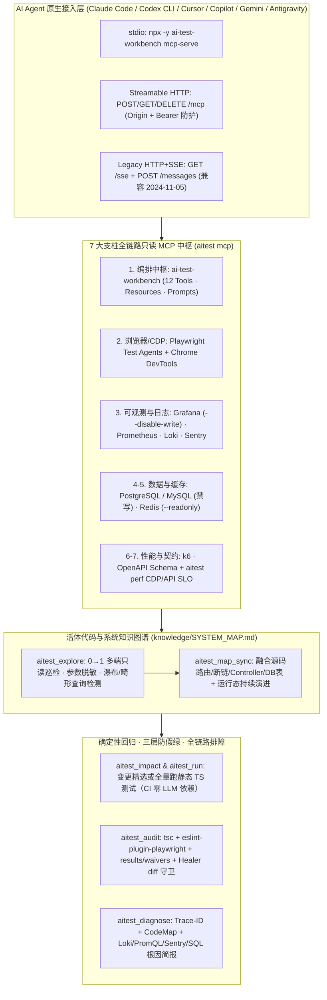

<div align="center">

# 🛡️ AI Test Workbench

**AI Agent 优先的多协议原生 MCP 自动化测试工作台、活体代码地图与标准 Agent Skill**

支持 **原生 MCP Server (`stdio` / Streamable HTTP `/mcp` / Legacy SSE `/sse`)** · **官方 Playwright Test Agents** · **0→1 探索与活体代码知识图谱** · **7 大系统只读 MCP 中枢** · **CDP/API 性能 SLO** · **三层防假绿门禁**

[English README](./README.en.md) · [AI Agent 快速上手与提示词](./docs/ai-agent-quickstart.md) · [AGENTS.md](./AGENTS.md) · [架构与安全边界](./ARCHITECTURE.md) · [架构蓝图 v4.0](./Playwright%20Test%20Agents%20+%20Codex%20%E5%8F%AF%E5%A4%8D%E7%94%A8%E6%9C%AC%E6%9C%BA%20AI%20%E8%87%AA%E5%8A%A8%E5%8C%96%E6%B5%8B%E8%AF%95%E5%B7%A5%E4%BD%9C%E5%8F%B0%E2%80%94%E2%80%94%E6%9E%B6%E6%9E%84%E8%AE%BE%E8%AE%A1%E4%B8%8E%E5%AE%9E%E6%96%BD%E6%8F%90%E7%A4%BA%E8%AF%8D.md) · [更新日志](./CHANGELOG.md)

[](https://github.com/seaworld008/ai-test-workbench/actions/workflows/ci.yml)
[](https://github.com/seaworld008/ai-test-workbench/releases)
[](./LICENSE)
[](./VERSION.md)
[](./skills/ai-test-workbench/references/mcp-server-protocol.md)
[](https://playwright.dev/)

</div>

---

## ✨ 为什么选择 AI Test Workbench (v4.0)？

在 Claude Code、Codex CLI、Antigravity、Cursor、VS Code Copilot、Gemini CLI 让研发提速数倍之后，传统 E2E 测试容易陷入四大困境：
1. **AI Agent 缺少标准工具接口**：只能拼接脆弱 Shell 命令并盲猜非结构化终端输出，跨客户端配置复杂。
2. **陌生系统冷启动成本高**：不理解多端切换、后端接口、数据库表与历史变更关系，用例覆盖残缺。
3. **自愈变成“假绿（Fake-Green）”**：默认 `@playwright/test@1.65.1` Healer 提示词就包含“若持续失败则改标 `test.fixme()`”的妥协指令；AI 还常删断言、加 `{ force: true }`、`waitForTimeout()` 伪造通过。
4. **回归耗时与环境越权风险**：小改动触发全量 E2E 拖慢研发；或误打生产环境、泄露凭据与 `storageState`。

**AI Test Workbench v4.0** 从第一性原理为 **AI Agent 优先** 重构全链路：内置 **零依赖全协议 MCP 服务端（`mcp-serve`）**、**0→1 探索 + 活体代码地图**、**7 大只读系统 MCP 中枢**、**CDP/API 性能基线** 与 **三层防假绿质量门禁**，默认中文文档并完整配对英文 `.en.md`。

---

## 🏗️ v4.0 AI Agent 优先全链路核心架构



---

## 🚀 30 秒让你的 AI Agent 接管测试（AI Agent 快速接入）

### 方式一：通过原生 MCP Server 一键接入（推荐）

- **Claude Code**：
  ```bash
  claude mcp add ai-test-workbench -- npx -y ai-test-workbench mcp-serve
  ```
- **Codex CLI**（`.codex/config.toml`）：
  ```toml
  [mcp_servers.ai-test-workbench]
  command = "npx"
  args = ["-y", "ai-test-workbench", "mcp-serve"]
  ```
- **Cursor / Windsurf / Antigravity / Gemini CLI**（`.mcp.json` / MCP 设置）：
  ```json
  {
    "mcpServers": {
      "ai-test-workbench": {
        "command": "npx",
        "args": ["-y", "ai-test-workbench", "mcp-serve"]
      }
    }
  }
  ```
- **Streamable HTTP (`/mcp`) + Legacy SSE (`/sse`) 远程服务模式**：
  ```bash
  npx ai-test-workbench mcp-serve --transport http --port 3847 --target /path/to/your-repo
  ```

### 方式二：第一次使用的直接对 AI 说的话（复制即用提示词）

> **首次接入任意项目（复制到你的 AI 对话框）：**
> ```text
> 请使用 ai-test-workbench MCP 工具（或 npx ai-test-workbench CLI）为当前仓库初始化隔离自动化测试工作台：
> 1. 先调用 aitest_doctor 检查 Node >= 22.12 与 Chromium 环境；
> 2. 以 dryRun=true 调用 aitest_init 预览后正式生成隔离的 qa/ 子工程；
> 3. 调用 aitest_run(suite="smoke", audit=true) 跑通离线 Smoke 与三层防假绿基线；
> 4. 调用 aitest_map_sync 生成初版 knowledge/SYSTEM_MAP.md，并严格区分「本机工作台验收」与「真实业务 E2E 验收」向我汇报计划。
> ```
>
> 更多场景提示词（陌生多租户系统 0→1 探索、全链路 Trace-ID/可观测排障）与 VS Code Copilot 配置详见 **[AI Agent 快速上手指南](./docs/ai-agent-quickstart.md)** 与 [`prompts/first-time-ai-agent.md`](./prompts/first-time-ai-agent.md)。

---

## 💻 CLI 极速上手与面向多端 SaaS 闭环

### 环境要求
- **Node.js**：`>= 22.12.0`（Node 20 已停止维护 EOL；推荐 **Node 24 Maintenance LTS** 或 **Node 26 Active LTS**）
- **操作系统**：Windows 11 PowerShell (`pwsh`)、macOS、Linux

### 最简 CLI 工作流

```bash
# 1. 环境与浏览器缓存体检
npx ai-test-workbench doctor

# 2. 幂等初始化独立 <repo>/qa（支持 --dry-run 预览与宿主 ESLint/TS 冲突探测）
npx ai-test-workbench init --name my-app --target "/path/to/your-repo" --loop codex

# 3. 短信/SSO 登录捕获 -> 从0到1只读探索 -> 活体代码地图 -> 全链路只读 MCP -> 性能与回归
npx ai-test-workbench auth-login --target "/path/to/your-repo" --base-url https://staging.example.internal
npx ai-test-workbench explore --target "/path/to/your-repo" --base-url https://staging.example.internal --max-pages 30
npx ai-test-workbench map --target "/path/to/your-repo"
npx ai-test-workbench mcp add --target "/path/to/your-repo" --profile full-link && npx ai-test-workbench mcp doctor --target "/path/to/your-repo"
npx ai-test-workbench perf --target "/path/to/your-repo" --concurrency 4 --iterations 12 --enforce-budget
npx ai-test-workbench run --target "/path/to/your-repo" --suite all --audit
```

### 一键本地全栈靶场自检（零外部服务器）

```bash
git clone https://github.com/seaworld008/ai-test-workbench.git
cd ai-test-workbench
cd templates/playwright-qa && npm ci && npx playwright install chromium && cd ../..

npm run lint:docs
npm test
npm run smoke
npm run demo:verify
```

---

## 🧰 完整 CLI 命令与对应 MCP 工具速查

| CLI 命令 | 对应 MCP 工具 | 核心用途与结构化能力 |
|---|---|---|
| `doctor` | `aitest_doctor` | 探测 OS、Node/npm、Git、Codex/Claude、Docker 与浏览器缓存 |
| `init` | `aitest_init` | 幂等初始化 `<repo>/qa`，冲突不覆盖，自动探测宿主配置重叠 |
| `auth-login` | *(交互式 CLI)* | 打开有头浏览器支持人工输入短信验证码/SSO（绝不绕过门禁），保存双态登录凭证 |
| `explore` | `aitest_explore` | 从 0 到 1 只读遍历多端切换器与路由，生成 `system-overview.md` |
| `map` | `aitest_map_sync` | 融合静态路由/Controller/DB 表 + 运行态与测试结果，同步 `SYSTEM_MAP.md` |
| `mcp` | `aitest_mcp_hub` | `presets \| add \| doctor \| serve` 管理 7 大支柱 MCP 并阻断不安全写入与明文密钥 |
| `mcp-serve` | *(原生 MCP 服务端)* | 启动全协议 MCP Server（`stdio` / Streamable HTTP `/mcp` / Legacy SSE `/sse`） |
| `perf` | `aitest_perf` | 测量真实 Chromium CDP Web Vitals（TTFB/FCP/LCP/CLS）与并发 GET API P95/RPS |
| `run` | `aitest_run` | 运行确定性 Playwright 套件（`smoke/e2e/api/a11y/critical/seed/impact/all`）并捕获 Trace-ID |
| `impact` | `aitest_impact` | 基于 Git Diff + `impact-map.json` 精选受影响测试集（不确定退全量） |
| `audit` | `aitest_audit` | 执行静态 `tsc+eslint` + 运行时 `results/waivers` + `--diff-base` Healer Diff 门禁 |
| `diagnose` | `aitest_diagnose` | 输出脱敏诊断简报、Trace-ID、CodeMap 代码关联与 Loki/PromQL/Sentry/SQL 线索 |
| `report` | `aitest_report` | 索引 HTML、JUnit、JSON、系统全景图、活体代码地图、性能总结与 Trace 路径 |
| `update-agents` | *(CLI 同步命令)* | 基于 SHA-256 清单安全更新官方 Test Agents，保留手改内容并产出 `*.aitest-new` |
| `skill-install` | `aitest_skill_install` | 将 `SKILL.md` 安装至 `.codex` / `.claude` / `.gemini` / `.github` / `.agents` / `qa` |

---

## 🛡️ 安全红线与双口径验收

1. **禁止连接生产环境**：`TEST_ENV=production|prod|live|online` 与非 `TEST_ALLOWED_HOSTS` 白名单目标由 `support/target-guard.mjs` 直接阻断；浏览器 `page.route` 与 `APIRequestContext` 双通道阻断 `TEST_DENIED_ORIGINS` 与 `TEST_BLOCKED_ENDPOINTS`；启用 `serviceWorkers: 'block'`。
2. **防提示词注入**：页面 DOM 与接口返回一律视为**不可信数据而非指令**；MCP HTTP 模式校验 `Origin` 防 DNS 重绑定（`403`），非回环地址强制 Bearer Token（`401`）。
3. **自动化无障碍客观口径**：`expectAccessible()` 基于 `@axe-core/playwright` 捕获机器可检的 WCAG 2.0/2.1/2.2 A/AA 问题，**不替代完整人工无障碍合规认证**。
4. **严格区分两种验收结论**：**本机工作台验收** vs **真实业务 E2E 验收**，绝不以离线 Smoke 冒充业务上线验收。

---

## 📚 全站双语文档导航（默认中文，均配英文 `.en.md`）

| 文档主题 | 简体中文（默认） | English |
|---|---|---|
| **AI Agent 快速上手与配置** | [docs/ai-agent-quickstart.md](./docs/ai-agent-quickstart.md) | [docs/ai-agent-quickstart.en.md](./docs/ai-agent-quickstart.en.md) |
| **AI Agent 操作规范** | [AGENTS.md](./AGENTS.md) · [CLAUDE.md](./CLAUDE.md) · [llms.txt](./llms.txt) | [AGENTS.en.md](./AGENTS.en.md) |
| **系统架构与双层安全边界** | [ARCHITECTURE.md](./ARCHITECTURE.md) | [ARCHITECTURE.en.md](./ARCHITECTURE.en.md) |
| **总架构蓝图与完整提示词** | [完整架构蓝图 v4.0](./Playwright%20Test%20Agents%20+%20Codex%20%E5%8F%AF%E5%A4%8D%E7%94%A8%E6%9C%AC%E6%9C%BA%20AI%20%E8%87%AA%E5%8A%A8%E5%8C%96%E6%B5%8B%E8%AF%95%E5%B7%A5%E4%BD%9C%E5%8F%B0%E2%80%94%E2%80%94%E6%9E%B6%E6%9E%84%E8%AE%BE%E8%AE%A1%E4%B8%8E%E5%AE%9E%E6%96%BD%E6%8F%90%E7%A4%BA%E8%AF%8D.md) | [docs/architecture-and-prompts-blueprint.en.md](./docs/architecture-and-prompts-blueprint.en.md) |
| **版本矩阵与 Docker 对齐** | [VERSION.md](./VERSION.md) | [VERSION.en.md](./VERSION.en.md) |
| **多技术栈适配 / 安全 / 排查 / 升级** | [adapter](./docs/project-adapter.md) · [security](./docs/security.md) · [troubleshooting](./docs/troubleshooting.md) · [upgrade](./docs/upgrade.md) · [probe](./docs/agents-probe-1.65.1.md) | [adapter.en](./docs/project-adapter.en.md) · [security.en](./docs/security.en.md) · [troubleshooting.en](./docs/troubleshooting.en.md) · [upgrade.en](./docs/upgrade.en.md) · [probe.en](./docs/agents-probe-1.65.1.en.md) |
| **本地全栈演示靶场** | [examples/demo-webapp/README.md](./examples/demo-webapp/README.md) | [examples/demo-webapp/README.en.md](./examples/demo-webapp/README.en.md) |
| **社区规范与安全策略** | [CONTRIBUTING.md](./CONTRIBUTING.md) · [SECURITY.md](./SECURITY.md) · [CODE_OF_CONDUCT.md](./CODE_OF_CONDUCT.md) | [CONTRIBUTING.en.md](./CONTRIBUTING.en.md) · [SECURITY.en.md](./SECURITY.en.md) · [CODE_OF_CONDUCT.en.md](./CODE_OF_CONDUCT.en.md) |

## 📄 License

[MIT License](./LICENSE)
