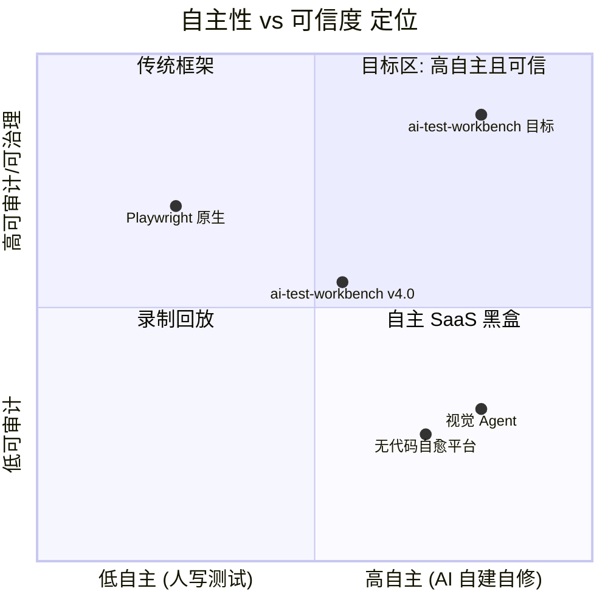
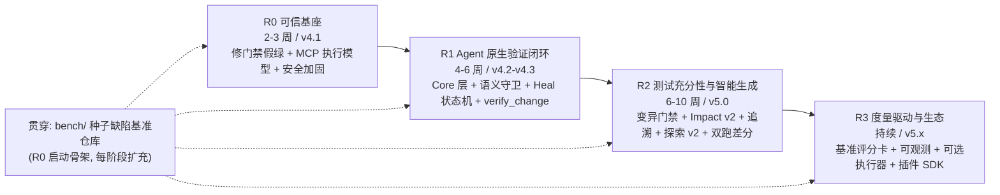
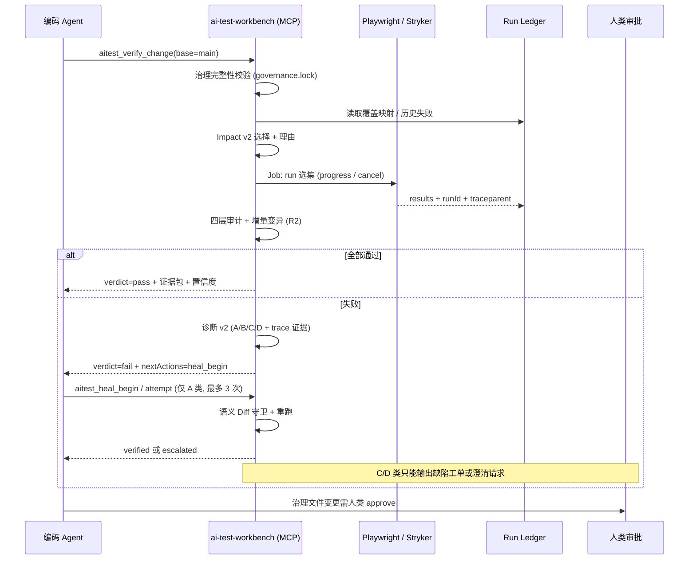
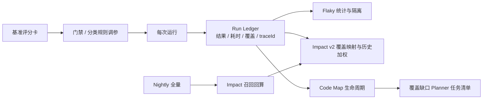

# ai-test-workbench 优化路线图（2026 Q4 – 2027）：打造 AI 时代的可信验证层

> [English Summary](./v5-optimization-roadmap-2026-2027.en.md) · [配套审查报告](./v4-architecture-code-review-2026-11.md) · [v5.0 验证评分卡](./v5-verification-scorecard.md) · [ADR-0001](../adr/0001-mcp-protocol-stack-and-zero-dep-kernel.md) · [主文档 README](../../README.md) · [AGENTS.md](../../AGENTS.md)
>
> **执行进度更新（`v5.0.0` 已落地，2026-11-24）**：R0 全部可信底座修复、R1 工具强执治理与一键终审（`aitest_verify_change` / `governance.lock` / `Run Ledger` / `aitest_heal_*` / `Flaky Quarantine`）、以及 R2 核心智能选测与公开基准（Import-Graph Impact v2、CodeMap v4、需求追溯 `REQ-xxx`、JSON Schema 契约、`npm run bench`）已完成交付并通过实测：**`FGER = 0.0% (26/26)`、`SDDR = 100.0% (7/7)`、诊断准确率 `100.0% (45/45)`、脱敏召回率 `100.0% (35/35)`、误修率 `0.0%`**。详见 [v5.0 验证评分卡](./v5-verification-scorecard.md)。
>
> **文档版本**：v1.1（2026-11-24）· **适用基线**：`v4.0.0@e43e107` → `v5.0.0` · **维护规则**：每个阶段结束时更新第 7 节“度量看板”和第 9 节“行动清单”。新增或删除工作包必须同步更新第 4 节，并写一条 ADR。
>
> **使用方式**：本文档是后续落地的唯一路线真源。每个工作包（WP）都写明了「目标 → 设计要点 → 交付物 → 验收标准 → 度量 → 依赖」，可以直接拆成 Issue 或 PR。审查问题编号（如 `G-01`）对应 [审查报告](./v4-architecture-code-review-2026-11.md) 第 5 节。

---

## 0. 愿景、定位与北极星

### 0.1 一句话定位

> **ai-test-workbench = AI 编码 Agent 的「独立、可信、可审计」验证层。**
> 编码 Agent（Claude Code / Codex / Cursor / Copilot / Gemini / Antigravity）每改一次代码，都可以通过一个 MCP 调用拿到一份**不可篡改、可证伪、可解释**的结构化判决：这次变更该测什么、测了什么、绿灯有多可信、红灯属于哪一类责任、证据在哪。

### 0.2 六条设计原则（所有工作包都必须遵守）

1. **写代码的 Agent 不定义成功标准**：断言的期望值必须能追溯到需求、规格或人工确认；Agent 无权修改治理配置。
2. **AI 跑一次，确定性永续**：AI 只用于探索、生成和诊断；回归阶段零 LLM，产物是可 lint、可 diff 的 Playwright 代码。
3. **门禁必须可证伪**：每道门禁都要有对抗样本集和检出率指标。没有度量的门禁，视为不存在。
4. **治理即代码**：A/B/C/D 分类、修复次数上限、豁免审批、受保护文件，都由工具层强制执行，而不是写在提示词里。
5. **本机优先，默认只读，默认拒绝**：出站白名单、写操作默认拒绝、凭据永不出本机。
6. **度量驱动收敛**：每个阶段都有可量化的退出门槛；不达标就不进入下一阶段，也不新增能力面。

### 0.3 北极星指标

| 指标 | 定义 | 当前 | R0 结束 | R1 结束 | R2 结束 |
|---|---|---|---|---|---|
| **假绿逃逸率 FGER** | 基准仓库中“作弊式修复”被门禁放行的比例 | 未度量（实测 8/8 逃逸） | 建立基线 | ≤ 10% | ≤ 3% |
| **种子缺陷检出率 SDDR** | 基准仓库中注入的产品缺陷被套件检出的比例 | 未度量 | 建立基线 | ≥ 70% | ≥ 85% |
| **变更行变异分 MSCL** | 变更涉及代码上的变异体被杀死的比例 | 无 | — | 试点 | 核心模块 ≥ 70% |
| **判决时延 TTV P50** | `aitest_verify_change` 从调用到给出判决的时间（impact 模式） | 无此工具 | — | ≤ 8 分钟 | ≤ 5 分钟 |
| **Impact 召回率** | Nightly 全量运行中的失败，有多少被当时的 impact 选集覆盖 | 未度量 | — | 建立基线 | ≥ 98% |
| **分类准确率** | A/B/C/D 自动建议在标注样本库上的准确率 | 实测 0/3 | ≥ 60% | ≥ 80% | ≥ 90% |
| **误修率** | Healer 把 C 类或 D 类失败修成绿灯的比例（基准仓库） | 未度量 | 建立基线 | 0 | 0 |

---

## 1. 全球前沿对标

> 资料截至 2026-11。标注“(待核实)”的条目在落地前需要到官方 release notes 或仓库确认。

### 1.1 对标矩阵

| 类别 | 代表项目 | 关键机制 | 我们现状 | 借鉴点 → 工作包 |
|---|---|---|---|---|
| 官方上游 | **Playwright Test Agents**（planner / generator / healer，`init-agents`）https://playwright.dev/docs/test-agents | seed test 起点；Healer 默认“修不好就 `fixme`” | 已集成，并用 A/B/C/D 覆盖了 `fixme` 条款 | 把治理从提示词迁到工具层 → R1-4 |
| 官方上游 | **Playwright 新版能力**：`toMatchAriaSnapshot`、`--only-changed`、Speedboard、isolated retries、`--shuffle`、`--debug=cli`、`playwright-cli`（版本归属待核实）https://playwright.dev/docs/release-notes | 原生面向 Agent 的 CLI 和现场接管 | 锁定 1.65.1，只用了 `--only-changed` | flaky 信号识别 → R1-2；Healer 现场接管 → R3-3 |
| 浏览器 MCP | **Playwright MCP**（ARIA 快照 + `ref`、`--caps=testing`）https://github.com/microsoft/playwright-mcp；**Chrome DevTools MCP**（trace / Insights / console）https://github.com/ChromeDevTools/chrome-devtools-mcp | 浏览器操作层的事实标准 | 作为预设写进配置 | 本项目专注编排层，浏览器操作委托给上游 → R1-0 |
| 动作缓存 | **Stagehand v3** https://github.com/browserbase/stagehand、**Magnitude** https://github.com/magnitudedev/magnitude | 第一次用 LLM 解析动作，之后缓存并确定性重放，失效时回退 LLM | 产物本身就是确定性代码（更透明） | 度量“AI 介入率”和 token 成本 → R3-2 |
| 视觉 Agent | **Midscene.js** https://midscenejs.com、**Browser Use** https://github.com/browser-use/browser-use、**Skyvern** | 视觉驱动，跨端（Web / Android / iOS） | 无 | 作为可选 executor，断言同样过门禁 → R3-3 |
| 商业自主测试 | **QA Wolf**、**Octomind**、**Momentic**、**Checksum**、**mabl**、**TestSprite MCP**、**Bug0** | 自主探索、自愈、PR 内反馈、产出原生 Playwright 代码、多模型共识判定 | 已有探索、自愈和 MCP | 我们的差异化不是“修得多”，而是**修得可信**；借鉴 TestSprite 式“结构化修复工单回灌编码 Agent” → R1-7 |
| 回放差分 | **Meticulous** https://www.meticulous.ai | PR 上 base / head 双跑、网络 stub、确定性 Chromium、视觉 diff | 无 | base / head 双跑差分 → R2-5 |
| 流量生成 | **Keploy** https://github.com/keploy/keploy | eBPF 录制 API 和 DB 流量，生成测试与 mock | 无 | 只读流量录制生成 API 用例（远期） → R3-5 |
| 测试强度 | **Meta TestGen-LLM** https://arxiv.org/abs/2402.09171、**Meta ACH**（变异引导生成，工程师接受率约 73%，编号待核实）、**Google 代码评审增量变异测试** | 只保留“可构建、可通过、可重复、能提升覆盖或能杀死变异体”的测试 | 只有“有没有断言”的检查 | 增量变异门禁 + 变异引导生成 → R2-1 |
| 测试选择 | **CloudBees Smart Tests（原 Launchable）**、Trunk Flaky Tests | 预测性选择、可解释的相关度、flaky 隔离区 | 文件名启发式 | 依赖图 + 覆盖映射 + 历史加权 + 召回度量 → R2-2；隔离区 → R1-2 |
| Trace 测试 | **Tracetest** https://tracetest.io | 对 OTel span 断言（DB 耗时、调用顺序、MQ 载荷） | 被动捕获 Trace-ID | 主动注入 traceparent → R1-3；trace 断言 → R2-7 |
| 契约 / 属性 | **Pact / PactFlow** https://pact.io、**Antithesis**（确定性仿真）+ Hegel、fast-check | `can-i-deploy` 门禁；LLM 推导属性，PBT 引擎生成输入 | 只有手写回调校验 | OpenAPI Schema 校验 + 属性测试 → R2-6 |
| 评测基准 | **SWT-Bench** https://swtbench.com、**TestGenEval** https://arxiv.org/abs/2410.00752 | 用“修复前失败、修复后通过”和变异分衡量测试 Agent | 无 | 自建带种子缺陷的基准仓库 → R3-1（**R0 就启动骨架**） |
| MCP 安全 | **mcp-scan**（Invariant Labs，后被 Snyk 收购）https://github.com/invariantlabs-ai/mcp-scan | 工具描述哈希锁定、投毒扫描、运行时代理 | 只检查启动参数里的只读开关 | 描述哈希锁 + 漂移告警 + 版本锁定 → R1-6 |
| Agent 可观测 | **OTel GenAI 语义约定**、Langfuse | `invoke_agent` / `execute_tool` span 和 token 用量 | 无 | 每次工具调用发出 span，设置预算硬上限 → R3-2 |
| 验证层 | **Jules**、Codex cloud、Cursor Bugbot、CodeRabbit；E2B / Modal 沙箱 | 提 PR 前在沙箱里跑测试 | 本机验证 | 一键 `verify_change` + 证据包 → R1-7；远程沙箱 → R3-4 |

### 1.2 差异化定位



> 注意：`quadrantChart` 在部分渲染器中不受支持。如果无法显示，可以这样理解：横轴是自主性，纵轴是可审计性；我们的目标是**右上角**，即“高自主 + 可审计的治理”。商业 SaaS 大多在右下角（自主但黑盒），传统框架在左上角（可审计但全靠人工）。

### 1.3 我们要赢的三件事（也明确不去赢的事）

- **要赢**：① 绿灯可信度（防假绿内核 + 测试强度度量）；② Agent 原生闭环（一次调用拿到判决，治理由工具强制）；③ 本机优先的安全治理（只读、默认拒绝、证据链）。
- **不去赢**：不自研浏览器 Agent（委托 Playwright MCP / CLI）；不做云端托管 SaaS；不追求“零代码自然语言执行”（自然语言只停在 plan 层）；不再扩充 MCP 预设的数量。

---

## 2. 目标能力模型（成熟度 L1 → L5）

| 能力域 | L1 现状 | L3（R1 结束） | L5（R2/R3 结束） |
|---|---|---|---|
| 门禁 | 行级正则、单次结果 | AST 语义 diff + 受保护文件 + 结果绑定 + flaky 历史 | 增量变异分门禁 + 断言来源追溯 + 门禁检出率看板 |
| 编排 | 15 个 CLI 命令函数，MCP 劫持 stdout | Core 层 + 类型化 Result + Job Runner + `verify_change` | 多仓库、远程沙箱、策略可插拔 |
| 智能选择 | 文件名启发式 | 依赖图 + 可解释的选择理由 | 依赖图 + 覆盖映射 + 历史加权，召回率 ≥ 98% |
| 知识 | 正则索引，只增不减 | AST 索引 + 生命周期 + 动态路由 | 需求 ↔ 路由 ↔ API ↔ 表 ↔ 用例 ↔ 变异体全图 |
| 自愈 | 提示词治理 | Heal Session 状态机强制执行 | 基于证据的自愈（base / head 差分 + trace 断言），误修率为 0 |
| 可观测 | 无 | Run Ledger | OTel GenAI 与成本预算，公开基准评分卡 |

---

## 3. 路线总览



| 阶段 | 时间盒 | 版本 | 主题 | 退出门槛（全部满足才能进入下一阶段） |
|---|---|---|---|---|
| **R0** | 2–3 周 | v4.1.0 | 让门禁不再说谎 | 审查报告中所有 P0 已修复且有回归测试；基准骨架产出 FGER / SDDR 基线；长任务不再被客户端超时杀掉 |
| **R1** | 4–6 周 | v4.2 → v4.3 | Agent 一次调用拿到可信判决 | FGER ≤ 10%；分类准确率 ≥ 80%；`verify_change` 端到端可用；误修率为 0 |
| **R2** | 6–10 周 | v5.0.0 | 绿灯有强度、选择有依据 | FGER ≤ 3%；SDDR ≥ 85%；核心模块 MSCL ≥ 70%；Impact 召回率 ≥ 98% |
| **R3** | 持续 | v5.x | 公开度量、生态扩展 | 每个版本发布公开评分卡；插件 SDK 有稳定的 v1 |

---

## 4. 工作包详细设计

> **统一完成定义（DoD，所有 WP 都适用）**：① 有单元测试和对抗性测试；② `npm run lint:docs`、`npm test`、`npm run smoke`、`npm run demo:verify` 全绿；③ 中英文文档同步，宣称写入 `docs/claims.json` 并绑定测试；④ 有对应的基准指标或说明为什么不需要；⑤ CHANGELOG 和 ADR（重大设计时）已更新。

### R0 可信基座（v4.1，2–3 周）

#### R0-1 受保护治理文件与豁免审批（修复 G-02、G-03）
- **目标**：Agent 不能通过修改配置、豁免文件或 lint 规则让门禁失效。
- **设计要点**：
  - 新增 `qa/.aitest/governance.lock`，记录受保护文件的 SHA-256 和审批人，例如：`{ "files": { "playwright.config.ts": "sha256…", "eslint.config.mjs": "…", "aitest.config.json": "…", "waivers.json": "…", "support/target-guard.mjs": "…", "tests/fixtures/base.ts": "…" }, "approvedBy": "…", "approvedAt": "…" }`。
  - `aitest audit` 新增**第 0 层「治理完整性」**：哈希不一致就失败，并输出“需要人类执行 `aitest governance approve`”。
  - `aitest governance approve` 只能交互式运行，或在 CI 中依据 PR 标签 / CODEOWNERS 审批后运行；**不暴露为 MCP 工具**，从机制上防止 Agent 自批。
  - 豁免条目新增必填字段 `approvedBy`、`issue` 或 `traceId`；`expiresAt - createdAt ≤ 14 天`；超出总量上限（例如占总用例数 5%）直接失败。
- **交付物**：`src/governance.mjs`、`templates/playwright-qa/.aitest/governance.lock`（init 时生成）、`test/governance.test.mjs`、`docs/governance.md` 与 `.en.md`。
- **验收**：基准仓库中 5 种“改配置作弊”（`testIgnore`、关闭 lint 规则、调高 `maxFlaky`、自加豁免、篡改 fixture）**全部被拦截**。
- **度量**：FGER 中“配置篡改”子项降为 0。

#### R0-2 Run Ledger v0 与结果绑定（修复 G-04、A-05）
- **目标**：每次运行都有可追溯的身份；审计只认本次运行产生的结果。
- **设计要点**：
  - `aitest run` 开始前生成 `runId`（ULID），写入 `.aitest/runs/<runId>/manifest.json`：`{ runId, gitSha, worktreeHash, command, suite, envFingerprint(已脱敏), startedAt, finishedAt, resultsSha256, exitCode, toolVersion }`。
  - 通过环境变量 `AITEST_RUN_ID` 把 runId 传进 Playwright，reporter 把它写入 `results.json` 的 `config.metadata`。
  - 审计时校验：`metadata.runId` 存在、`resultsSha256` 一致、`gitSha` 和 `worktreeHash` 与当前工作区一致。独立调用 `aitest_audit` 时，默认审计最近一次 run 并输出这次 run 的 `runId`。
  - 索引文件 `.aitest/runs/index.jsonl` 每次运行追加一行（计数、耗时、失败列表），作为 R1-2 和 R2-2 的数据源。
- **交付物**：`src/ledger.mjs`、runner 改造、audit 改造、`test/ledger.test.mjs`。
- **验收**：先跑一次绿灯，再改代码让用例失败但不重跑，此时 `aitest audit` **必须失败**并提示“结果过期”。

#### R0-3 MCP 执行模型重构（修复 M-01..M-05、A-02）
- **目标**：长任务不再超时，工具之间不再互相阻塞，target 有边界，会话合规。
- **设计要点**：
  - **Job Runner**：`aitest_run`、`aitest_explore`、`aitest_perf`、`aitest_init` 在子进程中执行（`node tools/aitest.mjs <cmd> --json --job <id>`），父进程只做调度。
    - 客户端带了 `progressToken`：按 reporter 事件推送 `notifications/progress`，任务完成后返回最终结果。
    - 预计会超过 `AITEST_MCP_SYNC_BUDGET_MS`（默认 45 秒）的任务：返回 `{ jobId, status: 'running' }`，客户端再用新增的 `aitest_job_status` / `aitest_job_result` / `aitest_job_cancel` 查询或取消。
    - 收到 `notifications/cancelled` 时终止整个子进程树（Windows 上用 `taskkill /T`）。
  - **锁粒度**：只读工具并发执行；写工具按 `qaDir` 加互斥锁；去掉全局 console 劫持（子进程天然隔离输出）。
  - **边界**：`--workspace-root <dir>`（可重复）加上客户端通过 MCP **roots** 声明的根目录；target 不在任一根目录内则拒绝。HTTP 模式必须提供 workspace-root。
  - **会话**：只有 `initialize` 能创建会话；未知 session 返回 404；TTL 30 分钟、最多 32 个会话；校验 `MCP-Protocol-Version` 头；Token 比较改用 `crypto.timingSafeEqual`；JSON-RPC 批量请求只在 2025-03-26 及更早协议版本下接受。
- **交付物**：`src/jobs.mjs`、`src/mcp/transport-*.mjs`（拆分 1493 行的单文件）、新增 3 个 job 工具、`test/mcp-jobs.test.mjs`。
- **验收**：在 demo 上模拟一个 3 分钟的套件，客户端设 30 秒超时仍能拿到最终结果；运行期间 `aitest_report` 可并发返回；取消后 5 秒内子进程清零。

#### R0-4 正确性修复包（修复 P-01、P-03、M-08、A-07、D-01 第一部分）
- LCP / CLS / INP：用 `addInitScript` 注册 `PerformanceObserver({type, buffered:true})`；新增“LCP 必须非空”的回归测试（复用审查中的实测脚本）。
- axe 标签补上 `wcag21a`、`wcag21aa`；单测锁定标签集合。
- MCP schema 和实现共用常量（如 `maxPages`）。
- 版本统一：`MCP_SERVER_INFO.version` 从 `package.json` 读取；code-map 加 `schemaVersion: 4` 和迁移函数。
- 诊断规则先补关键信号：`[Same-Origin 5xx Guard]` → C，`[Network Guard]` → B，`expect(locator).toHaveText` 期望不符 → 按 A 或 C 双候选输出并标低置信度。
- **验收**：审查报告“本机实测记录”中的 5 项全部翻转为符合预期。

#### R0-5 安全加固包（修复 S-01..S-05、E-05）
- Explore 防火墙默认拒绝非 GET/HEAD 请求；白名单通过 `EXPLORE_SAFE_POST_PATHS` 配置；解析 GraphQL 请求体，遇到 `mutation` 就拦截；复用 `checkOutgoingRequestSafety`。
- 从 `TEST_SAFE_WRITE_PATHS` 默认值中移除 `/graphql`。
- 新增 `TEST_EGRESS_MODE=allowlist|denylist`（新初始化项目默认 `allowlist`），配合 `TEST_EGRESS_EXTRA_HOSTS` 登记 CDN 等第三方域名。
- 用 fixture 覆盖 `context` 和 `page`，统一包装 `.request`；新增 ESLint 规则 `aitest/no-raw-request-context`。
- 脱敏 v2：识别 JSON 键、JWT、高熵串、Cookie 片段；建立 `test/adversarial/redaction.cases.json`（≥ 30 条样本）。
- **验收**：对抗样本 100% 通过；在 demo 中试图访问非白名单域名的用例必须失败。

#### R0-6 质量基础设施（修复 Q-01..Q-05，并启动 R3-1 骨架）
- `src/` 加 `// @ts-check` 并接入 `tsc --checkJs --noEmit`（在 CI 中运行）。
- CI 矩阵：Node 22 / 24 / 26 × ubuntu / windows。
- `test/adversarial/`：diff 绕过样本（≥ 20 条，包含审查报告中的 8 种）、分类样本（≥ 40 条带标签的失败）、脱敏样本。
- `docs/claims.json`（README 中每条宣称 → 测试 ID），由 `lint:docs` 校验。
- **基准骨架 `bench/`**：基于 `examples/demo-webapp` 制作 10 个种子缺陷分支（产品缺陷）和 10 个作弊修复补丁（假绿），用 `npm run bench` 输出 FGER / SDDR 基线。
- **R0 退出评审**：产出 `docs/review/r0-exit-report.md`。

### R1 Agent 原生验证闭环（v4.2 – v4.3，4–6 周）

#### R1-0 Core Service 层与类型化结果（修复 A-01、A-03、M-06、M-07、M-10）
- **设计要点**：
  - 新增 `src/core/<capability>.mjs`（纯逻辑 + 显式副作用接口），每个能力返回 `Result<T>`。`schemas/*.schema.json` 是单一真源，由它生成 MCP `outputSchema`（每个工具都有自己具体的 `data` 定义）和 CLI `--json` 输出。
  - CLI 和 MCP 都只是适配器；彻底删除 `parseLastJsonObject` 和 console 劫持。
  - 精简输出：默认 `verbosity: "summary"`（P95 响应体 ≤ 4KB），大产物用 `resource_link` 指向 `aitest://run/<runId>/...` 资源。
  - 传输层迁移到官方 `@modelcontextprotocol/sdk`（这会打破“零依赖”的历史承诺，需要写 ADR 评估。备选方案：保留自研传输层，但通过官方 conformance 测试）。
  - 门禁内核抽成独立包 `@ai-test-workbench/gate`，宿主模板只保留一行薄壳；`aitest doctor` 检测宿主门禁版本是否漂移。
  - 工具注解按真实副作用重标：`readOnlyHint` 只给真正不写盘的工具。
- **验收**：12 个以上工具的 `structuredContent.data` 都能通过各自的 JSON Schema 校验；`aitest_run` 返回结构化的失败列表；对 CLI 和 MCP 做输出等价性快照测试。

#### R1-1 语义级 Diff 守卫 v2（修复 G-01、G-05）
- **设计要点**：基于 TypeScript Compiler API，对比 base 和 head 两版 AST，按测试用例逐个计算：
  - **断言强度格**（从强到弱）：`toEqual/toStrictEqual/toHaveText(精确)/toHaveURL(精确)/toMatchAriaSnapshot` > `toContainText/toHaveCount` > `toBeVisible/toBeEnabled` > `toBeTruthy/toBeDefined` > 恒真断言。强度下降即违规（除非有 R2-3 的需求证据）。
  - 检测项：`test.fail`、`expect.soft`、`retries` 和 `timeout` 的放大、`try/catch` 或 `.catch(任意)` 包裹动作或断言、`if` 包裹断言、locator 从语义定位器降级为 `body` / `*` / 纯 CSS、期望字面量被改写（标记为 **oracle 变更**，需要需求证据）。
  - 自定义断言 helper 必须在 `aitest.config.json` 中登记，并经 AST 确认内部调用了 `expect`。
  - 未跟踪的新测试文件也纳入分析。
- **交付物**：`packages/gate/src/semantic-diff.mjs`、违规码表（`AITEST-G101`…）。
- **验收**：diff 绕过样本 ≥ 95% 被识别；在 demo 的真实修复样本上误报率 ≤ 5%。

#### R1-2 Flaky 治理（修复 G-07）
- 基于 Ledger 计算每个用例在最近 N 次运行中的 flaky 率和失败率。
- 隔离区 `quarantine.json`：只能由策略自动加入（flaky 率超过阈值），必须有过期时间；隔离中的用例照常运行和采集数据，但不阻断流水线；连续 K 次稳定后自动解除。隔离用例的总数和平均停留时长都设上限。
- 识别 Playwright isolated retries 和 `--shuffle` 的信号；“重试后才通过”一律计入 flaky。
- **验收**：在 demo 中注入一个随机失败的用例，系统能自动隔离、到期后自动告警；隔离不会让 `executed` 计数作假。

#### R1-3 诊断 v2（修复 D-01、D-02）
- 分类依据优先级：结构化信号（runtime-guard 附件、HTTP 状态、错误类名）> 规则表 > 可选的 LLM 第二意见（只给建议，不放行）。
- 每个用例注入 W3C `traceparent` 并写入 Ledger；生成的 Loki / Tempo 查询只用 trace-id 段。
- 规则表做成数据驱动（`diagnose-rules.json`），在样本库上跑出准确率并写进 CI 产物。
- **验收**：分类准确率 ≥ 80%；每个 C 类失败都附带至少一个可查询的 trace-id（前提是后端支持透传）。

#### R1-4 Heal Session 状态机（修复 A-06、D-03）
- **新增 MCP 工具**：`aitest_heal_begin(testId)` → 返回 sessionId、诊断结果和允许的动作；`aitest_heal_attempt(sessionId, patchRef)` → 自动执行语义 diff 守卫、重跑目标用例、记录结果；`aitest_heal_conclude(sessionId, outcome, evidence)`。
- **状态机**：`diagnosed → (A) repairing ≤ 3 → verified | escalated`；B / C / D 类只能 `conclude` 为 `reported`，不允许 attempt。C 类要求生成缺陷工单（Markdown + 结构化 JSON，包含复现步骤、trace-id 和 base/head 证据）。
- 所有会话写入 `.aitest/heals/<sessionId>.json`，作为误修率统计和人工复核的依据。
- **验收**：在基准仓库中，Agent 对 C 类失败执行 attempt 被拒绝；第 4 次 attempt 被拒绝；误修率为 0。

#### R1-5 Code Map v2（修复 K-01..K-06）
- AST 索引：TS/JS 用 TypeScript Program，Vue SFC 用 `@vue/compiler-sfc`，Java 用轻量的 tree-sitter（可选依赖）。
- 保留动态路由模式；运行态 URL 反向归一到模式。
- 生命周期：每个节点和缺陷都带 `firstSeenAt`、`lastSeenAt`、`sourceSnapshotId`；同一快照不重复计数；过期降级；连续 N 次未再观测到的缺陷关闭。
- 内容哈希没变就不写盘；`history` 按天聚合；扫描被截断时显式告警。
- **验收**：对 demo 连续执行 10 次 `run`，`seenCount` 不变；删除一个路由后，下一次同步中该路由消失；覆盖率分母正确。

#### R1-6 MCP Hub 供应链与风险分级（修复 S-06、S-07）
- 所有预设锁定版本，并记录 npm integrity 或 PyPI 哈希；禁止 `@latest`。
- `aitest mcp doctor --lock`：连接各 MCP 拉取 `tools/list`，计算描述哈希写入 `.aitest/mcp.lock`；之后描述一旦漂移就告警，并扫描描述中是否含有可疑指令（参考 mcp-scan 的思路）。
- `riskLevel: read | local-write | remote-effect` 三档标注；DB 类预设在文档中强调“只读必须由数据库账号权限保证”，并换用维护中的实现。
- **验收**：篡改某个 MCP 的工具描述后，doctor 必须告警。

#### R1-7 一键判决 `aitest_verify_change` 与 PR 证据包
- **新增 MCP 工具** `aitest_verify_change({ target, base, mode: "impact"|"full", budgetMs })`，依次执行：治理完整性 → impact 选择（附理由）→ run（Job 模式）→ 四层审计 → 失败诊断 → 生成判决。
- **判决 schema（草案）**：
  ```json
  {
    "verdict": "pass | fail | blocked | inconclusive",
    "confidence": { "level": "high|medium|low", "reasons": ["selection=impact(recall-est 0.97)", "mutationScore=n/a"] },
    "runId": "01J...",
    "scope": { "mode": "impact", "selected": 14, "total": 212, "why": [{ "spec": "tests/e2e/cart.spec.ts", "via": "import-graph: src/components/CartItem.vue" }] },
    "gates": { "governance": "pass", "static": "pass", "runtime": "fail", "semanticDiff": "pass", "mutation": "skipped" },
    "failures": [{ "testId": "...", "category": "C", "confidence": "high", "traceIds": ["4bf9..."], "evidence": "aitest://run/01J.../failures/1" }],
    "acceptanceScope": "local-workbench | business-e2e",
    "nextActions": [{ "tool": "aitest_heal_begin", "args": { "testId": "..." } }]
  }
  ```
- **CI 适配器**：GitHub Job Summary、PR 评论（Markdown）、SARIF（门禁违规显示为代码扫描告警）、JUnit；Jenkins / GitLab 用示例同步。
- **证据包**：`.aitest/runs/<runId>/evidence.zip` 加 `attestation.json`（runId、gitSha、结果哈希、门禁版本、门禁结论，可选 Sigstore 签名）。
- **验收**：在 demo 上一次调用就能得到完整判决；`acceptanceScope` 严格区分“本机工作台验收”和“真实业务 E2E 验收”；PR 评论模板经人工评审。

### R2 测试充分性与智能生成（v5.0，6–10 周）

#### R2-1 增量变异测试门禁与变异引导生成（修复 G-06）
- **门禁**：对变更涉及的源码行，运行 Stryker（JS/TS，增量模式），Java 可选 PIT。变异体只在变更行上生成，并按 Ledger 中的覆盖映射挑选相关用例来跑，控制耗时。
  - 产出 MSCL；对存活的变异体输出“哪一行、哪种变异、哪条用例本该杀死它”。
  - 门禁模式分级：`report`（R2 初期）→ `warn` → `enforce`（核心模块 MSCL ≥ 70%）。
- **变异引导生成（参考 ACH）**：把存活变异体作为 Generator 的输入（“写一条能杀死这个变异体、且断言来源于 spec 的测试”），新测试必须同时满足四个条件：通过、能杀死该变异体、通过语义守卫、通过 R2-3 的来源检查，才会被推荐。
- **验收**：基准仓库中，有了变异门禁后 SDDR 提升至少 10 个百分点；impact 模式下单次变异门禁耗时 ≤ 10 分钟。

#### R2-2 Impact v2（修复 I-01..I-04）
- 三路信号融合：① 静态 import 图的反向传递闭包；② Ledger 中按用例记录的覆盖映射（前端 V8 coverage、后端 OTel `code.*` 属性）；③ 历史失败加权。每个选中的用例都附带选择理由。
- 安全阀不变：基础设施变更、无法解析的变更，一律退回全量。
- **召回度量**：Nightly 全量运行后自动回算 impact 选集的召回率，写入看板；召回率低于 98% 时自动收紧选择策略。
- **验收**：在 demo 和至少一个真实中型仓库上，召回率 ≥ 98%，选集中位数 ≤ 35%。

#### R2-3 需求可追溯与 oracle 来源（应对“LLM 把 bug 固化成预期”的风险）
- 在 `specs/*.md` 中用 `REQ-xxx` 给验收标准编号；测试通过 `test(..., { annotation: { type: 'req', description: 'REQ-xxx' } })` 或 `test.step('[REQ-xxx] …')` 关联需求。
- 报告输出**需求 ↔ 用例 ↔ 结果**追溯矩阵，并列出“没有用例的需求”和“没有需求的用例”。
- **oracle 变更规则**：语义守卫发现期望字面量被改写时，要求同一 PR 中对应的 REQ 有变更，或附带人工确认记录（D 类流程）；否则判违规。
- **验收**：demo 的 specs 全部编号；矩阵可以生成；“偷改期望值”样本被拦截。

#### R2-4 Explore v2：状态图探索（修复 E-01..E-04）
- 状态节点 = 脱敏后的 ARIA 快照哈希加 URL 模式；边 = 只读动作（Tab、分页、展开、打开详情抽屉）；有界 BFS（深度、步数、时间三重上限）。
- 每个页面输出 `specs/pages/<pattern>.md`（ARIA 结构摘要、可交互控件及风险分类、观测到的 API、截图缩略图），作为 Planner 的高质量上下文。
- Stack Adapter 插件：vue2 / vue3 / react-router / next / angular；通用层只依赖 ARIA。
- **覆盖缺口驱动**：Code Map 中“有路由、无用例”的节点自动生成 Planner 任务清单（`specs/backlog.md`）。
- **验收**：在一个 React SPA 示例上，页面发现数比 v4 至少提升 2 倍，零写请求放行。

#### R2-5 base / head 双跑差分（修复 D-04）
- 对 impact 选集分别在 base 构建和 head 构建上运行，对比 ARIA 快照、关键截图（可选 pixelmatch）和 API 响应结构。
- 用于诊断时区分“本次变更引入”和“早已存在”，并作为 C 类缺陷工单的证据。
- **验收**：在种子缺陷分支上，双跑能准确指出差异发生在哪一步。

#### R2-6 契约、属性与性能 v2（修复 P-02、P-04）
- `expectApiContract` 支持 OpenAPI，用 Ajv 校验响应；`aitest contract drift` 对比 OpenAPI 文档、实际响应和前端调用。
- 基于 OpenAPI 的 fast-check 属性测试模板：分页一致性、幂等 GET、鉴权隔离（401/403）、边界值。
- 性能 v2：每个路由跑 N 次取中位数和 P75，可选 CDP 节流，和 Ledger 基线做相对回归判定，新增 INP。
- **验收**：demo 上契约漂移样本被检出；性能回归样本被检出，同时噪声误报率 ≤ 5%。

#### R2-7 Trace 断言（可选）
- 通过只读 Tempo / Jaeger MCP 或 HTTP API，用注入的 trace-id 拉取 span，提供 `expectTrace(traceId).toHaveSpan({ name, maxDurationMs, attributes })`。
- **验收**：在带 OTel 的 demo 变体上验证“下单必须写库且耗时 < X”这类后端副作用断言。

### R3 度量驱动与生态（v5.x，持续）

| WP | 内容 | 验收 |
|---|---|---|
| **R3-1 公开基准评分卡** | 扩充 `bench/`：≥ 50 个种子缺陷、≥ 50 个作弊补丁、≥ 3 种技术栈；每个版本发布 FGER / SDDR / MSCL / 召回率 / 分类准确率 / TTV；参考 SWT-Bench 和 TestGenEval 的方法论 | 评分卡自动生成，并附在 Release 中 |
| **R3-2 可观测与成本预算** | 每次工具调用发出 OTel GenAI span（tool、耗时、exitCode、响应字节数、Agent 上报的 token 数）；`--budget` 硬上限；统计“AI 介入率” | 能接入 Langfuse 或 Grafana 查看 |
| **R3-3 可选执行器** | 委托 Playwright MCP / CLI 做浏览器操作；接入 `--debug=cli` 现场接管 Healer；视觉执行器插件（Midscene / Magnitude），其断言同样经过全部门禁 | 至少 1 个视觉执行器的示例 |
| **R3-4 远程沙箱与多仓库** | Job Runner 支持远程 worker（容器或 microVM）；多仓库看板 | 在一个远程 worker 上跑通 `verify_change` |
| **R3-5 插件 SDK** | Stack Adapter、Gate、Executor、Reporter 四类扩展点，提供 semver 稳定的 v1 API；只读流量录制生成 API 用例（参考 Keploy）作为第一个外部插件 | 插件 SDK 文档 + 2 个官方插件 |

---

## 5. 闭环设计

### 5.1 单次变更的验证闭环



### 5.2 学习闭环（越测越准）



---

## 6. 收敛机制（防止路线图发散）

1. **阶段退出门槛是硬约束**：第 3 节表格中的门槛没达到，就不开新阶段的工作包，只修复和补度量。
2. **在制品上限**：同一时间进行中的工作包不超过 3 个；每个 WP 拆成不超过 5 天就能合入的 PR。
3. **“不做清单”**（2027 年前不接受的需求）：新增 MCP 预设种类、云端 SaaS 化、自然语言直接执行、自研浏览器 Agent、“自动修复产品代码”。
4. **ADR 机制**：涉及打破历史承诺（例如零依赖）、对外 schema 变更、门禁语义变更的决策，必须在 `docs/adr/NNNN-*.md` 记录背景、选项和结论。
5. **Schema 版本化与弃用期**：所有对外 JSON（Result、code-map、ledger、verdict）都带 `schemaVersion`；破坏性变更至少保留一个小版本的兼容期，并在 CHANGELOG 中标注。
6. **宣称可证伪**：README / AGENTS / SKILL 中的每一条能力宣称都必须在 `docs/claims.json` 中有对应测试；新增宣称没有测试则 CI 失败。
7. **双周度量复盘**：每两周更新第 7 节看板，指标连续两次没有改善的 WP 必须复盘并调整方案。

---

## 7. 度量体系与看板

| 指标 | 计算方式 | 数据源 | 采集节点 | 目标 |
|---|---|---|---|---|
| FGER 假绿逃逸率 | 被门禁放行的作弊补丁数 ÷ 作弊补丁总数 | `bench/` | 每个 PR 和每次发版 | R1 ≤ 10%，R2 ≤ 3% |
| SDDR 种子缺陷检出率 | 套件检出的种子缺陷数 ÷ 种子缺陷总数 | `bench/` | 每次发版 | R1 ≥ 70%，R2 ≥ 85% |
| MSCL 变更行变异分 | 被杀死的变异体数 ÷（变异体总数 − 等价变异体数） | Stryker 报告 | `verify_change` | 核心模块 ≥ 70% |
| Impact 召回率 | impact 选集覆盖到的失败数 ÷ 全量运行的失败总数 | Ledger + Nightly | 每日 | ≥ 98% |
| Impact 缩减率 | 选中用例数 ÷ 用例总数（取中位数） | Ledger | 每次 | ≤ 35% |
| TTV P50 / P90 | `verify_change` 端到端耗时 | Ledger | 每次 | P50 ≤ 5 分钟 |
| 分类准确率 | 在标注样本库上的 Top-1 准确率 | `test/adversarial/` | 每个 PR | R1 ≥ 80%，R2 ≥ 90% |
| 误修率 | C/D 类被修成绿灯的会话数 ÷ C/D 类会话总数 | `.aitest/heals` + bench | 每次发版 | 0 |
| Flaky 率 | 一个窗口内被判为 flaky 的用例数 ÷ 执行过的用例数 | Ledger | 每日 | ≤ 1% |
| 隔离区平均停留时长 | 当前隔离用例的平均停留天数 | `quarantine.json` | 每日 | ≤ 7 天 |
| 工具响应体积 P95 | MCP 响应字节数 | 遥测 | 每次 | ≤ 4KB（summary 模式） |
| 长任务超时率 | 被客户端超时杀掉的任务数 ÷ 长任务总数 | 遥测 | 每次 | 0 |
| 知识陈旧率 | `lastSeenAt` 超期的节点数 ÷ 节点总数 | code-map | 每次同步 | ≤ 5% |
| 宣称覆盖率 | 有测试绑定的宣称数 ÷ 宣称总数 | `docs/claims.json` | 每个 PR | 100% |

---

## 8. 风险与对策

| 风险 | 影响 | 对策 |
|---|---|---|
| 引入 AST / Stryker / SDK 后依赖变重，偏离“零依赖”定位 | 安装变慢、供应链风险上升 | 核心 CLI 保持轻量，重能力放进可选包（`@ai-test-workbench/gate`、`/mutation`）；锁定版本并做 SBOM 扫描 |
| 变异测试耗时过长 | 判决时延超标 | 只对变更行生成变异体 + 按覆盖映射选用例 + 设时间预算，超预算降级为 `report` |
| 受保护文件机制被认为“太死板” | 团队绕开工具 | 提供 `governance approve` 的顺畅人工路径和 PR 标签自动化；豁免带期限，不搞永久封禁 |
| MCP 规范快速演进（Tasks、elicitation 等） | 兼容成本 | 传输层委托官方 SDK；用能力协商降级；用 conformance 测试兜底 |
| 基准仓库被“过拟合” | 指标好看但真实效果差 | 基准分公开集和私有保留集；每个季度新增真实项目样本 |
| 上游 Playwright 版本特性归属不确定 | 实现错位 | 落地前对照 release notes 写探针测试（沿用 `docs/agents-probe-*.md` 的做法） |

---

## 9. 近期两周行动清单（R0 第一个迭代）

| # | 任务 | 关联 | 主要文件 | 完成标志 |
|---|---|---|---|---|
| 1 | 修复 LCP / CLS 采集，新增 INP；补回归测试 | P-01 | `src/perf.mjs`、`test/perf.test.mjs` | 实测脚本 `viaObserver` 与工具输出一致 |
| 2 | axe 标签补 `wcag21a` / `wcag21aa`，并锁定 | P-03 | `templates/playwright-qa/tests/fixtures/base.ts` | 单测通过 |
| 3 | 脱敏 v2 + 30 条对抗样本 | S-05 | `src/proc.mjs`、`test/adversarial/redaction.cases.json` | 样本 100% 通过 |
| 4 | Explore 默认拒绝写请求、GraphQL mutation 拦截、复用 target-guard | S-01/S-02/E-05 | `src/explore.mjs`、`support/target-guard.mjs` | demo 零写请求放行 |
| 5 | Run Ledger v0 + 结果绑定 | G-04 | `src/ledger.mjs`、`src/runner.mjs`、`audit-results.mjs` | “陈旧结果”场景审计失败 |
| 6 | `governance.lock` 与 `governance approve`（不暴露 MCP） | G-02/G-03 | `src/governance.mjs`、init 模板 | 5 种配置作弊全部被拦截 |
| 7 | 诊断关键信号规则 + 40 条标注样本 | D-01 | `src/diagnose.mjs`、`test/adversarial/triage.cases.json` | 准确率 ≥ 60% |
| 8 | MCP Job Runner 原型（progress / cancel / job_status） | M-01/M-02 | `src/jobs.mjs`、`src/mcp-server.mjs` | 30 秒客户端超时下 3 分钟任务可完成 |
| 9 | `bench/` 骨架：5 个种子缺陷 + 8 个作弊补丁（来自审查实测） | R3-1 | `bench/`、`scripts/run-bench.mjs` | 输出 FGER / SDDR 基线 |
| 10 | `@ts-check` 接入，CI 增加 Node 22 / 26 | Q-01/Q-04 | `src/*.mjs`、`.github/workflows/ci.yml` | CI 全绿 |

---

## 附录 A：新增 / 调整的 MCP 工具规划

| 工具 | 阶段 | 类型 | 说明 |
|---|---|---|---|
| `aitest_job_status` / `aitest_job_result` / `aitest_job_cancel` | R0 | 只读 / 控制 | 异步长任务 |
| `aitest_verify_change` | R1 | 编排 | 一键判决（第 4 节 R1-7） |
| `aitest_heal_begin` / `aitest_heal_attempt` / `aitest_heal_conclude` | R1 | 有状态 | Heal Session 状态机 |
| `aitest_flaky_report` | R1 | 只读 | 隔离区与 flaky 统计 |
| `aitest_trace_matrix` | R2 | 只读 | 需求追溯矩阵 |
| `aitest_mutation` | R2 | 执行 | 增量变异 |
| `aitest_diff_run` | R2 | 执行 | base / head 双跑差分 |
| ~~`aitest_governance_approve`~~ | — | **永不暴露** | 只允许人类通过 CLI 或 CI 审批 |

## 附录 B：断言强度格（R1-1 草案）

| 等级 | 示例 | 说明 |
|---|---|---|
| S5 精确 | `toEqual`、`toStrictEqual`、`toHaveText('精确')`、`toHaveURL('精确')`、`toMatchAriaSnapshot`、`toHaveScreenshot` | 期望值能追溯到需求 |
| S4 结构 | `toHaveCount(n)`、`toHaveAttribute(k, v)`、Schema 校验 | — |
| S3 包含 | `toContainText`、`toHaveURL(/regex/)`、`toMatchObject` | — |
| S2 状态 | `toBeVisible`、`toBeEnabled`、`toBeChecked` | 只能证明“存在” |
| S1 弱 | `toBeTruthy`、`toBeDefined`、`not.toBeNull` | 仅允许作为辅助断言 |
| S0 无效 | `expect(true).toBe(true)`、`expect(1).toBeTruthy()`、恒真比较 | 一律违规 |

同一用例的强度下降（例如 S5 → S2）视为违规，除非同一 PR 带有对应 REQ 变更或人工确认记录。

## 附录 C：参考资料

- Playwright Test Agents：https://playwright.dev/docs/test-agents
- Playwright Release Notes：https://playwright.dev/docs/release-notes
- Playwright MCP：https://github.com/microsoft/playwright-mcp
- Chrome DevTools MCP：https://github.com/ChromeDevTools/chrome-devtools-mcp
- Stagehand：https://github.com/browserbase/stagehand
- Magnitude：https://github.com/magnitudedev/magnitude
- Midscene.js：https://midscenejs.com
- Browser Use：https://github.com/browser-use/browser-use
- Keploy：https://github.com/keploy/keploy
- Meticulous：https://www.meticulous.ai
- Meta TestGen-LLM：https://arxiv.org/abs/2402.09171
- TestGenEval：https://arxiv.org/abs/2410.00752
- SWT-Bench：https://swtbench.com
- Tracetest：https://tracetest.io
- Pact：https://pact.io
- mcp-scan：https://github.com/invariantlabs-ai/mcp-scan
- Stryker Mutator：https://stryker-mutator.io
- MCP 规范：https://modelcontextprotocol.io/specification
