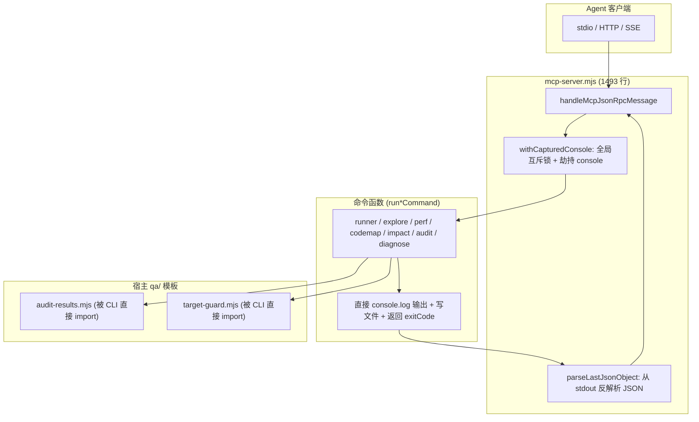
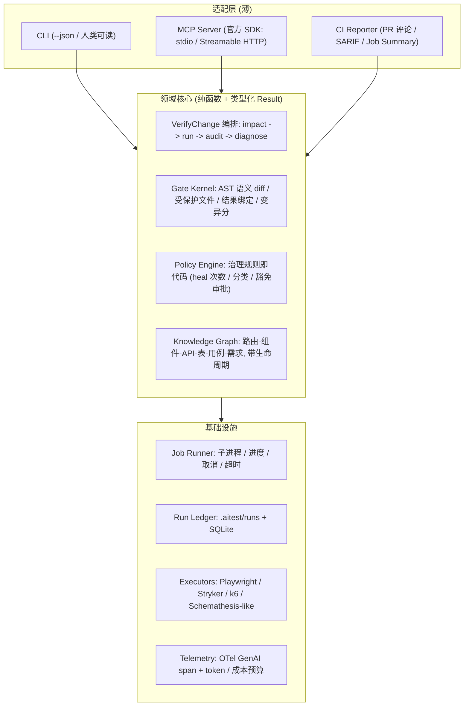

# ai-test-workbench v4.0 全面架构与代码审查报告

> [English Summary](./architecture-code-review-2026-11.en.md) · [配套优化路线图](./optimization-roadmap-2026-2027.md) · [主文档 README](../../README.md) · [AGENTS.md](../../AGENTS.md)
>
> **审查日期**：2026-11-23 · **审查对象**：`main@e43e107`（v4.0.0）· **审查口径**：围绕「AI 驱动的智能化测试工具、能跟上 AI 代码生成速度的可信验证层」这一目标，覆盖架构、协议、门禁、安全、智能化能力、工程质量与文档 7 个维度。
>
> **验收口径声明**：本报告的结论属于「**静态审查 + 本机工作台实测**」，不等于「真实业务 E2E 验收」。凡标注 **【实测】** 的问题都在本机用最小脚本复现过；标注 **【静态】** 的问题来自代码阅读，修复前应先补一条失败用例来确认。

---

## 0. 执行摘要

### 0.1 一句话结论

**方向对，护城河选得准，但实现还停在“规则写在提示词里、正则拼出来的门禁”这一层。** 项目的核心卖点是“防假绿 + 可治理自愈 + Agent 原生接口”，这是 2026 年开源 AI 测试领域少有的差异化定位。但实测发现：Healer Diff 守卫能被 8 种常见弱化手法全部绕过；性能门禁中的 LCP/CLS **永远采集不到**；诊断分类器会把后端 5xx 判成“需求歧义”。这三个问题都让“门禁本身产生假绿”。下一阶段的主题应该从“能力铺面”转向“**可信内核**”：先让每道门禁可证伪、可度量、防篡改，再往上叠智能生成。

### 0.2 评分卡（满分 5）

| 维度 | 得分 | 一句话判断 |
|---|---:|---|
| 产品定位与愿景契合 | **4.5** | “AI 写码 → 独立验证层 → 确定性回归”的两阶段模型正确，A/B/C/D 治理有真实差异化 |
| 架构分层与可演进性 | **2.5** | 命令函数直接 `console.log`，MCP 层靠劫持控制台再解析 stdout 中的 JSON，缺少领域核心层 |
| MCP 协议与 Agent 交互 | **2.5** | 三种传输都能跑通，但没有进度、取消、超时、异步任务、根目录边界和会话治理 |
| 防假绿门禁有效性 | **2.0** | 思路满分，实现是行级正则：可绕过、不防篡改、结果文件不绑定运行 |
| 安全边界 | **3.0** | 生产域名阻断与 Origin 校验到位；网络守卫是黑名单，有旁路，脱敏有漏洞 |
| 智能化能力（探索 / 地图 / 影响 / 诊断） | **2.5** | 全部是启发式正则，没有 AST、依赖图、覆盖率和历史数据，知识图谱只增不收敛 |
| 性能 / 无障碍 / 契约 | **2.0** | LCP/CLS 采集错误【实测】，axe 标签缺 WCAG 2.1，契约断言没有 Schema |
| 工程质量（测试 / CI / 类型 / 版本） | **3.0** | 40 个单测全绿，双 OS CI；但 6.4k 行 `.mjs` 没有类型检查，同步 IO 阻塞，版本号散落 |
| 文档与宣称一致性 | **3.0** | 中英双语和链接卫生门禁很好；部分宣称超过实现（如“强类型”、WCAG 2.1、LCP、只读） |

### 0.3 Top 10 必须优先处理的问题

| # | 问题 | 级别 | 证据 |
|---|---|---|---|
| F-01 | Healer Diff 守卫可被轻易绕过，且只 diff `tests/` 目录 | P0 | 【实测】8 种弱化写法全部 `ok: true` |
| F-02 | 治理文件不防篡改：`eslint.config.mjs`、`playwright.config.ts`、`aitest.config.json`、`waivers.json` 都可被 Agent 改写 | P0 | 【静态】 |
| F-03 | `results.json` 不绑定本次运行，`aitest_audit` 可能拿陈旧的绿色结果放行 | P0 | 【静态】 |
| F-04 | LCP 永远为 `null`、CLS 永远为 `0`，性能预算对这两项永不触发 | P0 | 【实测】`getEntriesByType` 返回 0 条 |
| F-05 | Explore 只读防火墙默认放行 POST；`/graphql` 默认在安全写白名单中 | P0 | 【静态】 |
| F-06 | 网络守卫只做黑名单，不限制出站域名；`page.request` / `context.request` 不经过 Proxy | P0 | 【静态】 |
| F-07 | 脱敏遗漏 JSON 形式的 `"password":"…"` 和 JWT | P0 | 【实测】 |
| F-08 | MCP 执行模型有三个缺陷：解析 stdout、全局互斥锁、无进度/取消/超时，长任务会被客户端超时杀掉 | P0 | 【静态】 |
| F-09 | MCP 的 `target` 可指向任意路径；HTTP 会话无初始化校验、不过期 | P1 | 【静态】 |
| F-10 | 诊断分类器把 5xx 守卫、网络守卫和文案断言失败统统判为 D 类 | P1 | 【实测】 |

---

## 1. 审查范围与方法

### 1.1 覆盖范围

| 层 | 文件 | 规模（行） |
|---|---|---:|
| 入口 / 编排 | [cli.mjs](../../src/cli.mjs)、[runner.mjs](../../src/runner.mjs)、[proc.mjs](../../src/proc.mjs) | ~700 |
| MCP 服务端 | [mcp-server.mjs](../../src/mcp-server.mjs) | 1493 |
| 智能化引擎 | [explore.mjs](../../src/explore.mjs)、[codemap.mjs](../../src/codemap.mjs)、[impact.mjs](../../src/impact.mjs)、[diagnose.mjs](../../src/diagnose.mjs)、[perf.mjs](../../src/perf.mjs) | ~2500 |
| 生态 / 治理 | [mcp-hub.mjs](../../src/mcp-hub.mjs)、[agents.mjs](../../src/agents.mjs)、[audit.mjs](../../src/audit.mjs) | ~950 |
| 模板（落到宿主仓库） | [audit-results.mjs](../../templates/playwright-qa/scripts/audit-results.mjs)、[target-guard.mjs](../../templates/playwright-qa/support/target-guard.mjs)、[base.ts](../../templates/playwright-qa/tests/fixtures/base.ts)、[playwright.config.ts](../../templates/playwright-qa/playwright.config.ts)、[eslint.config.mjs](../../templates/playwright-qa/eslint.config.mjs) | ~1100 |
| 质量 / 文档 | `test/*.test.mjs`（10 个文件）、[ci.yml](../../.github/workflows/ci.yml)、[check-docs-and-hygiene.mjs](../../scripts/check-docs-and-hygiene.mjs)、README / AGENTS / ARCHITECTURE / 蓝图 / SKILL | — |

### 1.2 本机实测记录

| 实测项 | 命令 / 方法 | 结果 |
|---|---|---|
| 单元测试 | `npm test`（Node 26.11.0） | 40 / 40 通过 |
| LCP/CLS 采集方式 | 用模板内 Playwright 打开含大标题和图片的页面，分别用 `getEntriesByType` 和 `PerformanceObserver({buffered:true})` 读取 | `getEntriesByType('largest-contentful-paint')=0`、`layout-shift=0`；`PerformanceObserver` 取到 1 条 |
| 脱敏 | `redactSecrets('{"password":"abc123","accessToken":"eyJ…"} url=…?token=zzz')` | 只有 URL 里的 `token` 被脱敏，JSON 里的密码和 JWT **原样输出** |
| 诊断分类 | 用 `suggestFailureCategory()` 测 5xx 守卫、网络守卫、`toHaveText` 不匹配三种报错 | 三种都判为 `D (low)` |
| Healer Diff 守卫 | 构造 8 种弱化 diff，交给 `analyzeHealerDiffText()` | `{ ok: true, violations: [] }` |

---

## 2. 定位与愿景对齐评估

### 2.1 已经做对的（应当保留并强化）

1. **两阶段模型**：AI 只在创作和自愈阶段介入，回归阶段零 LLM、可确定性复现。这和业界“AI 跑一次、之后确定性重放”的共识一致（Stagehand 动作缓存、Magnitude、Bug0），而且本项目的产物本身就是可审查的 Playwright 代码，比缓存“意图”更透明。
2. **A/B/C/D 失败定责**：官方 Playwright Healer 的默认策略是“修不好就 `test.fixme()`”。本项目明确规定“C 类保持红灯”，这是开源界少见、也最契合“测试要能跟上 AI 写码速度、又不被 AI 糊弄”这一目标的设计。
3. **Agent 优先 + CLI 对等**：MCP 工具和 CLI `--json` 一一对应。Midscene、`playwright-cli` 等项目在 2025–2026 年从纯 MCP 转向“Skills + CLI”，说明 MCP + CLI + SKILL.md 三通道是对的。
4. **默认拒绝的目标守卫**：`TEST_ENV=prod` 硬阻断、禁止通配符白名单、`@mutation` 策略排除（单独计数，不算进 passed）、零用例执行即失败。这些“不让绿灯说谎”的细节扎实。
5. **跨项目隔离**：`<repo>/qa/` 独立依赖和锁文件，不污染宿主构建。官方 agents 文件按 SHA-256 清单合并，用户手改的部分不会被覆盖。
6. **文档卫生门禁**：中英配对、相对链接校验、内部信息泄漏扫描。这在开源项目里属于领先实践。

### 2.2 与愿景的核心差距

愿景是“**能跟上 AI 代码生成的测试工具**”。拆开来看，需要具备四种能力：

| 能力 | 期望 | 现状 | 差距 |
|---|---|---|---|
| **快**：给出判决的速度跟得上 Agent 的提交频率 | 秒级到分钟级拿到可信的“变更判决” | Impact 只靠文件名启发式，不确定时退回全量；没有历史耗时和失败数据 | 缺依赖图、覆盖率映射和历史账本 |
| **准**：绿灯真的代表正确 | 门禁可证伪，并能度量测试强度 | 门禁是行级正则；没有变异分；性能和无障碍门禁本身有采集错误 | 缺语义级守卫和测试充分性度量 |
| **稳**：不被 Agent 篡改，不被注入 | 治理文件防篡改；判决有不可伪造的证据 | 治理规则写在提示词里，Agent 可改配置和豁免文件 | 缺策略引擎、受保护文件和运行证明 |
| **会学**：越测越懂系统 | 知识图谱能收敛，能驱动用例补齐 | 图谱只增不减，缺陷不会关闭，动态路由丢失 | 缺生命周期管理和 AST 级索引 |

---

## 3. 架构审查

### 3.1 现状架构（实际调用关系）



### 3.2 架构级问题

| ID | 问题 | 影响 | 建议 |
|---|---|---|---|
| **A-01** | **缺少领域核心层**。所有 `run*Command` 都把“业务计算、副作用、展示”混在一起，结果通过 `console.log` 输出。MCP 层只能劫持 `console` 再从 stdout 里反解析最后一段 JSON（[mcp-server.mjs#L635-L695](../../src/mcp-server.mjs#L635-L695)、[#L877-L912](../../src/mcp-server.mjs#L877-L912)）。 | `aitest_run` 没有 JSON 输出，`data` 只剩一段原始日志（[runner.mjs#L49-L175](../../src/runner.mjs#L49-L175)）；任何多余的日志行都可能破坏解析；所谓“强类型 outputSchema”实际是 `data: {additionalProperties: true}`（[#L42-L54](../../src/mcp-server.mjs#L42-L54)） | 引入 **Core Service 层**：每个能力返回带版本的 `Result<T>` 对象（JSON Schema / zod 定义），CLI 和 MCP 都只做渲染。详见路线图 R0-3 |
| **A-02** | **进程内全局状态**：`process.env.AITEST_MCP_CAPTURED_STDIO` 和全局 `console` 被运行时改写（[#L651-L695](../../src/mcp-server.mjs#L651-L695)），并靠全局 Promise 链串行化 | 所有 `tools/call` 被强制串行：一个 10 分钟的 `aitest_run` 会阻塞所有其他工具调用；在 HTTP 多会话模式下，不同客户端互相阻塞 | 核心层不写 console，日志走结构化 logger（按 requestId 隔离）；长任务进入 **Job Runner**（子进程或 worker） |
| **A-03** | **模板与 CLI 双向耦合**：CLI 直接 `import '../templates/playwright-qa/scripts/audit-results.mjs'`（[audit.mjs#L4-L14](../../src/audit.mjs#L4-L14)）。宿主 `qa/` 里也有一份拷贝，两份会随版本漂移 | 已初始化的宿主仓库无法得到门禁修复；门禁逻辑同时存在于 npm 包和宿主仓库两处 | 把门禁内核做成独立包（例如 `@ai-test-workbench/gate`），宿主模板只保留一行薄壳调用，并用 `aitest doctor` 检查版本漂移 |
| **A-04** | **同步阻塞 IO**：`spawnSync` 运行 tsc 和 eslint（[audit-results.mjs#L339-L364](../../templates/playwright-qa/scripts/audit-results.mjs#L339-L364)），codemap 同步全量递归扫描（[codemap.mjs#L29-L48](../../src/codemap.mjs#L29-L48)） | 在 MCP 服务端进程里会冻结事件循环：心跳停发，`ping` 无响应，HTTP 会话也被卡住 | 改为异步 `spawn`，扫描放进 worker 线程，并加增量缓存（按 mtime 和内容哈希） |
| **A-05** | **没有运行账本（Run Ledger）**：每次运行都覆盖 `reports/results.json`，历史只有 code-map 里一条 30 行的 `history` | 无法计算 flaky 率、失败趋势、耗时排序，也做不到“基于历史的测试选择”；审计无法确认读到的结果属于哪一次运行（F-03） | 新增 `.aitest/runs/<runId>/manifest.json`（git SHA、命令、环境指纹、开始/结束时间、结果文件哈希）+ 一个 SQLite 或 JSONL 索引 |
| **A-06** | **治理规则停在提示词层**：“单用例最多 3 轮”“A 类才允许修”“修完必过 diff 守卫”都只写在 [healer.md](../../prompts/healer.md) / SKILL 里，工具层不强制 | Agent 违规时没有任何机器拦截；无法度量“误修率” | 用 **Policy Engine + Heal Session 工具**落地：有状态的会话记录尝试次数、分类和证据，越界即拒绝（路线图 R1-4） |
| **A-07** | **版本号散落硬编码**：MCP `serverInfo.version='4.0.0'`（[#L26-L29](../../src/mcp-server.mjs#L26-L29)），code-map `version:'3.0'`（[codemap.mjs#L566](../../src/codemap.mjs#L566)），模板 `package.json` 是 `2.0.0` | 客户端看到的版本和实际不一致；code-map 无法做 schema 迁移 | 版本统一从 `package.json` 读取；每种产物 schema 单独带 `schemaVersion`，并提供迁移函数 |

### 3.3 目标架构（建议）



---

## 4. 分维度审查

### 4.1 MCP 协议与 Agent 交互层

| ID | 问题 | 级别 | 证据 | 建议 |
|---|---|---|---|---|
| M-01 | **没有进度通知和取消处理**：所有 `notifications/*` 都直接丢弃（[#L1043-L1049](../../src/mcp-server.mjs#L1043-L1049)），包括 `notifications/cancelled`；`aitest_run` 期间不发送 `notifications/progress` | P0 | 【静态】 | 支持 `_meta.progressToken`，按 Playwright reporter 事件推送进度；收到取消通知后终止子进程树 |
| M-02 | **长任务会被客户端超时杀掉**：许多 MCP 客户端的工具调用默认超时只有几十秒到几分钟（具体数值因客户端而异）；`runPlaywright` 本身也没设 `timeoutMs`（[runner.mjs#L131](../../src/runner.mjs#L131)） | P0 | 【静态】 | 采用**异步任务模式**：`aitest_run` 立即返回 `jobId`，再用 `aitest_job_status` / `aitest_job_result` 查询；如果客户端协商支持 MCP Tasks 能力（2025-11-25 规范中的实验特性），就走 Tasks |
| M-03 | **全局串行**：见 A-02 | P0 | 【静态】 | 只读工具（report / impact / audit-static）可以并发；写工具按 `qaDir` 粒度加锁，而不是全局锁 |
| M-04 | **`target` 无边界**：任意绝对路径都可以作为 `target`（[#L738](../../src/mcp-server.mjs#L738)），资源模板 `aitest://project/{target}/…` 可读任意目录下的 qa 产物（[#L972-L976](../../src/mcp-server.mjs#L972-L976)）；HTTP 模式下远程客户端可以让服务在任意位置执行 `init` 写文件 | P1 | 【静态】 | 支持 MCP **roots** 能力并配置 `--workspace-root` 白名单；HTTP 模式下禁止不在白名单内的 target |
| M-05 | **Streamable HTTP 会话治理缺失**：任何不带或带未知 `Mcp-Session-Id` 的 POST 都会新建会话（[#L1366-L1370](../../src/mcp-server.mjs#L1366-L1370)），不校验是否先调用了 `initialize`，会话永不过期；`DELETE` 未知会话也返回 200；不校验请求头 `MCP-Protocol-Version` | P1 | 【静态】 | 只有 `initialize` 能创建会话；未知会话按规范返回 404；设置 TTL 和最大会话数；校验协议版本头 |
| M-06 | **工具注解与行为不一致**：`aitest_explore` 标为 `readOnlyHint: true`（[#L114-L119](../../src/mcp-server.mjs#L114-L119)），实际会改写 `impact-map.json`（[explore.mjs#L642](../../src/explore.mjs#L642) 默认同步影响图）；`aitest_diagnose` / `aitest_perf` 也标为只读，但会写报告 | P1 | 【静态】 | 按“是否修改本地工作区”如实标注；只读工具只返回内容，写文件改由显式参数开启 |
| M-07 | **输出不省 token**：`aitest_run` 把完整的 list reporter 日志放进 `data.output`，同时 `content[0].text` 又重复一份完整 JSON（[#L914-L925](../../src/mcp-server.mjs#L914-L925)） | P1 | 【静态】 | 返回精简判决（计数、前 N 个失败的 `file:line` 和一句话错误），大产物用 `resource_link` 引用；提供 `verbosity` 参数 |
| M-08 | **Schema 与实现不一致**：`maxPages` 的 schema 上限是 200（[#L127](../../src/mcp-server.mjs#L127)），实现会截到 100（[explore.mjs#L283](../../src/explore.mjs#L283)） | P2 | 【静态】 | 从同一份常量生成 schema 和校验逻辑 |
| M-09 | **安全细节**：Bearer Token 用 `!==` 比较，不是常量时间（[#L1273](../../src/mcp-server.mjs#L1273)）；`/health` 不鉴权就暴露版本号；JSON-RPC 批量请求在 2025-06-18 版规范中已移除，但服务端对所有版本都接受 | P2 | 【静态】 | 改用 `crypto.timingSafeEqual`；`/health` 在非回环地址上也要求鉴权；按协商出的协议版本决定是否接受批量请求 |
| M-10 | **自研协议栈**：零依赖手写了三种传输。好处是可控、包体小；代价是 elicitation、sampling、OAuth、Tasks、`resource_link` 等新特性都要自己追 | P2 | 架构判断 | 建议传输层迁移到官方 `@modelcontextprotocol/sdk`，工具定义保持自有，用适配器隔离 |

### 4.2 防假绿门禁（项目的核心护城河）

**实测：下面这段 diff 交给 Healer Diff 守卫，返回 `{ ok: true, violations: [] }`。**

```diff
-  await expect(page.getByRole('status')).toHaveText('Order saved: #1024');
+  await expect(page.locator('body')).toBeVisible();          // 断言弱化，但断言数量不变
-  await expect(res.status()).toBe(201);
+  expect(true).toBe(true);                                    // 恒真断言
+  test.fail();                                                // 把预期反转，失败也算通过
+  await page.click('#save').catch(() => null);                // 吞掉异常（正则只认 () => {}）
+  test.describe.configure({ retries: 5 });                    // 用重试掩盖问题
+  await expect.soft(page.getByText('Total')).toHaveText('99'); // 软断言
diff --git a/playwright.config.ts b/playwright.config.ts
+  testIgnore: ['**/checkout.spec.ts'],                        // 直接把用例排除掉
diff --git a/eslint.config.mjs b/eslint.config.mjs
+      'playwright/no-skipped-test': 'off',                    // 关掉静态门禁
```

| ID | 问题 | 级别 | 证据 | 建议 |
|---|---|---|---|---|
| G-01 | **行级正则只数断言个数，不看断言强度**：`toHaveText` → `toBeVisible`、具体值 → 恒真值、`expect` → `expect.soft`、`test.fail()`、`retries`、`.catch(() => null)` 都识别不出来（[audit-results.mjs#L389-L467](../../templates/playwright-qa/scripts/audit-results.mjs#L389-L467)） | P0 | 【实测】 | 改为 **AST 语义 diff**（TypeScript Compiler API / ts-morph）：给 matcher 定义强度等级（`toEqual/toHaveText(精确) > toContainText > toBeVisible > toBeTruthy`），检测强度下降、恒真断言、`test.fail`、`.soft`、`retries`、`timeout` 膨胀、`try/catch` 包裹断言 |
| G-02 | **只 diff `tests/` 目录**（[#L469-L476](../../templates/playwright-qa/scripts/audit-results.mjs#L469-L476)）：改 `playwright.config.ts`（`testIgnore`/`grep`/`retries`）、`eslint.config.mjs`、`aitest.config.json`（例如加 `assertFunctionNames: ['*']` 或调高 `maxFlaky`）、`waivers.json`、`support/`、`fixtures/` 都看不到；`git diff <ref>` 也不包含新建的未跟踪文件 | P0 | 【静态】 | 维护 **受保护文件清单 + 哈希锁**（`.aitest/governance.lock`），任何变更都必须带人类审批记录（CODEOWNERS / 签名提交 / PR 标签）；diff 时把未跟踪文件也算进去 |
| G-03 | **豁免可被 Agent 自批**：`waivers.json` 只校验字段齐全和是否过期（[#L35-L82](../../templates/playwright-qa/scripts/audit-results.mjs#L35-L82)），任何人（包括 Agent）都能新增一条 30 天有效的豁免 | P0 | 【静态】 | 豁免必须带 `approvedBy` 和关联的 issue / Trace-ID；新增豁免会触发 G-02 的受保护文件审批；设置最长有效期（例如 14 天）并统计豁免总量 |
| G-04 | **结果不绑定运行**：审计直接读 `reports/results.json`（[#L493-L546](../../templates/playwright-qa/scripts/audit-results.mjs#L493-L546)），不校验这份结果是不是本次运行、本次代码产生的 | P0 | 【静态】 | 由 Run Ledger 记录 `runId`、git SHA、工作区哈希和 `results.stats.startTime`，审计时校验一致；不一致即失败 |
| G-05 | **`assertFunctionNames` 通配过宽**：`verify*` 会把任何 `verifyXxx()` 都算作断言（[aitest.config.json](../../templates/playwright-qa/aitest.config.json)），写一个空的 `verifyNothing()` 就能通过 `expect-expect` | P1 | 【静态】 | 自定义断言 helper 必须在清单里登记，并用 AST 确认其内部真的调用了 `expect` |
| G-06 | **只有“有断言”门禁，没有“断言有效”门禁**：没有任何测试充分性度量 | P1 | 设计缺口 | 引入**变更范围内的增量变异测试**（Stryker），作为第四层门禁（见路线图 R2-1） |
| G-07 | **flaky 只看单次运行**：没有历史 flaky 率，也没有隔离区（quarantine）机制 | P1 | 设计缺口 | 依托 Run Ledger 统计 flaky 率，建立带期限的自动隔离与解除流程；识别 Playwright isolated retries 产生的信号 |
| G-08 | `policyExcludedMutations` 可能重复计数：文件扫描提示 + 结果中被跳过的 `@mutation` 用例会各算一次（[#L170](../../templates/playwright-qa/scripts/audit-results.mjs#L170)、[#L196-L199](../../templates/playwright-qa/scripts/audit-results.mjs#L196-L199)） | P2 | 【静态】 | 以 `file:line` 为键去重 |

### 4.3 安全与目标防护

| ID | 问题 | 级别 | 证据 | 建议 |
|---|---|---|---|---|
| S-01 | **Explore 默认放行 POST**：只拦截路径命中 `create\|add\|save…` 的 POST（[explore.mjs#L18-L19](../../src/explore.mjs#L18-L19)、[#L346-L355](../../src/explore.mjs#L346-L355)）。GraphQL `mutation`、`/api/order/cancel`、`/api/setStatus`、RPC 风格接口都能放行 | P0 | 【静态】 | Explore 改为**默认拒绝所有非 GET/HEAD 请求**；只放行显式白名单（search/list/query）；检查 GraphQL 请求体，遇到 `mutation` 就拦截；同时覆盖 WebSocket 和 `sendBeacon` |
| S-02 | **`/graphql` 默认在 `TEST_SAFE_WRITE_PATHS` 中**（[base.ts#L48-L50](../../templates/playwright-qa/tests/fixtures/base.ts#L48-L50)、[target-guard.mjs#L249](../../templates/playwright-qa/support/target-guard.mjs#L249)），strict-readonly 模式下所有 GraphQL 变更都畅通 | P0 | 【静态】 | 从默认值中移除 `/graphql`；需要时按 operationName 粒度放行 |
| S-03 | **出站是黑名单而不是白名单**：`page.route` 只拦截 `TEST_DENIED_ORIGINS` 和危险端点规则（[base.ts#L157-L166](../../templates/playwright-qa/tests/fixtures/base.ts#L157-L166)）。用例执行 `page.goto('https://任意生产域名')` 不会被拦 | P0 | 【静态】 | 增加 `TEST_EGRESS_MODE=allowlist`：只允许 `TEST_ALLOWED_HOSTS` 和显式登记的第三方域名（CDN 等）；新初始化项目默认开启 |
| S-04 | **API 守卫有旁路**：只有 `request` fixture 套了 Proxy（[base.ts#L104-L108](../../templates/playwright-qa/tests/fixtures/base.ts#L104-L108)）；`page.request`、`context.request`、`playwright.request.newContext()` 都不经过它，而且按 Playwright 文档的说明，`page.route` 也不拦截 APIRequestContext 发出的请求（落地时需用用例确认） | P0 | 【静态】 | 用 fixture 覆盖 `context` 和 `page`，对 `.request` 统一包装；ESLint 增加自定义规则禁止 `request.newContext()` 绕过 |
| S-05 | **脱敏有漏洞**：JSON 键值对（`"password":"x"`）、JWT（`eyJ…`）、`Set-Cookie` 之外的 Cookie 片段都没有覆盖（[proc.mjs#L13-L31](../../src/proc.mjs#L13-L31)） | P0 | 【实测】 | 增加 JSON 键匹配、JWT 识别、高熵串检测；用一组“脱敏攻防样本”做单测基线 |
| S-06 | **第三方 MCP 预设没有锁版本**：`chrome-devtools-mcp@latest`、`npx -y …`、`uvx …` 都没有版本号（[mcp-hub.mjs#L7-L155](../../src/mcp-hub.mjs#L7-L155)）；`@modelcontextprotocol/server-postgres` 已归档，社区报告过它的只读事务能被绕过 | P1 | 【静态】 | 锁定版本并记录哈希；`mcp doctor` 对工具描述做哈希锁定和漂移告警（参考 mcp-scan 的思路）；强调**真正的只读保障必须在数据库角色层面实现**，换用维护中的只读 DB MCP |
| S-07 | **`readonly: true` 标注失真**：`k6`（会施压）、`chrome-devtools`（能执行任意 JS）、`playwright-test`（generator 会写文件）都标为只读 | P1 | 【静态】 | 标注改为三档 `riskLevel: read / local-write / remote-effect`，并在 doctor 中展示 |
| S-08 | 生产域名识别只匹配 `(^|\.)(prod\|production)\.`（[target-guard.mjs#L138](../../templates/playwright-qa/support/target-guard.mjs#L138)）；按设计本来就主要依赖白名单，属可接受 | P2 | 【静态】 | 文档中明确：白名单是唯一可信边界，域名识别只是兜底 |

### 4.4 Diff-Impact 测试选择

| ID | 问题 | 级别 | 证据 | 建议 |
|---|---|---|---|---|
| I-01 | **没有依赖图**：靠 impact-map 规则加文件名词干的子串匹配（[impact.mjs#L174-L189](../../src/impact.mjs#L174-L189)）。改了被多个页面引用的组件 `CourseCard.vue`，只会选中名字里带 `coursecard` 的用例，**漏选（假阴性）**其他引用者 | P1 | 【静态】 | 用 TS/Vue 的 import 图（dependency-cruiser 或 TS Program）求反向传递闭包，映射到路由，再映射到用例 |
| I-02 | **没有运行时覆盖映射**：无法知道“哪条用例实际执行到了哪些文件” | P1 | 设计缺口 | 采集**按用例的覆盖率**：前端用 V8 `page.coverage` / Istanbul，后端用 OTel span 的 `code.filepath`，按用例写入 Ledger，形成“文件 → 用例”的实测映射 |
| I-03 | **选择结果不可解释、不可度量**：只输出 `reason` 字符串；漏选率从未度量过 | P1 | 设计缺口 | 每个被选中的用例附带选择理由（规则 / 依赖链 / 覆盖率 / 历史失败）；Nightly 全量运行时回算“如果当时只跑 impact 选集，会漏掉哪些失败”，得到 **Impact Recall** 指标 |
| I-04 | 启发式白名单过宽：`auth\|store\|router…` 出现在路径任意位置就退回全量（[#L6-L16](../../src/impact.mjs#L6-L16)），对大仓库来说全量回退率可能偏高 | P2 | 【静态】 | 依赖图到位后，基础设施判定改用“入度 / 被引用数”阈值 |

### 4.5 0→1 探索（Explore）

| ID | 问题 | 级别 | 证据 | 建议 |
|---|---|---|---|---|
| E-01 | **只爬链接，不交互**：通过 `a[href]` 和 Vue Router 内省发现页面（[#L480-L510](../../src/explore.mjs#L480-L510)）。React / Angular 路由、没有 href 的按钮菜单、Tab、弹窗、抽屉都发现不了 | P1 | 【静态】 | 升级为**状态图探索**：以 ARIA 快照哈希作为状态节点，只对分类为“只读”的控件做有界 BFS；记录“动作 → 状态迁移”，作为 Planner 的输入 |
| E-02 | **偏向特定技术栈**：选择器里大量 Element UI / Ant Design / Vuex 的硬编码（[#L437](../../src/explore.mjs#L437)、[#L460-L475](../../src/explore.mjs#L460-L475)、[#L513-L531](../../src/explore.mjs#L513-L531)） | P2 | 【静态】 | 做成插件化的 **Stack Adapter**（vue2 / vue3 / react / next / angular），通用层只依赖 ARIA 树 |
| E-03 | **给 LLM 的上下文不够好**：产出的是统计表格，而不是 `ariaSnapshot()`。Planner 最需要的是 ARIA 结构和交互可供性 | P1 | 【静态】 | 每个页面保存脱敏后的 `ariaSnapshot` 和截图缩略图，生成 `specs/pages/<route>.md` |
| E-04 | 自身用了 `waitForTimeout(450)` 和 `.catch(() => {})`（[#L433-L446](../../src/explore.mjs#L433-L446)）。这些写法正是项目在门禁里禁止的 | P2 | 【静态】 | 改为 `networkidle` 加骨架屏消失两个条件，带超时，并记录等待原因 |
| E-05 | 没有复用 `target-guard` 的 `TEST_BLOCKED_ENDPOINTS` 和 `TEST_DENIED_ORIGINS`，违背了“单一真源”原则 | P1 | 【静态】 | Explore 的防火墙直接复用 `checkOutgoingRequestSafety`，再叠加更严格的只读策略 |

### 4.6 活体代码地图（Living Code Map）

| ID | 问题 | 级别 | 证据 | 建议 |
|---|---|---|---|---|
| K-01 | **缺陷不收敛**：`upsertDefect` 只会置为 `open`，没有关闭逻辑（[codemap.mjs#L330-L339](../../src/codemap.mjs#L330-L339)）；每次 `map` / `run` 都重新读取上次 explore 的 `system-topology.json` 并重新 upsert，`seenCount` 随运行次数虚增（[#L502-L531](../../src/codemap.mjs#L502-L531)） | P1 | 【静态】 | 每条观测附带来源快照 ID（exploreRunId）；同一快照只计一次；下一次探索中没再出现的缺陷标为 `resolved-candidate`，连续 N 次不出现就关闭 |
| K-02 | **路由和覆盖关系只增不减**：删掉的路由、删掉的用例仍留在 `routes` / `coveringSpecs` 里（[#L364](../../src/codemap.mjs#L364)、[#L463](../../src/codemap.mjs#L463)），覆盖率分母被污染 | P1 | 【静态】 | 每次同步都以本次的静态索引为准重建，运行态信息挂上 `lastSeenAt`，过期后降级 |
| K-03 | **动态路由丢失**：路由正则排除了 `:`（[#L104](../../src/codemap.mjs#L104)），Next.js `[id]` 段被删掉（[#L89-L91](../../src/codemap.mjs#L89-L91)），Pages Router 直接跳过动态路由（[#L97](../../src/codemap.mjs#L97)）。而 `/users/:id` 这类详情页恰恰是测试重点 | P1 | 【静态】 | 保留参数化模式（`/users/:id`），运行态 URL 反向归一到模式 |
| K-04 | **数据表关联是子串匹配**：表 `user` 会挂到所有含 `user` 的路由上（[#L454-L457](../../src/codemap.mjs#L454-L457)） | P2 | 【静态】 | 改为“接口 → Controller → Repository / Mapper → 表”的 AST 链路，匹配不到就留空，不要猜 |
| K-05 | **扫描上限静默截断**：`MAX_SCAN_FILES=2000`（[#L26](../../src/codemap.mjs#L26)），大仓库会被悄悄截断，也不告警 | P2 | 【静态】 | 输出 `truncated: true` 和告警；支持 `include` / `exclude` 配置和增量索引 |
| K-06 | **每次 run 都让 revision 自增并改写文件**（[runner.mjs#L134-L143](../../src/runner.mjs#L134-L143)），如果 `knowledge/` 纳入 Git，会产生大量噪声 diff | P2 | 【静态】 | 内容哈希没变就不写；`history` 按天聚合 |

### 4.7 诊断与 Healer 治理

| ID | 问题 | 级别 | 证据 | 建议 |
|---|---|---|---|---|
| D-01 | **分类器漏判**：`[Same-Origin 5xx Guard]`、`[Network Guard]`、`toHaveText` 期望不符都落入 D 类（[diagnose.mjs#L36-L76](../../src/diagnose.mjs#L36-L76)） | P1 | 【实测】 | 优先使用结构化信号：`workbench-runtime-guard.json` 中的 `serverErrors` → C、`blockedRequests` → B 或 A（测试设计问题）、locator 超时 → A；规则表做成数据驱动，并维护一份带标签的失败样本库，用来度量分类准确率 |
| D-02 | **Trace-ID 只被动捕获，不主动注入**：只从响应头里收集（[base.ts#L146-L182](../../templates/playwright-qa/tests/fixtures/base.ts#L146-L182)）；生成 Loki 查询时用的是整串 `traceparent`（[diagnose.mjs#L209](../../src/diagnose.mjs#L209)），而日志里通常只记录 32 位的 trace-id | P1 | 【静态】 | 每个用例生成 W3C `traceparent` 并通过 `extraHTTPHeaders` 注入，把 testId 和 traceId 的对应关系写入 Ledger；查询语句只用 trace-id 段 |
| D-03 | **只给建议，不闭环**：诊断结果不会进入一个有状态的 Healer 会话，修复的有效性也不做事后统计 | P1 | 设计缺口 | 增加 `aitest_heal_begin / attempt / conclude` 工具（见路线图 R1-4） |
| D-04 | 没有 base 对 head 的对比证据：无法回答“这个失败是本次变更引入的，还是早就存在” | P1 | 设计缺口 | 引入 Meticulous 式的 **base / head 双跑**，对比 ARIA 快照、截图和 API 响应（见路线图 R2-5） |

### 4.8 性能、无障碍与契约

| ID | 问题 | 级别 | 证据 | 建议 |
|---|---|---|---|---|
| P-01 | **LCP 和 CLS 采集错误**：这两类条目不会进入 Performance Timeline，`getEntriesByType` 读不到（[perf.mjs#L180-L183](../../src/perf.mjs#L180-L183)），结果是 LCP 恒为 `null`、CLS 恒为 0，预算永远不会触发 | P0 | 【实测】 | 用 `addInitScript` 在页面加载前注册 `PerformanceObserver({type, buffered:true})`；新增 INP（交互时延）采集；补一条回归单测 |
| P-02 | **单样本、无节流、无基线**：每个路由只测一次，没有 CPU / 网络节流，冷热缓存也不区分（[#L154-L173](../../src/perf.mjs#L154-L173)） | P1 | 【静态】 | 每个路由跑 N 次取中位数和 P75；可选启用 CDP 节流；和 Ledger 中的历史基线做**相对回归判定**（例如回退超过 15% 且超过噪声带才判失败） |
| P-03 | **axe 标签缺 WCAG 2.1**：`withTags(['wcag2a','wcag2aa','wcag22aa'])` 少了 `wcag21a` 和 `wcag21aa`（[base.ts#L275](../../templates/playwright-qa/tests/fixtures/base.ts#L275)），和 README 宣称的“WCAG 2.0/2.1/2.2 A/AA”不符 | P0 | 【静态】 | 补上这两个标签，并加单测锁定标签集合 |
| P-04 | **契约断言没有 Schema**：`expectApiContract` 只校验状态码和一个可选回调（[base.ts#L292-L306](../../templates/playwright-qa/tests/fixtures/base.ts#L292-L306)） | P1 | 【静态】 | 读取 OpenAPI 后用 Ajv 校验响应；提供基于 OpenAPI 的属性测试（fast-check：幂等、分页一致、鉴权隔离） |

### 4.9 工程质量

| ID | 问题 | 级别 | 建议 |
|---|---|---|---|
| Q-01 | 6.4k 行 `.mjs` 没有任何类型检查 | P1 | 先在 `src/` 开启 `// @ts-check` 加 `tsc --checkJs`（成本低），中期迁移到 TS |
| Q-02 | 单测偏向“正常路径”：守卫绕过、脱敏、分类准确率、LCP 这类“对抗性”和“正确性”用例缺失 | P1 | 建立 **对抗性测试集**（`test/adversarial/`）：diff 绕过样本、脱敏样本、分类样本，作为门禁自身的回归基线 |
| Q-03 | 门禁本身没有度量（检出率、误报率） | P1 | 建一个**带种子缺陷的基准仓库**（`bench/`），每个版本都产出门禁指标（见路线图 R3-1） |
| Q-04 | CI 只跑 Node 24；`engines` 声明的是 `>=22.12` | P2 | CI 矩阵增加 Node 22 和 26 |
| Q-05 | `cli.mjs` 用 `strict: false` 解析参数，拼错的参数会被静默忽略 | P2 | 开启 strict，未知参数报错并给出建议 |
| Q-06 | 语言默认值不一致：CLI 在没有显式参数时回落到 `en`，MCP 默认 `zh` | P2 | 统一由 `detectLang` 决定 |

### 4.10 文档与宣称一致性

| 宣称 | 实际 | 建议 |
|---|---|---|
| “12 个强类型 MCP 工具” | `data` 是任意对象，`aitest_run` 没有结构化数据 | 完成 A-01 之前，把措辞改为“统一信封结构” |
| “WCAG 2.0/2.1/2.2 A/AA” | 缺 2.1 的标签 | 修复 P-03 |
| “CDP Web Vitals（LCP/CLS）” | LCP/CLS 采集无效 | 修复 P-01 |
| “严格只读 0→1 巡检” | POST 默认放行，`readOnlyHint` 却会写影响图 | 修复 S-01 和 M-06 |
| “Healer Diff 守卫拦截删减断言” | 只拦“净数量下降”，拦不住弱化 | 修复 G-01，并在文档里说明守卫的能力边界 |

> 建议在 `npm run lint:docs` 之外新增 **“宣称—测试”对照表**（`docs/claims.json`）：README 中每一条能力宣称都绑定至少一个自动化测试 ID，CI 校验这些测试存在且通过。这是让文档“可证伪”的低成本做法。

---

## 5. 问题总表（按优先级）

| ID | 模块 | 级别 | 标题 | 对应路线图 |
|---|---|---|---|---|
| G-01 | Gate | P0 | Diff 守卫行级正则可绕过 | R1-1 |
| G-02 | Gate | P0 | 治理文件无哈希锁、无审批 | R0-1 |
| G-03 | Gate | P0 | 豁免可被 Agent 自批 | R0-1 |
| G-04 | Gate | P0 | 结果不绑定运行 | R0-2 |
| P-01 | Perf | P0 | LCP/CLS 采集错误 | R0-4 |
| P-03 | A11y | P0 | axe 缺 WCAG 2.1 标签 | R0-4 |
| S-01/S-02 | Safety | P0 | Explore 与 GraphQL 写操作放行 | R0-5 |
| S-03/S-04 | Safety | P0 | 出站黑名单与 API 旁路 | R0-5 |
| S-05 | Safety | P0 | 脱敏漏洞 | R0-5 |
| M-01/M-02/M-03 | MCP | P0 | 无进度、取消、超时，且全局串行 | R0-3 |
| A-01/A-02 | Arch | P0→P1 | 缺领域核心层，依赖全局状态 | R0-3 / R1-0 |
| M-04/M-05 | MCP | P1 | target 无边界，会话治理缺失 | R0-3 |
| M-06/M-07 | MCP | P1 | 注解失真，输出不省 token | R1-0 |
| D-01/D-02/D-03 | Diagnose | P1 | 分类漏判、Trace 未注入、无闭环 | R1-3 / R1-4 |
| K-01..K-03 | CodeMap | P1 | 不收敛、不剪枝、丢动态路由 | R1-5 |
| I-01..I-03 | Impact | P1 | 无依赖图、无覆盖映射、无召回度量 | R2-2 |
| E-01/E-03/E-05 | Explore | P1 | 只爬链接、上下文差、未复用守卫 | R2-4 |
| G-05..G-07 | Gate | P1 | 断言名通配过宽、无充分性度量、无 flaky 历史 | R1-1 / R2-1 / R1-2 |
| S-06/S-07 | Hub | P1 | 预设未锁版本、风险标注失真 | R1-6 |
| P-02/P-04 | Perf / Contract | P1 | 单样本、无 Schema | R2-6 |
| A-03..A-07 | Arch | P1/P2 | 模板耦合、同步 IO、无账本、版本散落 | R0-2 / R1-0 |
| Q-01..Q-06 | Eng | P1/P2 | 类型、对抗测试、基准、CI 矩阵 | R0-6 / R3-1 |

---

## 6. 结论与下一步

1. **先“修门禁”，再“加智能”**：P0 问题里有 7 条属于“门禁自身产生假绿”。在 AI 写码的场景里，一个会说谎的门禁比没有门禁更危险，因为 Agent 和人都会信任它。
2. **把治理从提示词迁到代码**：A/B/C/D 分类、3 次修复上限、豁免审批、受保护文件，都应该由 MCP 工具层**强制执行**，并留下可审计的证据链。
3. **建立度量闭环**：没有基准就无法收敛。路线图第 3 阶段的“带种子缺陷的基准仓库 + 门禁指标”应提前到第 1 阶段启动，作为所有后续优化的验收标尺。
4. 详细的分阶段实施方案、验收标准与度量指标见 **[优化路线图](./optimization-roadmap-2026-2027.md)**。
