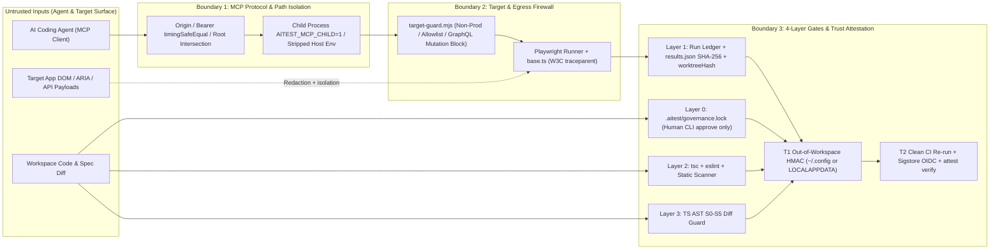
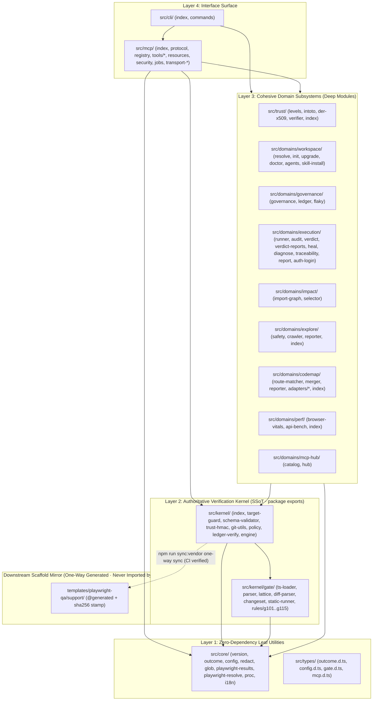

# AI Test Workbench v6.0.0 Architectural Refactor Assessment & Plan (Stage 0)

> [简体中文版本](./v6-refactor-assessment.md) · [README](../../README.en.md) · [Governance & 4-Layer Gates](../../docs/governance.en.md) · [Real-World FPR Pilot Summary](../../bench/real-world/results/SUMMARY.en.md) · [Upgrade Guide](../../docs/upgrade.en.md)

- **Baseline Version**: `ai-test-workbench@5.1.1` (branch `refactor/v6`, branched from `main@3d0c657`)
- **Assessment Date**: `2026-11-24`
- **Stage Status**: **Stage 0 Complete (Paused for confirmation before executing Stages 1..N)**
- **Epistemic Discipline**: Every metric below explicitly distinguishes **measured facts (`VERIFIED`)** from **proposed targets (`PROPOSED` / `TARGET`)**. All code sizes, import edges, line-number citations, coverage figures, strict TypeScript counts, and benchmark metrics were directly verified against the live codebase in this session.

---

## 0. Verified Baseline Snapshot (`VERIFIED` · `v5.1.1`)

| Metric | `v5.1.1` Measured Baseline (`VERIFIED`) | Command / Source |
|---|---|---|
| **Codebase Size (tracked)** | `src/` 34 files `14,480` lines; `templates/playwright-qa/support/` 9 files `4,359` lines; `scripts/` 7 files `1,454` lines; `test/` 17 files `3,532` lines | `git ls-files` line count |
| **Largest Single Modules** | `ast-analyzer.mjs` `1,615`L; `explore.mjs` `1,414`L; `codemap.mjs` `1,184`L; `mcp/registry.mjs` `1,038`L; `trust.mjs` `925`L | Static file scan |
| **Dependency Inversion (`src -> templates`)** | `12` import edges across `11` `src/` files + `2` `scripts -> templates` edges | Static ESM import graph |
| **Circular Imports (`src/**`)** | `4` static/dynamic cycles (`mcp-hub.mjs <-> mcp-server.mjs <-> mcp/{protocol,resources,transport-*}.mjs`) | DFS cycle analysis |
| **Unit Tests & Runtime** | `75 / 75` passing in `11.7s` (`Node v26.11.0`) | `npm test` |
| **Unit Test Coverage (Line / Branch / Func)** | Overall `70.08%` lines / `62.73%` branches / `71.20%` funcs; blind spots: `doctor.mjs` `7.38%`, `report.mjs` `7.29%`, `runner.mjs` `7.69%`, `auth-login.mjs` `12.50%`, `agents.mjs` `16.71%`, `verdict.mjs` `40.37%` (`3.92%` branches) | `node --test --experimental-test-coverage test/*.test.mjs` |
| **Type Safety Strictness** | Current `tsconfig.check.json` (`strict: false, noImplicitAny: false`) passes; enabling `--strict --noImplicitAny --useUnknownInCatchVariables` reveals **`1,012` type errors** across 39 files | `tsc -p tsconfig.check.json --strict --noImplicitAny --useUnknownInCatchVariables --noEmit` |
| **Adversarial Bench (`npm run bench`)** | `FGER-int = 0.0% (26/26)` · `FGER-holdout = 0.0% (24/24)` · `Gate-FPR(internal) = 0.0% (12/12)` · `SDDR = 100.0% (7/7)` · `Triage = 100.0%` · `C->A = 0.0%` · `Redaction = 100.0%` · `MisHeal = 0.0%` | `npm run bench` |
| **Real-World Gate FPR (Pilot `n=50`)** | Adjudicated FPR **`20.8%` (`10/48`, Wilson 95% CI `[11.7%, 34.3%]`)**; Raw alert rate `24.0%` (`12/50`, CI `[14.3%, 37.4%]`), including `2` TPs | `bench/real-world/results/SUMMARY.en.md` |
| **npm Package Manifest (`npm pack --dry-run`)** | `164` files / `425.1 kB` tarball / `1.3 MB` unpacked (leaks ~190 kB of `docs/review/*` drafts + 7 internal dev `scripts/*`) | `npm pack --dry-run` |
| **Docs & Hygiene (`npm run lint:docs`)** | `92` Markdown docs, `262` files scanned, `0` issues (lacks structural heading parity & CLI flag validity checks) | `npm run lint:docs` |

---

## 1. Current Architecture (`v5.1.1`)

### 1.1 Module Dependency Graph & Inversion Hotspots (Including Cycles)

```mermaid
flowchart TB
    subgraph ENTRY["Entrypoints (CLI & MCP)"]
        CLI["tools/aitest.mjs -> src/cli.mjs (420L)"]
        MCPSRV["src/mcp-server.mjs (123L)"]
        MPROT["src/mcp/protocol.mjs (500L)"]
        MREG["src/mcp/registry.mjs (1038L)"]
        MRES["src/mcp/resources.mjs (368L)"]
        MHTTP["src/mcp/transport-http.mjs (446L)"]
        MSTDIO["src/mcp/transport-stdio.mjs (109L)"]
        MSEC["src/mcp/security.mjs (203L)"]
        JOBS["src/jobs.mjs (526L)"]
    end

    subgraph DOMAINS["Domain & Orchestration Modules (src/)"]
        VERDICT["src/verdict.mjs (587L)"]
        TRUST["src/trust.mjs (925L)"]
        HEAL["src/heal.mjs (510L)"]
        AUDIT["src/audit.mjs (116L)"]
        GOV["src/governance.mjs (206L)"]
        LEDGER["src/ledger.mjs (268L)"]
        FLAKY["src/flaky.mjs (227L)"]
        IMPACT["src/impact.mjs (751L)"]
        RUNNER["src/runner.mjs (286L)"]
        EXPLORE["src/explore.mjs (1414L)"]
        CODEMAP["src/codemap.mjs (1184L)"]
        PERF["src/perf.mjs (651L)"]
        DIAG["src/diagnose.mjs (618L)"]
        DOC["src/doctor.mjs (244L)"]
        INIT["src/init.mjs (433L)"]
        MCPHUB["src/mcp-hub.mjs (588L)"]
        OGUARD["src/origin-guard.mjs (7L)"]
    end

    subgraph TPL["Scaffold Template Directory (templates/playwright-qa/) — Inverted Kernel"]
        TAUDIT["scripts/audit-results.mjs (112L)"]
        GKERNEL["support/gate-kernel.mjs (75L)"]
        AST["support/gate/ast-analyzer.mjs (1615L)"]
        ENGINE["support/gate/engine.mjs (200L)"]
        POLICY["support/gate/policy.mjs (585L)"]
        LVER["support/gate/ledger-verify.mjs (426L)"]
        GITU["support/gate/git-utils.mjs (534L)"]
        HMAC["support/gate/trust-hmac.mjs (245L)"]
        TGUARD["support/target-guard.mjs (480L)"]
        SVAL["support/schema-validator.mjs (190L)"]
    end

    CLI --> VERDICT & RUNNER & EXPLORE & CODEMAP & PERF & MCPHUB & MCPSRV & INIT & DOC & GOV & TRUST
    MCPSRV --> MPROT & MREG & MRES & MHTTP & MSTDIO & MSEC
    MHTTP --> MPROT
    MSTDIO --> MPROT
    MPROT --> JOBS & MREG & MRES & MSEC

    %% Circular dependency edges
    MPROT -. "cycle: reads MCP_PRESETS" .-> MCPHUB
    MRES -. "cycle: reads MCP_PRESETS" .-> MCPHUB
    MCPHUB -. "cycle: dynamic import" .-> MCPSRV

    %% Dependency inversion edges (src -> templates)
    AUDIT -. "inversion" .-> TAUDIT
    VERDICT & TRUST & HEAL & GOV & LEDGER & FLAKY & IMPACT & DOC -. "inversion (8 files)" .-> GKERNEL
    OGUARD -. "inversion" .-> TGUARD
    MREG -. "inversion" .-> SVAL

    TAUDIT --> GKERNEL
    GKERNEL --> ENGINE & AST & POLICY & LVER & GITU & HMAC
```

### 1.2 Core Data Flow & Trust Boundaries

**Sound Design Decisions Worth Preserving (Do Not Rewrite)**:
- **Subprocess-isolated MCP Job Runner (`src/jobs.mjs`)**: Eliminates global `console` hijacking via `AITEST_MCP_CHILD=1`, implements cross-platform process-tree termination (`taskkill /T /F` and `-pid`), strips host credentials (`STRIPPED_CHILD_ENV_KEYS`), and parses JSON before redacting (`redactStructuredValue`).
- **Honest T0 / T1 / T2 Trust Tiering & Zero-Dep Offline Sigstore Verification (`src/trust.mjs`)**: Clearly separates local integrity (T1) from CI provenance (T2), with offline DSSE PAE + Fulcio OIDC Issuer + GitHub Workflow SAN verification.
- **Physical Privilege Separation (`governance approve` human-CLI-only)**, declarative protected file globs, cross-session 3-attempt Heal FSM (`src/heal.mjs`), and reverse import-graph impact selection (`src/impact.mjs`).
- **Modularized `src/mcp/` protocol stack** backed by the isolated official `conformance/` interoperability suite.

---

## 2. Verification of the 10 Structural Suspicions & New Findings (Ranked P0 / P1 / P2)

### P0 Findings (Architectural Root Causes or Trust/Safety Invariant Gaps)

#### [P0-1] Suspicion 1: Dependency Direction Inversion (`src -> templates`) & Template Drift — **Confirmed (Worse Than Suspected)**
- **Evidence**:
  - **11 files and 12 edges** in `src/` import backward into `templates/playwright-qa/`:
    - `src/audit.mjs:5` -> `../templates/playwright-qa/scripts/audit-results.mjs`
    - `src/doctor.mjs:7`, `src/flaky.mjs:7`, `src/governance.mjs:6`, `src/heal.mjs:17`, `src/impact.mjs:7`, `src/ledger.mjs:7`, `src/trust.mjs:6`, `src/verdict.mjs:26` -> `../templates/playwright-qa/support/gate-kernel.mjs`
    - `src/origin-guard.mjs:6-7` -> `../templates/playwright-qa/support/target-guard.mjs`
    - `src/mcp/registry.mjs:3` -> `../../templates/playwright-qa/support/schema-validator.mjs`
  - `scripts/bench-real-world.mjs:7-8` also imports directly from `templates/playwright-qa/support/gate/{ast-analyzer,engine}.mjs`.
  - Real version drift already exists: `templates/playwright-qa/package.json:3` is stuck at `"version": "5.0.0"` (vs `5.1.1`); `policy.mjs:256,325,329,337` and `ledger-verify.mjs:288,336,411` hardcode 7 `ai-test-workbench@5.1.1` literals; `engine.mjs:17` hardcodes `GATE_KERNEL_VERSION = '5.1.1'` separately from `src/version.mjs`.
  - **New Live Bug (`N2`)**: `src/doctor.mjs:208-224` greps `GATE_KERNEL_VERSION = '...'` inside `support/gate-kernel.mjs`, even though v5.0 moved that constant into `support/gate/engine.mjs:17`. Consequently `doctor --target` ALWAYS reports `Host QA kernel vunknown != workbench v5.1.1` on every initialized repository.
- **Impact**: CLI runtime depends on scaffold templates, initialized user `qa/` repos cannot be upgraded cleanly, and `doctor` kernel drift checks are permanently broken.
- **Industry Convention**: Kernel code belongs in the primary package as the Single Source of Truth; scaffold templates are downstream distribution artifacts synced deterministically with per-file manifests and an explicit `upgrade` command.
- **Recommended Solution (ADR-0002)**:
  1. Move the authoritative kernel into `src/kernel/` and expose subpath exports (`./kernel`, `./target-guard`, `./schema-validator`) in `package.json#exports`.
  2. Forbid all `src/** -> templates/**` and `scripts/** -> templates/**` imports via an automated boundary test (`0` violations).
  3. Generate `templates/playwright-qa/support/` deterministically via `scripts/sync-template-vendor.mjs` stamped with `@generated from ai-test-workbench@<ver> sha256:<hash>` (CI asserts byte identity).
  4. Write `.aitest/template-manifest.json` during `init`, add `aitw upgrade` (3-way hash merge matching `update-agents`: clean update for untouched files, `.aitest-new` sidecar + exit code `2` on user edits, followed by human `governance approve`), and fix `doctor.mjs` to inspect the manifest/engine version.
- **Alternatives & Rejection Rationale**:
  - *Rejected Option A (making `qa/package.json` depend directly on pinned `ai-test-workbench@6.0.0`)*: `templates/playwright-qa/package-lock.json` is committed in-repo so `init` runs deterministic `npm ci`. Depending on an unpublished version creates a chicken-and-egg lockfile/CI publishing deadlock and breaks air-gapped offline `qa/` execution. Exposing `exports` gives package-import opt-in without breaking standalone `qa/` workflows.

#### [P0-2] Suspicion 3: Gate Rule Engine Design & 20.8% Real-World False-Positive Rate — **Confirmed**
- **Evidence**:
  - `templates/playwright-qa/support/gate/ast-analyzer.mjs` (`1,615L`) hardcodes all 15 rules (`AITEST-G101..G115`) inline across a 350L `visit()` (`L824-1105`), `compareAstSummaries()` (`L1110-1187`), `analyzeHealerDiffText()` (`L1300-1375`), and `scanSpecFilesFallback()` (`L1466-1539`). Rules cannot be toggled independently, have no metadata, and emit flattened strings instead of structured `Finding` objects with file/line/column.
  - Real-world pilot (`bench/real-world/results/SUMMARY.en.md`, `adjudications.json`) reports **`20.8%` adjudicated FPR (`10/48`, Wilson 95% CI `[11.7%, 34.3%]`)**. All 10 FPs trace directly to **5 systemic missing abstractions**:
    1. **Single-file-only accounting (2 FPs: `playwright-mcp@2bf57e22c6`, `29711d07d3`)**: `compareSpecSourcesAst` and `runGitDiffGuard` (`L1419-1452`) never pool tests across modified + added spec files in the same commit (`scripts/bench-real-world.mjs:152` also only reads `entry.testPaths` one file at a time).
    2. **Scope-blind AST walk (3 FPs: `vite@616296895b`, `vitepress@bead1384b2`, `sveltejs/kit@3d5800fad6`)**: `ctx.insideIf` (`L1096-1100`) leaks across `test()` callback boundaries (flagging file-level `if (!isBuild) { test(...) }` as `G110`); `L830-845` ignores `page.evaluate()` browser context and negative-assertion `try { op(); } catch (e) { expect(e)... }` blocks (`G107`).
    3. **Exact-snippet skip deduplication & missing runtime capability guard recognition (2 FPs: `sveltejs/kit@9bc12d379f`, `playwright-mcp@b85dc6954a`)**: `L1115` keys skips by `${code}:${snippet}`, so rewriting an existing skip expression fires `G105`; runtime feature guards (`test.skip(!globalThis.WebSocket, '...')`) in brand-new tests are indistinguishable from disabling broken specs.
    4. **Miscalibrated S0–S5 lattice & raw file-wide sum (2 FPs: `sveltejs/kit@30d06f5698`, `actualbudget/actual@a81408595c`)**: `L548-581` scores `page.evaluate(...activeElement.nodeName).toBe('BODY')` as S5 while idiomatic web-first `toBeFocused()` scores S2; a 1-point whole-file drop (`154 -> 153`) with preserved S5 business assertions trips `G103`.
    5. **Unconditional `route.fulfill()` block (1 FP: `sveltejs/kit@dd63fd1a2e`)**: `L1001-1022` flags `status >= 400` fault injection and cross-origin `attacker.example` honeypot traps identically to 2xx backend faking.
- **Impact**: A ~21% false-positive rate drives teams to disable the gate or abuse waivers, undermining the core product value proposition.
- **Industry Convention**: ESLint / Semgrep / Biome model rules as independent, toggleable rule objects producing structured `Finding` diagnostics, backed by lexical scope tracking and paired benign/malignant test fixtures.
- **Recommended Solution (ADR-0004)**: Rebuild under `src/kernel/gate/` with explicit lexical scope stack (`top-level | describe | test | browser-evaluate | catch`), commit-level `analyzeChangeset()` pooling by test title, calibrated web-first lattice, and 15 standalone rule modules. Pre-register a **new unseen holdout commit set** (fresh deterministic seed excluding the 50 pilot SHAs), measure BEFORE vs AFTER FPR with Wilson 95% CI (v6 threshold ≤ 5%, stretch ≤ 3%), while preserving 0.0% FGER on internal + holdout cheat corpora.
- **Alternatives & Rejection Rationale**:
  - *Rejected ad-hoc regex whitelisting tuned to the 50 pilot commits*: Overfits known samples and risks opening cheat bypasses.
  - *Rejected full `ts.createProgram` type checking inside Layer 3*: Requires installing target `node_modules`, degrades performance 10–50x, and breaks offline zero-execution real-world benchmarking.

#### [P0-3] Suspicion 8: Fragmented Result/Error Model & 6 Residual Fail-Open Branches — **Confirmed (6 Real Fail-Open Bugs Found)**
- **Evidence**:
  1. **Silent Layer 3 pass when TypeScript is absent**: `ast-analyzer.mjs:777` returns `usedAst: false`; `compareSpecSourcesAst` (`L1212-1216`) skips `compareAstSummaries` and returns `{ ok: true, violations: [] }`, and `runGitDiffGuard` (`L1445`) never verifies compiler availability.
  2. **Silent Layer 2 pass in CI when compilers are absent**: `ast-analyzer.mjs:1543` comments claim fail-closed under `CI === 'true'`, yet `L1560`/`L1586` only check `options.requireCompilers`, which **zero callers** ever pass (`git grep requireCompilers`).
  3. **Custom `--results` bypasses Run Ledger**: `ledger-verify.mjs:359-371` skips ledger checks (`enforced: false, status: 'pass'`) when auditing a non-default results path without `expectedRunId`, and `src/audit.mjs:72-83` passes CLI `--results` without `expectedRunId`.
  4. **Missing workspace markers return `pass`**: `policy.mjs:268-276` and `ledger-verify.mjs:293-303` return `status: 'pass'` when `!isInitializedQaWorkspace(qaDir)` (`engine.mjs:73` promotes `!govRes.enforced` to `pass`).
  5. **Unparseable URL allowed**: `target-guard.mjs:313-315` catches invalid `new URL(...)` and returns `{ blocked: false, reason: null }`.
  6. **Malformed `aitest.config.json` silently falls back to defaults**: `policy.mjs:156-158`; and `scripts/run-typecheck.mjs:24-25` exits `0` locally when `tsc` is absent.
  7. **Inconsistent envelopes & exit codes**: Only `mcp/protocol.mjs:106` uses `{ ok, exitCode, tool, summary, data, nextRecommendedActions }`; CLI `--json` in `explore`/`codemap`/`flaky`/`report`/`impact` lacks `ok`; `init` lacks `--json` entirely; `src/runner.mjs:212` returns exit code `1` instead of `2` on `blocked` audit outcome.
- **Impact**: Violates the core `fail-closed` security invariant and forces consumers to parse inconsistent JSON/exit-code contracts.
- **Industry Convention**: Single `Outcome = 'pass' | 'fail' | 'blocked'` and `CommandResult<T>` contract with deterministic exit codes (`0/1/2`), converting every missing tool/file/parse error into `blocked`.
- **Recommended Solution**: Build `src/core/outcome.mjs`, close all 6 fail-open paths with targeted regression tests, and standardize all CLI `--json` envelopes (including `init --json`).
- **Alternatives & Rejection Rationale**: *Rejected relying solely on thrown exceptions* — exceptions lose structured multi-gate aggregation and distinct `blocked` vs `fail` semantics.

#### [P0-4] New Finding (N1): `npm pack` Tarball Leaks Internal Review Drafts & Dev Scripts — **Confirmed (`VERIFIED`)**
- **Evidence**: `package.json:58,78` lists `"scripts/"` and `"docs/"` wholesale. Verified `npm pack --dry-run` includes `164` files (`1.3 MB` unpacked), packing `docs/review/architecture-code-review-2026-11*.md`, `optimization-roadmap-2026-2027*.md`, untracked local `v5-cto-deep-review-and-roadmap-2026-11*.md` (~190 kB total), plus all 7 internal dev/bench scripts under `scripts/`.
- **Impact**: Bloats published packages and risks publishing internal review drafts or unvetted scratch docs to npm.
- **Industry Convention**: Strict allowlist in `package.json#files` verified by an automated `npm pack --dry-run --json` hygiene test.
- **Recommended Solution**: Narrow `package.json#files` to shipped runtime code, templates, and user-facing docs (excluding `docs/review/`, `docs/history/`, and repo-internal `scripts/`), and enforce tarball hygiene in unit tests.
- **Alternatives & Rejection Rationale**: *Rejected `.npmignore` blacklisting* — allowlisting is fail-closed against future directories.

---

### P1 Findings (Maintainability, Testability & Evolution Friction)

#### [P1-1] Suspicion 2: God Modules (5 Files Between 925 and 1,615 Lines) — **Confirmed**
- **Evidence**: `ast-analyzer.mjs` (`1,615L`), `explore.mjs` (`1,414L`, with a single 964-line `runExploreCommand` at `L451-1414` and duplicate Vue route walking at `L172-196` vs `L976-984`), `codemap.mjs` (`1,184L`, mixing 7 framework parsers, 372L merge FSM, direct `governance.lock` reading at `L1109-1118`, and CLI), `mcp/registry.mjs` (`1,038L`), `trust.mjs` (`925L`, mixing T0-T2 policy, in-toto, cosign, ASN.1 DER/X.509/DSSE crypto, and CLI). Also `auth-login.mjs` (`336L`, `N5`) writes multi-hundred-line template-literal `.mjs` scripts to `os.tmpdir()` instead of importing Playwright directly, bypassing `checkJs`.
- **Impact**: High cognitive load, tight coupling between pure logic and IO/browser orchestration, and stagnant unit test coverage.
- **Industry Convention**: Deep modules organized by cohesive domain subpackages (≤ 500L per file) with adapter registries for multi-framework extractors.
- **Recommended Solution**: Decompose into `src/kernel/gate/`, `src/trust/`, `src/domains/{explore,codemap,perf}/`, and `src/mcp/tools/`, and replace `auth-login.mjs` temp-file codegen with direct dynamic import via `src/core/playwright-resolve.mjs`.
- **Alternatives & Rejection Rationale**: *Rejected micro-splitting into shallow 20-line pass-through files* — every module must satisfy the deletion test and own a meaningful interface/test surface.

#### [P1-2] Suspicion 4: MCP Layer Boundaries, Circular Imports & Tool Surface — **Partially Confirmed**
- **Evidence**:
  - **Preserved strengths**: `src/mcp/` is already modularized (`protocol`, `registry`, `resources`, `security`, `transport-http`, `transport-stdio`), and `registry.mjs` already unifies schemas, annotations, CLI arg builders, and `nextActions`.
  - **Confirmed issues**: (1) **4 circular import paths (`N6`)** through `mcp-hub.mjs:436 <-> mcp-server.mjs <-> mcp/{protocol,resources,transport-*}.mjs`; (2) `protocol.mjs:207-284` still hardcodes execution branches for `aitest_job_*` and `aitest_mcp_hub(action=presets)`; (3) 21 tools can consolidate cleanly to **17** (`aitest_heal` + `aitest_job` using `action`, matching `aitest_mcp_hub`) to save context tokens; (4) `src/cli.mjs:27-116` (`N3`) uses one flat 89-flag bag across all commands, silently ignoring unrelated flags.
- **Impact**: Circular imports block architecture lint gates; adding in-memory tools requires editing `protocol.mjs`; extra tool schemas inflate LLM prompt tokens.
- **Industry Convention**: Separate pure static catalogs from command handlers, attach declarative `execute` hooks to registry entries, group lifecycle actions under cohesive verb tools, and validate CLI flags per subcommand.
- **Recommended Solution (ADR-0005)**: Extract `src/domains/mcp-hub/catalog.mjs` and route `mcp serve` in `src/cli/` (`0` cycles); add `execute` hooks on tool entries; consolidate 21 -> 17 tools with 6 deprecated v5 call aliases; move to per-command CLI flag specs (`src/cli/commands.mjs`).
- **Alternatives & Rejection Rationale**: *Rejected migrating root MCP runtime to `@modelcontextprotocol/sdk`* — violates zero-runtime-dependency hard constraint while `conformance/` already verifies upstream interoperability.

#### [P1-3] Suspicion 5: Duplicate Implementations — **Partially Confirmed (No HMAC Duplication, 6 Real Duplicates Found)**
- **Evidence**:
  - **Refuted**: `src/trust.mjs:6-11` reuses `trust-hmac.mjs` cleanly via `gate-kernel.mjs`.
  - **Confirmed (6 duplicates)**: (1) **5 Playwright `results.json` suite walkers** (`ledger-verify.mjs:19-49`, `ledger.mjs:37-91`, `codemap.mjs:419-440`, `diagnose.mjs:7-32`, `traceability.mjs:99-113`, with divergent `retryPassed` handling!); (2) **2 flaky-rate calculators** (`policy.mjs:470-510` vs `flaky.mjs:14-60`); (3) **2 identical glob compilers** (`impact.mjs:29-46` vs `policy.mjs:74-92`); (4) **4 Playwright path resolvers** (`proc.mjs:409-418`, `explore.mjs:425-434`, `perf.mjs:128-134`, `auth-login.mjs:57`); (5) **2 Vue route walkers** (`explore.mjs:172-196` vs `L976-984`); (6) **Split redaction** (`proc.mjs:9-177` embeds 170L redaction inside process spawning while `explore.mjs:114-130,231-248` adds URL/PII redaction).
- **Impact**: Subtle semantic drift across modules (`codemap` and `traceability` miss `retryPassed` flaky cases).
- **Industry Convention**: Single pure leaf utilities in `src/core/`.
- **Recommended Solution**: Consolidate into `src/core/{playwright-results,playwright-resolve,glob,redact}.mjs` and share flaky telemetry computation.
- **Alternatives & Rejection Rationale**: *Rejected external utility packages (`minimatch`, etc.)* — violates zero runtime dependency constraint.

#### [P1-4] Suspicion 6: Weak Type Safety (`strict: false` & Template `typeRoots`) — **Confirmed**
- **Evidence**: `tsconfig.check.json:9-13` disables `strict`, `noImplicitAny`, and `useUnknownInCatchVariables`, and relies on `./templates/playwright-qa/node_modules/@types`. Enabling full strict flags surfaces **`1,012` latent errors** across 39 files.
- **Impact**: Silent `any` masks null-dereference bugs and contract mismatches.
- **Industry Convention & Single Choice Decision (ADR-0003)**:
  - **Chosen Option: Progressive `strict: true` via JSDoc + `checkJs` + dedicated `src/types/*.d.ts` (TypeScript 6.0 `@import`), rejecting `.ts -> dist/` compilation.**
  - **Rationale**: (1) Preserves zero-build execution (`git clone && node tools/aitest.mjs` works immediately); (2) Keeps `src/kernel/*.mjs` 1:1 source-identical with vendored `templates/playwright-qa/support/*.mjs`; (3) Moves locked `typescript` + `@types/node` to root `devDependencies` (keeping `dependencies: {}` zero-runtime-dep) and eliminates template `typeRoots` coupling; (4) Enforces `strict: true` immediately on new/refactored modules via `tsconfig.strict.json` and drives all 1,012 errors to `0` in WU-08.
- **Alternatives & Rejection Rationale**: *Rejected migrating `src/` to `.ts` + `dist/` build* — adds build/artifact drift, complicates `use-local-cli` CI and template vendoring, and creates massive churn unrelated to core architectural defects.

#### [P1-5] Suspicion 7: Test Organization & Coverage Blind Spots — **Confirmed**
- **Evidence**: `test/red-team-and-hardening.test.mjs` (`568L`) groups 7 unrelated subsystems by historical review IDs (`M-01..M-15`, `E-01..E-08`, etc.); `scripts/run-unit-tests.mjs` only scans flat `test/*.test.mjs` with no coverage threshold. Measured baseline coverage is `70.08%` lines overall with severe gaps (`doctor.mjs` `7.38%`, `report.mjs` `7.29%`, `runner.mjs` `7.69%`, `auth-login.mjs` `12.50%`, `agents.mjs` `16.71%`, `verdict.mjs` `40.37%` / `3.92%` branches).
- **Impact**: Regressions in low-coverage paths (`doctor.mjs` drift check) ship undetected.
- **Industry Convention**: 3-tier test layout (`unit/`, `integration/`, `adversarial/`) plus automated coverage gates.
- **Recommended Solution**: Reorganize into `test/{unit,integration,adversarial}/` while preserving 100% of existing adversarial/red-team/E1–E6 assertions, close blind spots to ≥ 80% core line coverage, and enforce Node's built-in `--experimental-test-coverage` threshold in `npm test` and CI.
- **Alternatives & Rejection Rationale**: *Rejected adding Vitest/Jest/c8* — Node 22/24/26 native `node:test` + V8 coverage accomplishes this with zero extra dependencies.

#### [P1-6] Suspicion 9: Scattered Configuration & Environment Reads — **Confirmed**
- **Evidence**: **57 distinct `process.env` expressions** scattered across **22 files**; `loadAitestConfig()` (`policy.mjs:128-159`) lacks JSON Schema validation and silently returns defaults on parse errors; `playwright.config.ts:7` mutates global `process.env`.
- **Impact**: Hard to audit env precedence, easy to misconfigure, hard to test deterministically.
- **Industry Convention**: Single schema-validated config loader accepting injectable `env` objects.
- **Recommended Solution**: Create `src/core/config.mjs` validating `TEST_*`, `AITEST_*`, `.env`, and `aitest.config.json` via `schema-validator.mjs`, failing closed on malformed configs.
- **Alternatives & Rejection Rationale**: *Rejected `dotenv` + `zod`* — violates zero-runtime-dependency constraint.

---

### P2 Findings (Documentation Bloat, Drift & Hygiene)

#### [P2-1] Suspicion 10: Docs Bloat, Bilingual Imbalance & Live Drift — **Confirmed**
- **Evidence**:
  - `92` Markdown files total; two overlapping ADRs (`docs/adr/0001-mcp-protocol-stack-and-zero-dep-kernel.md` vs `docs/adr/mcp-zero-dependency.md`) plus a dangling `ADR-0002` reference in `trust-hmac.mjs:7`.
  - Historical reviews overlap with severe Chinese/English imbalance (`architecture-code-review-2026-11.md` `334L` vs `.en.md` `56L`; `optimization-roadmap-2026-2027.md` `480L` vs `.en.md` `52L`), plus a v4 root Chinese blueprint requiring `SPECIAL_EN_PAIRS` hack in `scripts/check-docs-and-hygiene.mjs:51-54`.
  - **Live documentation bugs**: `docs/governance.md:31` documents non-existent flag `--approver` (actual flag is `--by` at `src/cli.mjs:74`, crashing strict CLI!); `docs/governance.md:15` & `ARCHITECTURE.md:30` still cite "11 protected files" and "`G101..G113` (13 rules)" instead of 17 globs and 15 rules; manual tool tables and `v5.0` marketing copy linger across `README`/`AGENTS`/`SKILL`.
- **Impact**: Copy-pasted doc commands fail; maintaining 92 files manually causes constant drift.
- **Industry Convention**: Generate CLI/MCP tool matrices from live registries (`--check` in CI), archive historical reviews to `docs/history/`, and enforce structural bilingual parity.
- **Recommended Solution**: Archive v4/v5 historical docs to `docs/history/`, consolidate ADRs (`0001..0005`), add `scripts/generate-docs.mjs --check` wired into `npm run lint:docs`, strengthen hygiene rules, strip marketing hype, and author a complete v5 -> v6 `docs/upgrade.md`.
- **Alternatives & Rejection Rationale**: *Rejected dropping English docs* — violates bilingual structural parity constraint.

---

## 3. Target Architecture (`v6.0.0`)

### 3.1 Layered Architecture & Acyclic Dependency Rules

**Enforced Dependency Rules (Verified by `test/unit/architecture-boundaries.test.mjs`)**:
1. `src/core/**` may ONLY import `node:*` built-ins and sibling `src/core/*`.
2. `src/kernel/**` may ONLY import `node:*` and `src/core/**` (never `domains`, `trust`, `mcp`, `cli`, or `templates`).
3. `src/trust/**` and `src/domains/**` may import `src/core/**` and `src/kernel/**`; cross-domain calls go through public `index.mjs` entrypoints only, with zero cycles.
4. `src/mcp/**` and `src/cli/**` may import lower layers; `src/mcp/**` imports only pure data `src/domains/mcp-hub/catalog.mjs`, eliminating all cycles.
5. **Hard Forbidden Edges**: `0` imports from `src/**` or `scripts/**` into `templates/**`; `0` circular imports anywhere in `src/**`.

### 3.2 Directory Layout & Module Size Target

- **Single-Module Ceiling**: Target `<= 500` lines per module across `src/` and `src/kernel/` (eliminating all 900–1,600L god modules).
- **Package Exports (`package.json#exports`)**:
  - `.` / `./kernel` -> `./src/kernel/index.mjs`
  - `./target-guard` -> `./src/kernel/target-guard.mjs`
  - `./schema-validator` -> `./src/kernel/schema-validator.mjs`
  - Root `dependencies` stays `{}` (zero runtime deps); locked `typescript` + `@types/node` move to root `devDependencies`.

### 3.3 Key ADRs Planned for `v6.0.0` (5 ADRs)

| ADR | Title | Core Decision |
|---|---|---|
| **ADR-0001** | Zero-Dependency MCP Protocol Stack & Official Conformance Gate (consolidates `0001-*` & `mcp-zero-dependency`) | Keep zero runtime dependencies in root `package.json`, maintain modular `src/mcp/`, enforce upstream interoperability via isolated `conformance/`, and retain OAuth 2.1 / Elicitation / Tasks re-evaluation triggers. |
| **ADR-0002** | Kernel Single Source of Truth (`src/kernel/`), Deterministic Vendor Mirror & `upgrade` Workflow | Home kernel in `src/kernel/` + `package.json#exports`; generate stamped `templates/playwright-qa/support/` via `scripts/sync-template-vendor.mjs` (CI byte-identity check); track per-file hashes in `.aitest/template-manifest.json` and ship `aitw upgrade` (3-way merge), avoiding unpublished lockfile deadlocks. |
| **ADR-0003** | Type Safety Strategy: Progressive Strict `JSDoc + checkJs + .d.ts` (TS 6.0 `@import`), No `.ts -> dist/` Build | Explicitly pick zero-build strict `checkJs` + `src/types/*.d.ts` with root dev-only `typescript` + `@types/node`, ratcheting `tsconfig.check.json` to `strict: true, noImplicitAny: true, useUnknownInCatchVariables: true` (`0` errors). |
| **ADR-0004** | Pluggable AST Rule Engine & Changeset/Scope-Aware False-Positive Governance | Refactor `AITEST-G101..G115` into independent `GateRule` objects emitting structured `Finding` diagnostics; add lexical scope stack, commit-level `analyzeChangeset` test pooling, calibrated web-first lattice, and fault-injection/honeypot awareness; validate BEFORE/AFTER on a pre-registered unseen holdout commit set with Wilson 95% CI while keeping FGER = 0.0%. |
| **ADR-0005** | MCP Tool Surface Consolidation (21 -> 17), Unified `Outcome/CommandResult` & Centralized Config Layer | Merge `aitest_heal` and `aitest_job` by `action` while keeping 6 deprecated v5 call aliases for v6.x; attach declarative `execute` hooks to registry entries; unify `Outcome` + exit codes (`0/1/2`) + CLI `--json`; centralize schema-validated config in `src/core/config.mjs`. |

---

## 4. Breaking Changes & Migration Strategy (`v5.x -> v6.0.0`)

All breaking changes will be documented in `docs/upgrade.md` and `docs/upgrade.en.md`:

| Area | `v5.1.1` Behavior | `v6.0.0` Change | Compatibility & Migration Path (1 Major Release) |
|---|---|---|---|
| **MCP Tool Surface (21 -> 17)** | `aitest_heal_begin/attempt/conclude`; `aitest_job_status/result/cancel` | Consolidated into `aitest_heal(action: "begin"\|"attempt"\|"conclude")` and `aitest_job(action: "status"\|"result"\|"cancel")`; `tools/list` returns 17 canonical tools | `tools/call` accepts all 6 v5 tool names throughout `v6.x`, forwarding with a deprecation warning in `structuredContent.data._deprecation` and `summary` |
| **Per-Command Strict CLI Flags** | Single 89-flag global bag silently ignores unrelated flags | Each command declares its own allowed flags; unrelated flags exit `1` with closest-flag suggestion | Full per-command CLI flag matrix in `docs/upgrade.md`; `--approver` (formerly misdocumented in `docs/governance.md`) maps to `--by` with a deprecation warning |
| **Unified CLI `--json` & Exit Codes** | Some commands omit `ok`; `init` lacks `--json`; `run --audit` returns `1` on `blocked` | All `--json` outputs include `ok` and `exitCode`; `init --json` emits structured JSON; all `blocked` outcomes exit `2` | Existing top-level JSON fields remain backward-compatible |
| **Fail-Closed Hardening** | Missing TS passes Layer 3; missing `tsc/eslint` in CI warns only; custom `--results` skips Ledger; bad URLs pass; broken `aitest.config.json` falls back to defaults | All 6 paths now return `outcome: 'blocked'` (exit `2`) | Actionable remediation messages emitted on block; CLI-only `--allow-unbound-results` remains for explicit human T0 advisory audits |
| **Internal Kernel Imports** | Direct imports from `templates/playwright-qa/support/*.mjs` | Authoritative kernel lives in `src/kernel/*` and exports via `ai-test-workbench/kernel`, `/target-guard`, `/schema-validator` | `templates/playwright-qa/support/` remains a synced standalone copy for user `qa/` dirs; `aitw upgrade` updates existing `qa/` workspaces safely with `.aitest/template-manifest.json` |
| **Config Schema (`aitest.config.json`)** | No per-rule toggles or strict JSON Schema validation | Supports optional `rules` overrides (protected by `governance.lock`, requiring human `governance approve`) + strict type validation | All valid v5 `aitest.config.json` files remain 100% valid |

---

## 5. Ordered Work Units (Stages 1..N Execution Plan)

Each work unit is scoped to `<= 1 day` and follows: **lock tests first -> refactor -> pass all 7 verification gates -> Conventional Commit -> update progress table**.

| Unit | Title | Deps | Est. | Deliverables & Acceptance Criteria | Rollback Strategy | Status |
|---|---|---|---|---|---|---|
| **WU-01** | Architecture Boundary Harness, Core Leaf Modules (`src/core/`) & Deduplication | None | 0.5–1d | Create `src/types/*.d.ts` & `src/core/{version,glob,redact,playwright-results,playwright-resolve,proc,i18n}.mjs`; eliminate 5 `results.json` walkers, 4 Playwright resolvers, duplicate glob; add `architecture-boundaries.test.mjs`; all 7 gates pass | `git revert <sha>` (internal extraction only) | `pending` |
| **WU-02** | Kernel Homing (`src/kernel/`), Vendor Sync, Template Manifest & `upgrade` Command | WU-01 | 1d | Move kernel SSoT to `src/kernel/`, add `package.json#exports`, `scripts/sync-template-vendor.mjs` + CI byte-identity check; write `.aitest/template-manifest.json` in `init`; implement `aitw upgrade`; fix `doctor.mjs` kernel drift bug; `0` `src/scripts -> templates` edges | `git revert <sha>` (vendor file paths unchanged for existing users) | `pending` |
| **WU-03** | Unified `Outcome/Result`, 6 Fail-Closed Fixes & Centralized Config Layer | WU-02 | 1d | Implement `src/core/outcome.mjs` & `src/core/config.mjs` (schema-validated); close all 6 fail-open bugs (missing TS, CI compilers, custom `--results` bypass, bad URL, malformed config, `runner` exit `2`) with regression tests; add `init --json` | `git revert <sha>` (all existing env var names preserved) | `pending` |
| **WU-04** | Pluggable AST Rule Engine (`src/kernel/gate/`) & Structured `Finding` Model | WU-03 | 1d | Split 1,615L `ast-analyzer.mjs` into `ts-loader`, `parser` (explicit lexical scope stack), `lattice`, `diff-parser`, `changeset`, `static-runner`, and 15 standalone rule modules (`rules/g101..g115`); per-rule benign+malignant unit tests; maintain `FGER-int = 0% (26/26)`, `FGER-holdout = 0% (24/24)`, `Gate-FPR(internal) = 0% (12/12)` | `git revert <sha>` (facade functions preserved) | `pending` |
| **WU-05** | Real-World FP Governance & Unseen Holdout Before/After Evaluation | WU-04 | 1d | Pre-register a new unseen holdout corpus (`>= 50` unseen commits, fresh seed `20261125` excluding pilot SHAs) and record BEFORE FPR + Wilson 95% CI; implement 5 systemic FP improvements (changeset test pooling, scope reset + `browser-evaluate`/negative `catch`, structural skip delta + capability guards, calibrated web-first lattice, fault-injection/honeypot `G114`); report AFTER FPR (threshold ≤ 5%, target ≤ 3%) with zero FGER regression | Per-rule commits allow targeted `git revert`; holdout metadata immutable | `pending` |
| **WU-06** | Decompose Remaining God Modules (`trust`, `explore`, `codemap`, `perf`, `auth-login`) | WU-03 | 1d | Split `trust.mjs` (925L), `explore.mjs` (1414L), `codemap.mjs` (1184L with framework adapters), `perf.mjs` (651L); remove temp-file codegen in `auth-login.mjs`; max single module `<= 500L`; all tests, demo, and bench pass | Domain-scoped commits revert cleanly | `pending` |
| **WU-07** | MCP Cycle Removal, Tool Surface Consolidation (21 -> 17) & Per-Command CLI | WU-06 | 1d | Extract `mcp-hub/catalog.mjs` + route `mcp serve` in `src/cli/` (`0` cycles); split `mcp/tools/*` with declarative `execute` hooks; consolidate `aitest_heal` + `aitest_job` with 6 deprecated v5 call aliases; per-command CLI option specs (`src/cli/commands.mjs`); update and pass `conformance/` official + 3-transport SDK tests | `git revert <sha>` (6 deprecated aliases maintain v5 compatibility) | `pending` |
| **WU-08** | Progressive Strict Type Safety (`strict: true, noImplicitAny: true` Zero Errors) | WU-07 | 1d | Add locked `typescript` + `@types/node` to root `devDependencies` (keeping `dependencies: {}`), remove template `typeRoots`, make `run-typecheck.mjs` fail-closed everywhere, resolve all `1,012` strict errors to `0` under `strict: true` | `git revert <sha>` (type annotations & config only) | `pending` |
| **WU-09** | Three-Layer Test Architecture & ≥ 80% Core Coverage Gate | WU-08 | 1d | Reorganize `test/{unit,integration,adversarial}/` preserving 100% of existing adversarial/holdout/E1–E6 assertions; close coverage gaps (`doctor`, `runner`, `verdict`, `report`, `agents`, `skill-install`, `resources`, `audit`, `upgrade`, `config`) to ≥ 80% core line coverage; enforce Node `--experimental-test-coverage` threshold in `npm test` & CI | `git revert <sha>` (test layout & runner only) | `pending` |
| **WU-10** | Docs Convergence, Auto-Generated Tool Matrix, Tarball Hygiene & `v6.0.0` Prep | WU-09 | 0.5–1d | Tighten `package.json#files` (exclude `docs/review/`, `docs/history/`, internal `scripts/`) + `npm pack` hygiene test; archive stale docs to `docs/history/`; consolidate `docs/adr/0001..0005`; add `scripts/generate-docs.mjs --check`; strengthen `lint:docs`; de-hype `README`/`AGENTS`/`SKILL`; write full v5->v6 `docs/upgrade.md`, bump to `6.0.0`, pass all 7 final gates | `git revert <sha>` (docs, manifest & version bump only) | `pending` |

---

## 6. Explicit Non-Goals & Rationale

1. **Zero runtime npm dependencies in root `package.json`**: Preserves minimal supply-chain surface and fast offline/air-gapped `npx` startup.
2. **No `.ts -> dist/` compilation pipeline**: Avoids build-step friction, broken instant `node tools/aitest.mjs`, and vendor sync divergence; TS 6.0 strict `checkJs` + `.d.ts` `@import` achieves strict compile-time checking with zero build step.
3. **No root-runtime `@modelcontextprotocol/sdk` migration**: ADR-0001 re-evaluation triggers (OAuth 2.1, Elicitation, MCP Tasks, Sampling) are not active, and isolated `conformance/` enforces upstream interoperability.
4. **No full `ts.createProgram` type-checking inside Layer 3 AST Diff Guard**: Requires installing target `node_modules`, is 10–50x slower, and breaks offline zero-execution external benchmarking.
5. **No autonomous red-team agent implementation (`FGER-agentic`) in v6.0.0**: Requires live LLM credentials and non-deterministic loops; tracked separately in `bench/agentic/DESIGN.en.md`.
6. **No weakening or deletion of any existing adversarial, holdout, or E1–E6 forgery test; no new skips; no edits to `.github/workflows/release.yml` permissions; no `git push` or `npm publish`**.

---

## 7. Final Refactor Delivery Report (Populated After Stages 1..N)

> Pending user confirmation of this Stage 0 assessment. Upon completion of WU-01..WU-10, this section will be populated with per-unit commit SHAs, before/after verified metrics (LOC, max module LOC, dependency violations, coverage, FGER, unseen-holdout real-world FPR with Wilson 95% CI, test counts/runtime, package size), breaking-change migration summary, and known follow-ups.
