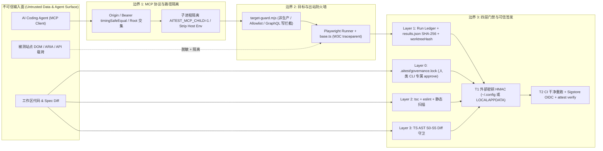
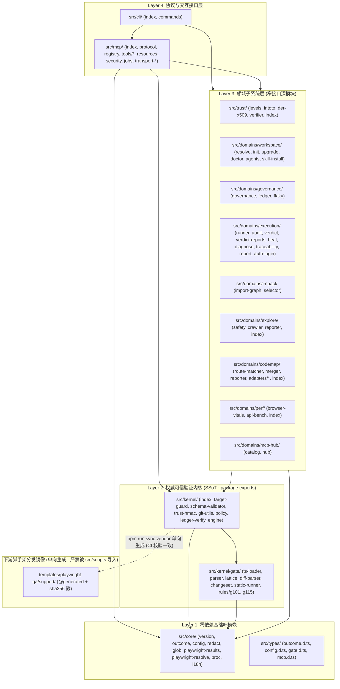

# AI Test Workbench v6.0.0 底层重构架构评估与实施方案（阶段 0）

> [English Version](./v6-refactor-assessment.en.md) · [主文档 README](../../README.md) · [治理与四层门禁](../../docs/governance.md) · [真实提交 FPR 试跑汇总](../../bench/real-world/results/SUMMARY.md) · [升级指南](../../docs/upgrade.md)

- **基线版本**：`ai-test-workbench@5.1.1`（分支 `refactor/v6`，基于 `main@3d0c657`）
- **评估日期**：`2026-11-24`
- **阶段状态**：**阶段 0 完成（等待确认后启动阶段 1..N 实施）**
- **事实口径说明**：本报告严格区分 **实测事实（`VERIFIED`）** 与 **设计目标/推断（`PROPOSED` / `TARGET`）**；所有基线代码规模、依赖边、行号证据、覆盖率、类型检查与基准数字均于本会话在当前仓库实测核验。

---

## 0. 本机实测基线快照（`VERIFIED` · `v5.1.1`）

| 指标维度 | `v5.1.1` 实测基线（`VERIFIED`） | 测量命令 / 来源 |
|---|---|---|
| **代码规模（跟踪文件）** | `src/` 34 文件 `14,480` 行；`templates/playwright-qa/support/` 9 文件 `4,359` 行；`scripts/` 7 文件 `1,454` 行；`test/` 17 文件 `3,532` 行 | `git ls-files` 行数统计 |
| **最大单文件行数** | `ast-analyzer.mjs` `1,615` 行；`explore.mjs` `1,414` 行；`codemap.mjs` `1,184` 行；`mcp/registry.mjs` `1,038` 行；`trust.mjs` `925` 行 | 文件行数扫描 |
| **依赖方向违规（`src -> templates`）** | `12` 条导入边跨越 `11` 个 `src/` 文件 + `2` 条 `scripts -> templates` 边 | 静态 ESM import 图分析 |
| **循环依赖（`src/**`）** | `4` 条静态/动态环路（`mcp-hub.mjs <-> mcp-server.mjs <-> mcp/{protocol,resources,transport-*}.mjs`） | DFS 依赖环扫描 |
| **单元测试与耗时** | `75 / 75` 通过，耗时 `11.7s`（`Node v26.11.0`） | `npm test` |
| **单元测试覆盖率（行 / 分支 / 函数）** | 全仓 `70.08%` 行 / `62.73%` 分支 / `71.20%` 函数；盲区：`doctor.mjs` `7.38%`、`report.mjs` `7.29%`、`runner.mjs` `7.69%`、`auth-login.mjs` `12.50%`、`agents.mjs` `16.71%`、`verdict.mjs` `40.37%`（分支 `3.92%`） | `node --test --experimental-test-coverage test/*.test.mjs` |
| **类型检查严格度** | 当前 `tsconfig.check.json`（`strict: false, noImplicitAny: false`）通过；开启 `--strict --noImplicitAny --useUnknownInCatchVariables` 暴露 **`1,012` 处类型错误**（分布于 39 文件） | `tsc -p tsconfig.check.json --strict --noImplicitAny --useUnknownInCatchVariables --noEmit` |
| **对抗基准 (`npm run bench`)** | `FGER-int = 0.0% (26/26)` · `FGER-holdout = 0.0% (24/24)` · `Gate-FPR(internal) = 0.0% (12/12)` · `SDDR = 100.0% (7/7)` · `Triage = 100.0%` · `C->A = 0.0%` · `Redaction = 100.0%` · `MisHeal = 0.0%` | `npm run bench` |
| **真实提交误报率（Pilot `n=50`）** | 审核后误报率 **`20.8%` (`10/48`，Wilson 95% CI `[11.7%, 34.3%]`)**；原始告警率 `24.0%` (`12/50`，CI `[14.3%, 37.4%]`)，含 `2` 例 TP | `bench/real-world/results/SUMMARY.md` |
| **npm 打包清单 (`npm pack --dry-run`)** | `164` 文件 / `425.1 kB` 压缩包 / `1.3 MB` 解压体积（泄漏 `docs/review/*` ~190 kB 与 `scripts/*` 内部开发脚本） | `npm pack --dry-run` |
| **文档与双语巡检 (`npm run lint:docs`)** | `92` 份 Markdown，扫描 `262` 文件，`0` 条告警（但未校验标题结构对等与 CLI 旗标有效性） | `npm run lint:docs` |

---

## 1. 现状架构图（`v5.1.1`）

### 1.1 模块依赖与依赖方向倒置（含循环依赖）

```mermaid
flowchart TB
    subgraph ENTRY["入口层 (CLI & MCP)"]
        CLI["tools/aitest.mjs -> src/cli.mjs (420L)"]
        MCPSRV["src/mcp-server.mjs (123L)"]
        MPROT["src/mcp/protocol.mjs (500L)"]
        MREG["src/mcp/registry.mjs (1038L)"]
        MRES["src/mcp/resources.mjs (368L)"]
        MHTTP["src/mcp/transport-http.mjs (446L)"]
        MSTDIO["src/mcp/transport-stdio.mjs (109L)"]
        MSEC["src/mcp/security.mjs (203L)"]
        JOBS["src/jobs.mjs (526L)"]
    end

    subgraph DOMAINS["业务与编排层 (src/)"]
        VERDICT["src/verdict.mjs (587L)"]
        TRUST["src/trust.mjs (925L)"]
        HEAL["src/heal.mjs (510L)"]
        AUDIT["src/audit.mjs (116L)"]
        GOV["src/governance.mjs (206L)"]
        LEDGER["src/ledger.mjs (268L)"]
        FLAKY["src/flaky.mjs (227L)"]
        IMPACT["src/impact.mjs (751L)"]
        RUNNER["src/runner.mjs (286L)"]
        EXPLORE["src/explore.mjs (1414L)"]
        CODEMAP["src/codemap.mjs (1184L)"]
        PERF["src/perf.mjs (651L)"]
        DIAG["src/diagnose.mjs (618L)"]
        DOC["src/doctor.mjs (244L)"]
        INIT["src/init.mjs (433L)"]
        MCPHUB["src/mcp-hub.mjs (588L)"]
        OGUARD["src/origin-guard.mjs (7L)"]
    end

    subgraph TPL["脚手架模板目录 (templates/playwright-qa/) — 被倒置为内核"]
        TAUDIT["scripts/audit-results.mjs (112L)"]
        GKERNEL["support/gate-kernel.mjs (75L)"]
        AST["support/gate/ast-analyzer.mjs (1615L)"]
        ENGINE["support/gate/engine.mjs (200L)"]
        POLICY["support/gate/policy.mjs (585L)"]
        LVER["support/gate/ledger-verify.mjs (426L)"]
        GITU["support/gate/git-utils.mjs (534L)"]
        HMAC["support/gate/trust-hmac.mjs (245L)"]
        TGUARD["support/target-guard.mjs (480L)"]
        SVAL["support/schema-validator.mjs (190L)"]
    end

    CLI --> VERDICT & RUNNER & EXPLORE & CODEMAP & PERF & MCPHUB & MCPSRV & INIT & DOC & GOV & TRUST
    MCPSRV --> MPROT & MREG & MRES & MHTTP & MSTDIO & MSEC
    MHTTP --> MPROT
    MSTDIO --> MPROT
    MPROT --> JOBS & MREG & MRES & MSEC

    %% 循环依赖红线
    MPROT -. "环路: 读 MCP_PRESETS" .-> MCPHUB
    MRES -. "环路: 读 MCP_PRESETS" .-> MCPHUB
    MCPHUB -. "环路: dynamic import" .-> MCPSRV

    %% 依赖倒置红线 (src -> templates)
    AUDIT -. "倒置" .-> TAUDIT
    VERDICT & TRUST & HEAL & GOV & LEDGER & FLAKY & IMPACT & DOC -. "倒置 (8 files)" .-> GKERNEL
    OGUARD -. "倒置" .-> TGUARD
    MREG -. "倒置" .-> SVAL

    TAUDIT --> GKERNEL
    GKERNEL --> ENGINE & AST & POLICY & LVER & GITU & HMAC
```

### 1.2 核心数据流与信任边界（Trust Boundaries）

**现状中值得保留的优秀设计（重构时保持并增强）**：
- **子进程隔离作业模型（`src/jobs.mjs`）**：通过 `AITEST_MCP_CHILD=1` 彻底消除 `console` 劫持、实现跨平台进程树强杀（`taskkill /T /F` 与 `-pid`）、环境变量剥离（`STRIPPED_CHILD_ENV_KEYS`）和先解析 JSON 再脱敏（`redactStructuredValue`）。
- **T0 / T1 / T2 诚实信任分层与离线 Sigstore/ASN.1 DER 验签（`src/trust.mjs`）**：严格区分本地完整性（T1）与 CI 来源证明（T2），零第三方依赖实现 DSSE PAE + Fulcio OIDC Issuer + GitHub Workflow SAN 离线校验。
- **物理特权隔离（`governance approve` 仅限人类 CLI）** 与 **声明式受保护路径清单**、**跨会话 3 轮上限的自愈状态机（`src/heal.mjs`）**、**基于反向 `import` 依赖图的受影响用例精选（`src/impact.mjs`）**。
- **MCP 协议层内部已按传输/协议/安全/资源拆分**，且已建立隔离的官方 `conformance/` 互操作测试门禁。

---

## 2. 结构疑点逐条核实与新发现问题（按 P0 / P1 / P2 排序）

### P0 级问题（架构根因或安全/可信底线缺口，必须优先根治）

#### [P0-1] 疑点 1：依赖方向倒置（`src -> templates`）与模板版本漂移 — **成立（实际比疑点更严重）**
- **代码证据**：
  - `src/` 共有 **11 个文件、12 条边**反向导入 `templates/playwright-qa/`：
    - `src/audit.mjs:5` -> `../templates/playwright-qa/scripts/audit-results.mjs`
    - `src/doctor.mjs:7`、`src/flaky.mjs:7`、`src/governance.mjs:6`、`src/heal.mjs:17`、`src/impact.mjs:7`、`src/ledger.mjs:7`、`src/trust.mjs:6`、`src/verdict.mjs:26` -> `../templates/playwright-qa/support/gate-kernel.mjs`
    - `src/origin-guard.mjs:6-7` -> `../templates/playwright-qa/support/target-guard.mjs`
    - `src/mcp/registry.mjs:3` -> `../../templates/playwright-qa/support/schema-validator.mjs`
  - 此外 `scripts/bench-real-world.mjs:7-8` 也直接导入 `templates/playwright-qa/support/gate/{ast-analyzer,engine}.mjs`。
  - 模板版本已经发生真实漂移：`templates/playwright-qa/package.json:3` 仍为 `"version": "5.0.0"`，而根包为 `5.1.1`；`templates/playwright-qa/support/gate/policy.mjs:256,325,329,337` 与 `ledger-verify.mjs:288,336,411` 硬编码了 7 处 `ai-test-workbench@5.1.1`；`engine.mjs:17` 独立硬编码 `GATE_KERNEL_VERSION = '5.1.1'`。
  - **额外发现的现存 Bug（`N2`）**：`src/doctor.mjs:208-224` 检查宿主 `qa/support/gate-kernel.mjs` 中的 `GATE_KERNEL_VERSION = '...'`，但该常量早在 v5.0 拆分后移至 `support/gate/engine.mjs:17`，导致 `doctor --target` 对**所有**仓库恒定误报 `Host QA kernel vunknown != workbench v5.1.1`！
- **影响**：CLI 内核与模板强耦合、无升级机制（用户初始化一次后 `qa/support/` 永久僵化）、`doctor` 漂移检测彻底失效。
- **业界惯例**：脚手架工具（如 Vite/Playwright/Turborepo/Changesets）遵循**内核归属主包（Single Source of Truth）**，模板目录只作为下游分发产物（通过包 subpath exports 引用或构建期确定性同步 + 逐文件清单 + `upgrade` 迁移命令）。
- **建议方案（详见 ADR-0002）**：
  1. 将全部内核迁入 `src/kernel/` 作为唯一权威源码，并通过 `package.json#exports` 暴露 `./kernel`、`./target-guard`、`./schema-validator`。
  2. `src/**` 与 `scripts/**` **严禁**导入 `templates/**`（用自动化架构边界测试锁定为 `0` 违规）。
  3. 用 `scripts/sync-template-vendor.mjs` 确定性生成带 `@generated from ai-test-workbench@<ver> sha256:<hash>` 版本戳的 `templates/playwright-qa/support/` 镜像（CI 强制比对字节一致，防漂移）。
  4. `init` 写出 `.aitest/template-manifest.json`（逐文件版本 + SHA-256），新增 `aitw upgrade` 命令（复刻 `update-agents` 成熟的三方哈希合并策略：未改文件自动升级、用户手改文件写出 `.aitest-new` 侧车并返回退出码 `2`，最后提示人类执行 `governance approve`），同时修复 `doctor.mjs` 基于 manifest + `engine.mjs` 的版本检测。
- **替代方案及放弃理由**：
  - *放弃方案 A（让 `qa/package.json` 直接依赖锁定版本的 `ai-test-workbench@6.0.0`）*：`templates/playwright-qa/package-lock.json` 提交在仓库内供 `init` 执行确定性 `npm ci`。若模板直接依赖尚未发布到 npm 的 `ai-test-workbench@6.0.0`，每次开发/提测/发版都会触发“未发布则无法更新 `package-lock.json` 与通过离线 CI”的鸡生蛋死锁；且离线内网环境 `qa/` 无法独立跑通 `npm run audit`。本方案保留 `exports` 供高级用户按需直连，同时默认镜像+manifest+`upgrade` 彻底避免死锁。

#### [P0-2] 疑点 3：门禁规则引擎形态与真实提交 20.8% 误报率 — **成立**
- **代码证据**：
  - `templates/playwright-qa/support/gate/ast-analyzer.mjs`（`1,615` 行）将 `AITEST-G101..G115` 全部硬编码在一个 350 行 `visit()`（`L824-1105`）、`compareAstSummaries()`（`L1110-1187`）、`analyzeHealerDiffText()`（`L1300-1375`）与 `scanSpecFilesFallback()`（`L1466-1539`）中；规则不可独立开关、无结构化 `Finding`（缺行列号与规则元数据），仅输出拼接字符串。
  - 在 `bench/real-world/results/SUMMARY.md` 的 50 个真实提交上，审核后误报率达 **`20.8%`（`10/48`，Wilson 95% CI `[11.7%, 34.3%]`）**。逐条核对 `bench/real-world/adjudications.json` 确认全部 10 个误报源于 **5 类系统性抽象缺失**：
    1. **单文件孤立比对（2 起：`playwright-mcp@2bf57e22c6`、`29711d07d3`）**：`compareSpecSourcesAst` 与 `runGitDiffGuard`（`L1419-1452`）逐文件孤立计次，把跨文件拆分用例误报为 `G102/G103`（且 `scripts/bench-real-world.mjs:152` 仅拉取被修改路径，未包含同提交新增 spec 文件）。
    2. **无词法作用域栈（3 起：`vite@616296895b`、`vitepress@bead1384b2`、`sveltejs/kit@3d5800fad6`）**：`L1096-1100` 的 `ctx.insideIf` 穿透 `test()` 回调边界，导致文件级 `if (!isBuild) { test(...) }` 误触发 `G110`；`L830-845` 不区分 Node 测试体与 `page.evaluate()` 浏览器上下文，也不豁免 `try { failingOp(); } catch (e) { expect(e)... }` 负向异常断言，误触发 `G107`。
    3. **按文本片段去重导致改写既有 skip 误报 & 缺少运行时能力守卫识别（2 起：`sveltejs/kit@9bc12d379f`、`playwright-mcp@b85dc6954a`）**：`L1115` 用 `${code}:${snippet}` 精确串去重，改写已有 `test.skip(condA)` -> `test.skip(condB)` 即被判为新增 `G105`；新测试中的平台能力守卫 `test.skip(!globalThis.WebSocket, '...')` 与禁用失败用例无区分。
    4. **S0–S5 强度格失衡 + 全文件裸总分比较（2 起：`sveltejs/kit@30d06f5698`、`actualbudget/actual@a81408595c`）**：`L548-581` 将 `page.evaluate(...activeElement.nodeName).toBe('BODY')` 判 S5，而标准 web-first `toBeFocused()` 仅判 S2；全文件 154->153 降 1 分即触发 `G103`（即使核心 S5 业务断言完整保留）。
    5. **`route.fulfill` 一刀切（1 起：`sveltejs/kit@dd63fd1a2e`）**：`L1001-1022` 对所有 `route.fulfill()` 无条件报 `G114`，不区分 `status >= 400` 故障注入或 `attacker.example` 跨源安全蜜罐。
- **影响**：20.8% 的真实误报率会导致工程团队在真实仓库启用门禁一周内关闭拦截或滥用豁免，直接摧毁“可信验证内核”产品价值。
- **业界惯例**：ESLint / Semgrep / Biome 均采用**独立声明式规则对象（`id`, `meta`, `defaultSeverity`, `checkFile` / `checkChangeset`）+ 结构化 `Finding` + 词法作用域跟踪 + 良性/恶性双夹具单测**。
- **建议方案（详见 ADR-0004）**：拆分为 `src/kernel/gate/` 规则引擎（解析器 + 显式作用域栈 + 校准后 S0–S5 格 + 提交级 `analyzeChangeset` 跨文件标题池化 + 15 个独立规则模块）；**先用新种子预登记留出集（unseen holdout）测出改前基线**，再落地系统性改进并实测改后留出集 FPR（门槛 ≤ 5%，目标 ≤ 3%）及内部/红队 FGER = 0.0%。
- **替代方案及放弃理由**：
  - *放弃针对 50 条样本写正则特判/白名单*：属于过拟合（反模式），无法泛化到未见仓库且容易打开作弊绕过口子。
  - *放弃在 Layer 3 引入完整 `ts.createProgram` 类型推断*：需安装被测仓库 `node_modules`，会破坏离线快速比对与外部仓库零代码执行评测边界，性能退化 10–50 倍。

#### [P0-3] 疑点 8：结果/错误模型不统一与 6 处残留 fail-open 漏洞 — **成立（发现 6 处真实 fail-open 缺口）**
- **代码证据**：
  1. **Layer 3 缺 TS 编译器静默放行**：`templates/playwright-qa/support/gate/ast-analyzer.mjs:777` 在 `!ts` 时返回 `usedAst: false`，随后 `compareSpecSourcesAst`（`L1212-1216`）因 `if (baseSum.usedAst || headSum.usedAst)` 为假，直接返回 `{ ok: true, violations: [] }`；`runGitDiffGuard`（`L1445`）未检测 `ts` 可用性，导致缺 TypeScript 时 Layer 3 静默变绿！
  2. **Layer 2 缺编译器在 CI 亦未 fail-closed**：`ast-analyzer.mjs:1543` 注释宣称 `process.env.CI === 'true'` 时缺 `tsc`/`eslint` 会 fail-closed，但 `L1560`、`L1586` 仅检查 `options.requireCompilers`，全仓 `git grep requireCompilers` 证实**没有任何调用方传入 `requireCompilers: true`**！
  3. **自定义 `--results` 路径绕过 Run Ledger**：`ledger-verify.mjs:359-371` 当 `resultsPath !== reports/results.json` 且未传 `expectedRunId` 时直接返回 `{ ok: true, status: 'pass', enforced: false }`；`src/audit.mjs:72-83` 允许 CLI 传入 `--results` 而不传 `expectedRunId`，导致 `audit --results forged.json` 绕过账本校验。
  4. **未初始化标记缺失返回 `pass`**：`policy.mjs:268-276` 与 `ledger-verify.mjs:293-303` 在 `!isInitializedQaWorkspace(qaDir)` 时均返回 `status: 'pass'`（且 `engine.mjs:73` 将 `!govRes.enforced` 置为 `governanceStatus = 'pass'`）。
  5. **非法 URL 放行**：`target-guard.mjs:313-315` 中 `new URL()` 解析失败直接返回 `{ blocked: false, reason: null }`。
  6. **损坏配置静默回退默认值**：`policy.mjs:156-158` 中 `loadAitestConfig` 捕获 `JSON.parse` 错误后静默返回 `defaults`；`scripts/run-typecheck.mjs:24-25` 本地缺 `tsc` 时退出码 `0`。
  7. **结果信封与退出码割裂**：仅 `src/mcp/protocol.mjs:106` 使用 `{ ok, exitCode, tool, summary, data, nextRecommendedActions }`；CLI 中 `explore`/`codemap`/`flaky`/`report`/`impact` 输出无 `ok` 字段，`init` 完全不支持 `--json`；`src/runner.mjs:212` 将 `auditOut.outcome === 'blocked'` 映射为退出码 `1` 而非 `2`。
- **影响**：违背核心 `fail-closed` 不变量，自动化脚本/Agent 解析 CLI 与 MCP 输出需要双套逻辑。
- **业界惯例**：单一 `Outcome = 'pass' | 'fail' | 'blocked'` 与 `CommandResult<T>` 信封 + 确定性退出码映射（`pass -> 0`、`fail -> 1`、`blocked -> 2`），所有缺失/解析异常路径显式返回 `blocked`。
- **建议方案**：新建 `src/core/outcome.mjs` 统一构建结果与退出码，逐条堵死上述 6 处 fail-open 分支，并统一全部 CLI `--json` 输出（含 `init --json`）。
- **替代方案及放弃理由**：*放弃仅靠 `try/catch` 抛异常让顶层捕获*——异常会丢失结构化的 `outcome: 'blocked'` 与多条并行门禁错误聚合。

#### [P0-4] 新发现（N1）：`npm pack` 发布包泄漏内部审查草稿与开发脚本 — **成立（`VERIFIED`）**
- **代码证据**：`package.json:58,78` 声明 `"scripts/"` 与 `"docs/"` 全量打包。实测 `npm pack --dry-run` 打包了 `164` 文件（`1.3 MB` 解压），其中包含：
  - `docs/review/architecture-code-review-2026-11*.md`（43.5 kB）、`docs/review/optimization-roadmap-2026-2027*.md`（47.1 kB）、甚至**未跟踪本地草稿** `docs/review/v5-cto-deep-review-and-roadmap-2026-11*.md`（95.0 kB）！
  - `scripts/{bench-real-world,check-docs-and-hygiene,run-bench,run-smoke,run-typecheck,run-unit-tests,verify-demo}.mjs`（7 个仓库内部开发测试脚本）。
- **影响**：用户安装体积虚增，且任何置于 `docs/review/` 的未提交评审草稿都会在发版时意外发布至 npm 公共仓库，违反交付卫生底线。
- **业界惯例**：`package.json#files` 使用精确白名单，只包含运行时代码、用户模板与用户指南，并在 CI 中校验 `npm pack --dry-run --json` 禁止内部目录进入产物。
- **建议方案**：将 `"files"` 收敛为精确用户文件列表（排除 `docs/review/`、`docs/history/`、仓库内部 `scripts/`），新增单元测试解析 `npm pack --dry-run --json` 断言零审查稿/缓存/测试语料泄漏。
- **替代方案及放弃理由**：*放弃依赖 `.npmignore`*——白名单 `files` 比黑名单 `.npmignore` 更符合 default-deny 原则且更不易漏网。

---

### P1 级问题（显著损害可维护性、可测试性或演化成本）

#### [P1-1] 疑点 2：上帝模块（5 个 925–1,615 行巨型文件） — **成立**
- **代码证据**：
  - `templates/.../gate/ast-analyzer.mjs`（`1,615L`）：6 类职责混杂（TS 加载、AST 遍历、S0–S5 格、15 条规则、diff 解析、tsc/eslint 调度）。
  - `src/explore.mjs`（`1,414L`）：仅 `runExploreCommand` 单个函数就占 **964 行（`L451-1414`）**，混杂安全分类、PII 清洗、分层队列、浏览器爬虫、多框架 DOM 探针、Markdown 渲染与 CLI 输出，且内部还重复实现了 Vue 路由遍历（`L172-196` vs `L976-984`）。
  - `src/codemap.mjs`（`1,184L`）：文件遍历、Next.js/Vue/React/Spring/Express/Nest/Python/PHP/Prisma/SQL 7 类静态提取、Spec 索引、372 行合并与缺陷收敛状态机、Markdown 渲染、CLI 全堆在一处；`L1109-1118` 还绕过治理模块直接手读 `governance.lock`。
  - `src/mcp/registry.mjs`（`1,038L`）：21 个工具的全部 schema、CLI 映射与 `nextActions` 堆在单个大数组中。
  - `src/trust.mjs`（`925L`）：混合 T0/T1/T2 定义、CI 环境探测、in-toto 构造、cosign 子进程、200 行底层 ASN.1 DER/X.509/DSSE PAE 密码解析与 CLI。
  - 另有 `src/auth-login.mjs`（`336L`，`N5`）通过字符串模板拼接两段 150 行 `.mjs` 写临时文件执行，完全绕过 `checkJs` 类型检查。
- **影响**：单次改动需通读上千行上下文，单元测试难以隔离纯逻辑与 IO/浏览器，覆盖率停滞不前。
- **业界惯例**：按领域拆分为**深模块（Deep Modules）**——窄接口封装复杂内部实现，单文件控制在 ≤ 400–500 行，框架解析器采用适配器表（Adapter Registry）而非巨型 `if/else`。
- **建议方案**：按第 3 节目标目录结构将 5 个上帝模块拆分为高内聚子目录（`src/kernel/gate/`、`src/trust/`、`src/domains/{explore,codemap,perf}/`、`src/mcp/tools/`），并消除 `auth-login.mjs` 的临时文件代码生成。
- **替代方案及放弃理由**：*放弃过度拆成几十个 20 行薄包装文件（浅模块反模式）*——每个拆分后的子模块必须通过“删除测试”：承载完整领域职责与独立测试面。

#### [P1-2] 疑点 4：MCP 协议层边界、循环依赖与工具面膨胀 — **部分成立**
- **代码证据**：
  - **已做好的部分（保留）**：`src/mcp/` 已按 `protocol`、`registry`、`resources`、`security`、`transport-http`、`transport-stdio` 清晰分层；`src/mcp/registry.mjs` 已将 schema、annotations、CLI 参数映射与 `nextActions` 收敛至同一份声明式数组（非 v5.0 时代的三套平行表）。
  - **确认存在的问题**：
    1. **4 条循环依赖（`N6`）**：`src/mcp/protocol.mjs:4` 和 `src/mcp/resources.mjs:5` 导入 `../mcp-hub.mjs` 的静态常量 `MCP_PILLARS/MCP_PRESETS/MCP_PROFILES`，而 `src/mcp-hub.mjs:436` 又动态导入 `./mcp-server.mjs`，形成环路。
    2. **协议层泄露工具执行分支**：`src/mcp/protocol.mjs:207-284` 硬编码 `if (name === 'aitest_job_status' | 'aitest_job_result' | 'aitest_job_cancel')` 与 `if (name === 'aitest_mcp_hub' && args.action === 'presets')`，破坏注册表单一来源。
    3. **工具数量偏多（21 -> 17）**：`aitest_heal_begin/attempt/conclude`（3 个）与 `aitest_job_status/result/cancel`（3 个）完全可效仿 `aitest_mcp_hub(action)` 合并为 `aitest_heal(action)` 与 `aitest_job(action)`，减少每次对话的 `tools/list` Token 开销。
    4. **CLI 选项平铺（`N3`）**：`src/cli.mjs:27-116` 将 89 个选项平铺在全局 `CLI_OPTION_DEFS` 中，导致给 `doctor` 传 `--max-pages` 不会报错。
- **影响**：模块图带环无法启用架构门禁；扩展内存工具需改 `protocol.mjs`；过多离散工具增加 LLM 选错工具与上下文开销。
- **业界惯例**：静态配置数据下沉为纯数据模块；工具注册表声明可选 `execute(args, ctx)` 处理器；相关生命周期操作按 `action` 动词收敛；CLI 按子命令隔离参数表。
- **建议方案（详见 ADR-0005）**：抽离 `src/domains/mcp-hub/catalog.mjs`，在 `src/cli/` 直接路由 `mcp serve`（环路清零）；在 `ToolRegistryEntry` 增加 `execute` 钩子；21 工具合并为 17 个权威工具并在 `protocol.mjs` 保留 6 个 v5 别名转发（带弃用告警）；`src/cli/commands.mjs` 实现按子命令严格参数校验。
- **替代方案及放弃理由**：*放弃引入 `@modelcontextprotocol/sdk` 重写 MCP 服务端*——根包零运行时依赖为硬约束，且隔离 `conformance/` 套件已由官方测试保障 3 传输互操作性。

#### [P1-3] 疑点 5：多份重复实现 — **部分成立（HMAC 无重复，但查出 6 处真实重复）**
- **代码证据**：
  - **不成立项**：`src/trust.mjs:6-11` 直接复用 `gate-kernel.mjs`（`trust-hmac.mjs`）的 HMAC 实现，并无重复。
  - **成立项（6 处实证重复）**：
    1. **5 份 Playwright `results.json` 递归遍历器**：`ledger-verify.mjs:19-49`、`src/ledger.mjs:37-91`、`src/codemap.mjs:419-440`、`src/diagnose.mjs:7-32`、`src/traceability.mjs:99-113`；且后两者漏判 `retryPassed = status === 'expected' && results.length > 1` 导致状态统计口径分叉！
    2. **2 份 Flaky 率公式与 `index.jsonl` 读取**：`policy.mjs:470-510` 与 `src/flaky.mjs:14-60` 各自手写 `flaky + min(passed, failed)` 计算。
    3. **2 份完全相同的 Glob 编译器**：`src/impact.mjs:29-46`（`globToRegex`）与 `policy.mjs:74-92`（`compilePolicyGlob`）逐行雷同。
    4. **4 份 Playwright 路径定位器**：`src/proc.mjs:409-418`、`src/explore.mjs:425-434`、`src/perf.mjs:128-134`、`src/auth-login.mjs:57`。
    5. **2 份 Vue 路由树遍历器**：`src/explore.mjs:172-196` 与 `L976-984`。
    6. **脱敏职责错位分散**：`src/proc.mjs:9-177` 把 170 行凭据脱敏塞进进程执行模块，而 `src/explore.mjs:114-130,231-248` 另写 URL 与 DOM PII 脱敏。
- **影响**：一处语义修正（如 Playwright `retryPassed` 判定）漏改多处，制造隐蔽口径不一致。
- **业界惯例**：单一事实来源（DRY on domain concepts），下沉至 `src/core/` 无副作用纯模块。
- **建议方案**：在 `src/core/` 沉淀 `playwright-results.mjs`、`playwright-resolve.mjs`、`glob.mjs`、`redact.mjs`，并在 `src/kernel/policy.mjs` 与 `src/domains/governance/flaky.mjs` 共享同一 flaky 评估函数。
- **替代方案及放弃理由**：*放弃引入第三方 npm 工具库（如 minimatch/glob）*——违反根包零运行时依赖硬约束。

#### [P1-4] 疑点 6：类型安全薄弱（`strict: false` 与模板 `typeRoots`） — **成立**
- **代码证据**：
  - `tsconfig.check.json:9-13` 配置 `strict: false`、`noImplicitAny: false`、`useUnknownInCatchVariables: false`，且 `typeRoots` 指向 `./templates/playwright-qa/node_modules/@types`；`scripts/run-typecheck.mjs:11` 同样从模板目录找 `tsc`。
  - 实测全开严格模式（`--strict --noImplicitAny --useUnknownInCatchVariables`）共检出 **`1,012` 处错误**（`ast-analyzer.mjs` 116、`explore.mjs` 94、`codemap.mjs` 87、`perf.mjs` 61、`target-guard.mjs` 48、`trust.mjs` 48、`impact.mjs` 43、`heal.mjs` 41 等）。
- **影响**：静态类型检查流于形式，大量 `any` 掩盖了空值解引用与结构字段拼写错漏（如 `src/explore.mjs:86` 潜在 `undefined`）。
- **业界惯例与二选一决策（详见 ADR-0003）**：
  - **明确选择：逐模块推进 `strict: true`（JSDoc + `checkJs` + 独立 `src/types/*.d.ts` + TS 6.0 `@import`），放弃迁移为 `.ts` 源码构建 `dist/`。**
  - **理由**：(1) 保持**零构建步骤**（`git clone` 后直接运行 `node tools/aitest.mjs`，所有现有脚本/测试/CI `use-local-cli` 无需编译流水线）；(2) `src/kernel/*.mjs` 与 `templates/playwright-qa/support/*.mjs` 保持 1:1 可读 ESM 源码镜像，零转译噪音；(3) 根包可仅添加锁定版本的 `devDependencies`（`typescript`、`@types/node`），彻底解除对模板 `node_modules` 的反向依赖，同时**严格保持 `dependencies` 为空（零运行时依赖）**；(4) 通过 `tsconfig.strict.json` 棘轮机制要求所有新建/重构模块从第一天起通过 `strict: true`，并在 WU-08 清零全部 1,012 处错误。
- **替代方案及放弃理由**：*放弃迁移到 `.ts` 源码 + `tsc` 构建 `dist/`*——引入构建产物同步、`dist/` 路径改写、Node 22.12 兼容性（不依赖实验性 strip-types）以及 14.5k 行机械重写噪音，投入产出比明显不如 JSDoc + `.d.ts` 严格化。

#### [P1-5] 疑点 7：测试组织混乱与覆盖率盲区 — **成立**
- **代码证据**：
  - `test/red-team-and-hardening.test.mjs`（`568L`）按历史审查编号（`M-01..M-15`、`E-01..E-08`、`D-01..D-03`、`T-01..T-06`、`I-01..I-06`）混装 7 个毫不相干的子系统；`scripts/run-unit-tests.mjs:8-12` 仅扫描 `test/` 一层扁平目录，无覆盖率采集与阈值门禁。
  - Node 26 实测覆盖率揭示严重盲区：整体 `70.08%` 行覆盖，而 `doctor.mjs`（`7.38%`）、`report.mjs`（`7.29%`）、`runner.mjs`（`7.69%`）、`auth-login.mjs`（`12.50%`）、`agents.mjs`（`16.71%`）、`skill-install.mjs`（`20.45%`）、`verdict.mjs`（`40.37%` 行 / `3.92%` 分支）、`mcp/resources.mjs`（`41.03%`）、`audit.mjs`（`43.97%`）几乎裸奔。
- **影响**：缺陷难以定位到归属模块，低覆盖核心路径隐藏真实回归（如 `doctor.mjs` 漂移检测失效一直未被发现）。
- **业界惯例**：三层测试金字塔（`test/unit/<module>` 隔离单测 + `test/integration/<scenario>` 端到端集成 + `test/adversarial/` 语料驱动对抗基准）+ CI 行覆盖阈值门禁。
- **建议方案**：升级 `scripts/run-unit-tests.mjs` 递归发现三层目录并开启 Node 原生 `--experimental-test-coverage`；**100% 保留全部既有对抗用例、红队 24 例、E1–E6 伪造场景与断言强度**，按模块补齐盲区单测使核心模块行覆盖 ≥ 80%。
- **替代方案及放弃理由**：*放弃引入 Jest/Vitest/c8*——Node 22/24/26 内置 `node:test` + 原生 V8 覆盖率零依赖即可达成目标，无需增加依赖。

#### [P1-6] 疑点 9：配置与环境变量散落无 Schema 校验 — **成立**
- **代码证据**：
  - 静态扫描统计 `src/` 与 `templates/` 中共存在 **`57` 处 `process.env` 读取，分散在 `22` 个文件**（`TEST_*` 15 个、`AITEST_*` 12 个、`E2E_*` 3 个、`FAIL_ON_*` 2 个、`EXPLORE_*` 2 个、CI 变量 12 个等）。
  - `policy.mjs:128-159` 的 `loadAitestConfig()` 无 JSON Schema 校验、忽略未知键并在 JSON 语法错误时静默回退默认值。
  - `playwright.config.ts:7` 通过 `loadEnvFileIfPresent` 直接修改全局 `process.env`。
- **影响**：环境变量命名与默认值难以追踪、文档与代码易漂移、无法在启动早期拦截非法配置值（如负数 `maxFlaky`、非法 `TEST_EGRESS_MODE`）。
- **业界惯例**：单一配置加载与 Schema 校验层（如 `loadWorkbenchConfig({ qaDir, env, cliOverrides })`），支持显式注入 `env` 字典便于纯单测隔离。
- **建议方案**：建设 `src/core/config.mjs`，集中声明全部 `TEST_*`、`AITEST_*` 与 `aitest.config.json` Schema（复用 `kernel/schema-validator.mjs`），以不可变配置对象向下注入，非法配置一律 fail-closed 返回 `blocked`。
- **替代方案及放弃理由**：*放弃引入 `dotenv` + `zod`*——零运行时依赖约束下，自研 `parseEnvText` + `validateJsonSchema` 已足够完备且已通过充分测试。

---

### P2 级问题（文档膨胀、表述漂移与工程卫生）

#### [P2-1] 疑点 10：文档膨胀、双语不对等与实时漂移 — **成立**
- **代码证据**：
  - 全仓共 **`92` 份 Markdown 文件**。
  - **ADR 重复与悬空引用**：`docs/adr/0001-mcp-protocol-stack-and-zero-dep-kernel.md`（2026-11-23）与 `docs/adr/mcp-zero-dependency.md`（2026-11-24）讨论同一主题且编号格式不统一（`0001` vs `001`）；`trust-hmac.mjs:7` 引用了不存在的 `ADR-0002`。
  - **历史审查重叠且中英严重失衡**：`docs/review/architecture-code-review-2026-11.md`（`334L`）配 `.en.md`（`56L`，6:1 缺口）；`docs/review/optimization-roadmap-2026-2027.md`（`480L`）配 `.en.md`（`52L`，9:1 缺口）；根目录遗留带空格与破折号的 v4 中文蓝图文件，迫使 `scripts/check-docs-and-hygiene.mjs:51-54` 维护特殊例外表 `SPECIAL_EN_PAIRS`。
  - **实测文档错误漂移**：
    - `docs/governance.md:31` 写了**根本不存在的参数 `--approver`**（实际 CLI 参数为 `--by`，见 `src/cli.mjs:74`、`src/governance.mjs:156`），直接复制运行会因严格参数解析报错！
    - `docs/governance.md:15` 与 `ARCHITECTURE.md:30` 仍写“11 个受保护文件”和“`AITEST-G101..G113` 共 13 类”，而代码已演进为 17 条保护 glob（23 文件）与 `G101..G115`（15 条规则）。
    - `README.md`、`AGENTS.md`、`SKILL.md` 的 21 工具表全部手工维护，且标题多处残留 `v5.0` 与偏营销化修饰语（如“极速”、“全链路一网打尽”等）。
- **影响**：用户与 AI Agent 复制文档命令会失败，双语维护成本倍增。
- **业界惯例**：单一事实来源（工具/命令表由代码注册表自动生成并在 CI 做 `--check` 校验），历史文档归档至 `docs/history/`，`lint:docs` 强制校验标题层级结构对等与文档中 CLI 旗标有效性。
- **建议方案**：归档历史文档至 `docs/history/`，合并/编号 5 份 v6 ADR（`docs/adr/0001..0005`），新增 `scripts/generate-docs.mjs --check` 自动同步 `README` / `AGENTS` / `SKILL` 中的工具清单，加强 `check-docs-and-hygiene.mjs`（只增不减），去营销化重写核心文档并补全 `docs/upgrade.md`。
- **替代方案及放弃理由**：*放弃移除英文文档*——硬约束要求中英双语保持同结构。

---

## 3. 目标架构（`v6.0.0`）

### 3.1 分层架构与依赖方向铁律

**强制依赖方向规则（由 `test/unit/architecture-boundaries.test.mjs` 自动守护）**：
1. `src/core/**` 仅可导入 `node:*` 内置模块及同层 `src/core/*`（允许零外泄）。
2. `src/kernel/**` 仅可导入 `node:*` 与 `src/core/**`，严禁导入 `src/domains/**`、`src/trust/**`、`src/mcp/**`、`src/cli/**`、`templates/**`。
3. `src/trust/**` 与 `src/domains/**` 可导入 `src/core/**`、`src/kernel/**`；跨域调用仅限通过目标域的公共入口 `index.mjs`（且禁止形成环路）。
4. `src/mcp/**` 与 `src/cli/**` 可导入下层，且 `src/mcp/**` 仅导入 `src/domains/mcp-hub/catalog.mjs` 纯数据模块，永不与 `mcp-hub` 形成环路。
5. **全局禁止边**：`src/**` 禁止导入 `templates/**`（`0` 违规）；`scripts/**` 禁止导入 `templates/**`（`0` 违规）；全仓 `src/**` 循环导入为 `0`。

### 3.2 目录结构与单模块规模目标

- **目标单模块上限**：`src/` 与 `src/kernel/` 下所有模块行数目标 `<= 500` 行（彻底消除 900–1,600 行上帝模块）。
- **包导出面（`package.json#exports`）**：
  - `.` -> `./src/kernel/index.mjs`（或 CLI/程序化公共 API）
  - `./kernel` -> `./src/kernel/index.mjs`
  - `./target-guard` -> `./src/kernel/target-guard.mjs`
  - `./schema-validator` -> `./src/kernel/schema-validator.mjs`
  - 根包 `dependencies` 保持 `{}`（零运行时依赖）；仅在 `devDependencies` 中精确锁定 `typescript` 与 `@types/node`（消除对模板 `node_modules` 的反向 `typeRoots` 依赖）。

### 3.3 准备落地的 5 份核心 ADR

| ADR 编号 | 标题 | 核心决策 |
|---|---|---|
| **ADR-0001** | MCP 零运行时依赖协议栈与官方合规门禁（合并原 `0001-*` 与 `mcp-zero-dependency`） | 根包维持零运行时依赖，保留 `src/mcp/` 轻量协议栈并以隔离的 `conformance/` 官方套件 + SDK 三传输测试做客观门禁；保留 OAuth 2.1 / Elicitation / Tasks 重审触发条件。 |
| **ADR-0002** | 验证内核单源归位（`src/kernel/`）、构建期确定性同步镜像与 `upgrade` 迁移机制 | `src/kernel/` 为唯一权威源码并通过 `package.json#exports` 暴露；`templates/playwright-qa/support/` 由 `scripts/sync-template-vendor.mjs` 确定性生成并加版本+哈希戳（CI 强校字节一致）；`init` 落盘 `.aitest/template-manifest.json`，新增 `aitw upgrade` 做三方哈希安全升级，规避模板 `package-lock.json` 未发布死锁。 |
| **ADR-0003** | 类型安全策略：渐进式严格 `JSDoc + checkJs + .d.ts`（TS 6.0 `@import`），不迁 `.ts -> dist/` | 二选一明确选择零构建的严格 `checkJs` + 独立 `src/types/*.d.ts`；在根包 `devDependencies` 锁定 `typescript` + `@types/node`，将 `tsconfig.check.json` 推至 `strict: true, noImplicitAny: true, useUnknownInCatchVariables: true`（0 错误），保持零构建与 1:1 源码镜像优势。 |
| **ADR-0004** | 可插拔 AST 门禁规则引擎与跨文件/作用域感知误报治理 | 将 `AITEST-G101..G115` 重构为独立可开关 `GateRule` 对象 + 结构化 `Finding`；引入词法作用域栈（`top-level/describe/test/browser-evaluate/catch`）、提交级 `analyzeChangeset` 跨文件测试标题池化、校准后 S0–S5 web-first 格与故障注入/蜜罐感知；以**新种子未见留出集**实测前后 FPR 与 Wilson 95% CI，严守 FGER = 0%。 |
| **ADR-0005** | MCP 工具面收敛（21 -> 17）、统一 `Outcome/CommandResult` 与集中式配置层 | 合并 `aitest_heal` 与 `aitest_job`（按 `action` 分发）并在 `v6.x` 保留 6 个旧工具名弃用别名；注册表支持声明式 `execute` 清理协议层硬编码分支；统一三态 `Outcome`、退出码（`0/1/2`）与 CLI `--json` 信封；新建 `src/core/config.mjs` 集中加载并校验全部 `TEST_*`、`AITEST_*` 与 `aitest.config.json`。 |

---

## 4. 破坏性变更清单与迁移策略（`v5.x -> v6.0.0`）

所有变更将同步完整记录在 `docs/upgrade.md`（及 `.en.md`）：

| 类别 | v5.1.1 行为 | v6.0.0 变更 | 兼容与迁移路径（保留 1 个大版本） |
|---|---|---|---|
| **MCP 工具面（21 -> 17）** | `aitest_heal_begin`、`aitest_heal_attempt`、`aitest_heal_conclude`；`aitest_job_status`、`aitest_job_result`、`aitest_job_cancel` | 合并为 `aitest_heal(action: "begin"\|"attempt"\|"conclude")` 与 `aitest_job(action: "status"\|"result"\|"cancel")`；`tools/list` 暴露 17 个权威工具 | `tools/call` 在整个 `v6.x` 周期继续接受上述 6 个旧工具名，自动转发并在 `structuredContent.data._deprecation` 及 `summary` 输出弃用告警 |
| **CLI 按命令严格参数校验** | 89 个全局平铺参数，传错命令的无用参数被静默忽略 | 每个子命令独立声明允许的选项，传入无关参数直接退出码 `1` 并提示拼写建议 | 升级指南列出各命令完整参数表；同时为曾误写在 `docs/governance.md` 的 `--approver` 提供向 `--by` 映射的弃用告警别名 |
| **CLI `--json` 与退出码统一** | 部分命令缺 `ok` 字段、`init` 不支持 `--json`、`run --audit` 遇 `blocked` 返回 `1` | 全部 `--json` 输出统一包含 `ok`、`exitCode`、`outcome`（门禁类）；`init --json` 输出结构化计划与结果；所有 `blocked` 统一退出码 `2` | 保留既有顶级数据字段向后兼容，仅补充统一信封字段 |
| **Fail-Closed 行为收紧** | 缺 TS 编译器时 Layer 3 静默 `pass`；CI 缺 `tsc/eslint` 仅告警；自定义 `--results` 绕过 Run Ledger；畸形 URL 放行；损坏 `aitest.config.json` 回退默认值 | 以上 6 类场景全部收紧为 `outcome: 'blocked'`（退出码 `2`） | CLI 明确报错并给出修复命令（如安装 `typescript`/传 `--expected-run-id`/修复 JSON）；人工离线调试仍可通过 CLI 专属 `--allow-unbound-results` 显式降级为 T0 |
| **内部程序化导入路径** | 内部/高级脚本从 `templates/playwright-qa/support/*.mjs` 导入 | 权威路径迁至 `src/kernel/*` 并通过 `ai-test-workbench/kernel`、`ai-test-workbench/target-guard`、`ai-test-workbench/schema-validator` 导出 | `templates/playwright-qa/support/` 仍保留确定性同步的脚手架副本供用户 `qa/` 独立运行；新增 `aitw upgrade` 一键安全升级宿主 `qa/` 并生成 `.aitest/template-manifest.json` |
| **配置 Schema 扩展** | `aitest.config.json` 不支持按规则配置且无 Schema 校验 | 新增 `rules` 字段支持按规则码配置（修改仍受 `governance.lock` 保护，需人类 `governance approve`），并启用严格类型校验 | `v5` 格式的合法 `aitest.config.json` 100% 兼容，仅拒绝类型错误或损坏 JSON |

---

## 5. 有序工作单元列表（阶段 1..N 执行计划）

每个工作单元工期 `<= 1 天`，严格遵循 **先锁测试 -> 实施重构 -> 全量 7 项门禁通过 -> Conventional Commit 提交 -> 更新下表状态** 的节奏。

| 单元 | 名称 | 依赖 | 预估 | 关键交付与验收标准 | 回滚方式 | 状态 |
|---|---|---|---|---|---|---|
| **WU-01** | 架构边界测试、基础叶模块（`src/core/`）与重复实现消除 | 无 | 0.5–1d | 落地 `src/types/*.d.ts`、`src/core/{version,glob,redact,playwright-results,playwright-resolve,proc,i18n}.mjs`；统一 5 份 `results.json` 遍历器、4 份 Playwright 定位器、2 份 glob；新增 `architecture-boundaries.test.mjs`；全量 7 项门禁全绿 | `git revert <sha>`（纯内部模块抽提，无外部协议变更） | `done` |
| **WU-02** | 内核归位（`src/kernel/`）、构建期镜像同步、模板清单与 `upgrade` 命令 | WU-01 | 1d | 迁出权威内核至 `src/kernel/`，配置 `package.json#exports`，落地 `scripts/sync-template-vendor.mjs` + CI 字节一致断言；`init` 写入 `.aitest/template-manifest.json`；新增 `aitw upgrade` 三方安全升级；修复 `doctor.mjs` 版本漂移检测；`src/scripts -> templates` 违规边清零（`0`） | `git revert <sha>`（`templates/playwright-qa/support/` 保持等价文件形态） | `done` |
| **WU-03** | 统一 `Outcome/Result` 模型、6 处 Fail-Closed 堵漏与集中式配置层 | WU-02 | 1d | 落地 `src/core/outcome.mjs` 与 `src/core/config.mjs`（带 Schema 校验）；修复 TS 缺失静默放行、CI 缺编译器、自定义 `--results` 绕过账本、畸形 URL 放行、损坏配置回退、`runner` 退出码 `2`；补齐针对每处漏洞的回归单测；`init` 支持 `--json` | `git revert <sha>`（配置层兼容全部现有 env 变量名） | `done` |
| **WU-04** | 可插拔 AST 规则引擎（`src/kernel/gate/`）与结构化 `Finding` | WU-03 | 1d | 拆分 1,615 行 `ast-analyzer.mjs` 为 `ts-loader`、`parser`（含显式词法作用域栈）、`lattice`、`diff-parser`、`changeset`、`static-runner` 与 `rules/g101..g115` 独立模块；每条规则配独立良性+恶性单测；`FGER-int = 0% (26/26)`、`FGER-holdout = 0% (24/24)`、`Gate-FPR(internal) = 0% (12/12)` | `git revert <sha>`（`gate-kernel` 公共函数签名保持兼容封装） | `done` |
| **WU-05** | 真实提交误报率治理与**新种子未见留出集**前后对比评测 | WU-04 | 1d | 先按 `PREREGISTRATION.md` 用新种子（如 `20261125`）抽取 `>= 50` 个未见真实提交作为留出集并记录**改前** FPR + Wilson 95% CI；再落地 5 项系统性降误报改进（跨文件标题池化、作用域复位与 `browser-evaluate`/负向 `catch`、结构化 skip 计次与能力守卫、web-first 强度格校准、故障注入/蜜罐感知 `G114`）；实测**改后**留出集 FPR（目标 ≤ 5%，理想 ≤ 3%）且 FGER 零回退 | 按规则子提交可单条 `git revert`；留出集元数据独立提交不篡改 | `done` |
| **WU-06** | 拆分剩余上帝模块（`trust`、`explore`、`codemap`、`perf`、`auth-login`） | WU-03 | 1d | 拆分 `trust.mjs`(925L)、`explore.mjs`(1414L)、`codemap.mjs`(1184L，抽框架适配器)、`perf.mjs`(651L)，消除 `auth-login.mjs` 临时脚本代码生成；单模块行数全部 `<= 500L`；所有既有与新增单测、demo、bench 全绿 | 按域拆分的子模块保留旧门面导出或按单域提交回滚 | `done` |
| **WU-07** | MCP 环路清零、工具面收敛（21 -> 17）与按命令 CLI 参数表 | WU-06 | 1d | 抽离 `mcp-hub/catalog.mjs` 清零 4 条循环依赖；拆分 `mcp/tools/{verification,discovery,stateful}.mjs` 并引入声明式 `execute` 清理 `protocol.mjs` 硬编码；合并 `aitest_heal` + `aitest_job` 并实现 6 个 v5 弃用别名；`cli/commands.mjs` 实现按子命令严格校验；更新并通过 `conformance/` 官方合规与 3 传输 SDK 测试 | `git revert <sha>`（6 个旧工具名在 v6.x 中有兼容别名） | `done` |
| **WU-08** | 渐进式严格类型安全（`strict: true, noImplicitAny: true` 全量清零） | WU-07 | 1d | 根包 `devDependencies` 锁定 `typescript` + `@types/node`（`dependencies` 仍为 `{}`），解除模板 `typeRoots` 依赖；`run-typecheck.mjs` 全环境 fail-closed；清零全部 `1,012` 处严格类型错误，`tsconfig.check.json` 切换至 `strict: true, noImplicitAny: true, useUnknownInCatchVariables: true` 全绿 | `git revert <sha>`（纯 JSDoc/`.d.ts`/tsconfig 变更，不影响运行时逻辑） | `done` |
| **WU-09** | 三层测试体系重组与核心模块行覆盖率 ≥ 80% 门禁 | WU-08 | 1d | 重组 `test/{unit,integration,adversarial}/`，完整保留全部 24 红队 + 20 内部 + E1–E6 + 12 良性 + 45/12 诊断 + 35 脱敏用例；补齐 `doctor`、`runner`、`verdict`、`report`、`agents`、`skill-install`、`resources`、`audit`、`upgrade`、`config` 覆盖率盲区，核心模块行覆盖 ≥ 80%，并在 `run-unit-tests.mjs` 与 CI 强制执行覆盖率阈值 | `git revert <sha>`（仅测试文件与运行脚本调整） | `pending` |
| **WU-10** | 文档收敛、工具清单自动生成、打包卫生治理与 `v6.0.0` 封版 | WU-09 | 0.5–1d | 收紧 `package.json#files`（排除 `docs/review/`、`docs/history/`、内部 `scripts/`）+ `npm pack` 卫生单测；归档过时文档至 `docs/history/`；合并整理 `docs/adr/0001..0005`；落地 `scripts/generate-docs.mjs --check` 同步工具表；强化 `lint:docs`（结构对等 + CLI 旗标校验）；去营销化修订 `README`/`AGENTS`/`SKILL`，完善 `docs/upgrade.md` 与 `CHANGELOG.md`，升级版本号至 `6.0.0` 并通过全量验收门禁 | `git revert <sha>`（纯文档、打包清单与版本号变更） | `pending` |

---

## 6. 明确不做的事以及原因（Non-Goals）

1. **不在根包引入任何运行时第三方依赖**：严格守住零供应链攻击面与 `npx` 毫秒冷启动优势（核心定位与硬约束）。
2. **不将 `src/` 迁移为 `.ts` 编译产物（`dist/`）**：会引入构建步骤、破坏源码直跑与 1:1 模板镜像机制；TS 6.0 `strict: true` JSDoc + `.d.ts` `@import` 足以在零构建下获得同等编译期保障。
3. **不在根包运行时迁移到 `@modelcontextprotocol/sdk`**：ADR-0001 的重审触发条件（OAuth 2.1、Elicitation、MCP Tasks、Sampling）尚未触发，且隔离 `conformance/` 官方合规套件已保障互操作性。
4. **不在 Layer 3 引入完整 `ts.createProgram` 跨文件类型推断**：需要安装宿主 `node_modules`，速度慢 10–50 倍且破坏离线零执行评测边界；词法作用域栈 + 提交级标题池化可在离线纯 AST 层系统性根治现有误报。
5. **不在 v6.0.0 实现自治红队 Agent 评测（`FGER-agentic`）**：需外部实时 LLM 密钥与非确定性多轮执行环境，继续按 `bench/agentic/DESIGN.md` 独立演进。
6. **不删减或弱化任何既有对抗/红队/E1–E6 用例，不新增 `skip`，不修改 `.github/workflows/release.yml` 发布权限，不执行 `git push` 或 `npm publish`**。

---

## 7. 最终重构交付报告（阶段 1..N 完成后填写）

> 待用户确认本阶段 0 方案后，按 WU-01..WU-10 顺序执行并在完成后于此处回填提交哈希、前后实测指标对比表、留出集误报率前后 Wilson 95% CI 对比、破坏性变更迁移说明及遗留问题。
