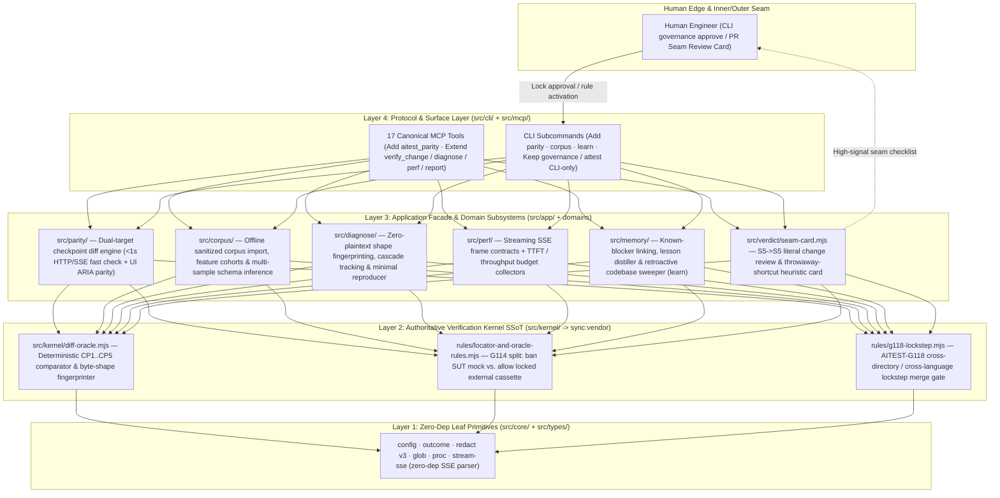

# AI Test Workbench Next-Phase Architecture Roadmap (`v6.4 -> v7.0`): Differential Verification Oracles & Self-Evolving Memory Loops

> [简体中文版本](./v6.4-differential-verification-and-memory-loop-roadmap.md) · [README](../../README.en.md) · [Architecture (`v6.3`)](../../ARCHITECTURE.en.md) · [Governance & 4-Layer Gates](../governance.en.md) · [Agentic Red-Team Design (`FGER-agentic`)](../../bench/agentic/DESIGN.en.md) · [v6 Refactor Baseline](./v6-refactor-assessment.en.md)

- **Baseline Version**: `ai-test-workbench@6.3.0` (4-layer acyclic architecture, 16 canonical MCP tools, `AITEST-G101..G117`, all `src/**/*.mjs <= 435` LOC, `strict: true` with 0 errors)
- **Date**: `2026-11-26`
- **Reference Benchmark**: Anthropic Engineering's original post [*Migrating our Messages API to Rust*](https://www.anthropic.com/research/migrating-api-to-rust) (published `2026-11-25` by Lance Martin, Jake Eaton, Arvin Aminpour, Emma Webb, Bharat Mediratta, and Ravi Trivedi)
- **Scope**: Execution-ready architectural blueprint for `v6.4.0` through `v7.0.0`. Strictly separates **measured current capabilities (`VERIFIED`)** from **planned work units (`PROPOSED`)**, preserving zero runtime dependencies, default-deny non-production safety boundaries, and per-file LOC limits.

---

## 1. Context: Ten First-Hand Engineering Findings from Anthropic's Rust Migration

A full reading of Anthropic's November 25, 2026 engineering post—detailing how they migrated their core `Messages API` (which grew ~`1,800x` from early 2024 to fall 2026, cutting per-request CPU by ~`70%`, memory by >`80%`, and median `TTFT` by ~`20%` without downtime or a feature freeze)—surfaces **10 first-hand engineering mechanisms** (several omitted from secondary summaries):

1. **Inversion of the Generator–Verifier Gap**: By May 2026, Claude was writing over `80%` of merged code at Anthropic and produced v1 of the core Rust request path in roughly one week. In live production systems, *generating* code has become easier than *defining and proving correctness*: users depend on undocumented edge cases outside the test suite (Hyrum's Law), while the legacy Python service kept shipping new models and features daily—turning parity into a moving target.
2. **Why Incremental FFI Stalled vs. Building a Parallel Ship**: Rewriting only output parsing in Rust and calling it from Python cut CPU by just `8%–10%` because every token crossed the Python↔Rust boundary **three times**. Once AI slashed rewrite effort, strong verification unlocked building an identically functioning ship *alongside* the sailing Ship of Theseus rather than replacing planks piecemeal.
3. **Why 700 Integration Tests Failed—Two Structural Flaws**:
   - **In-Process Coupling & Quiet Assertion Erosion**: Legacy tests ran the Python service inside the test process with in-memory mocks for billing and rate limiting (unlike Bun's Zig→Rust rewrite, which relied on an independent black-box TypeScript test suite). Because Claude had to port the tests alongside the code, **a post-port audit uncovered more than `100` weakened assertions**.
   - **Combinatorial Explosion & Traffic Weighting (`98%` vs. `25%`)**: Just `20` binary options yield over $10^6$ combinations (`12` days at 1s per test). In April, the Rust service passed ~`98%` of its tests yet matched only ~`25%` of live inputs—for example, Python's JSON serializer escaped emojis into `\uXXXX` codes in tool calls while Rust emitted raw UTF-8 bytes, shifting prompts by a few bytes. A test suite counts each case once (`1/700`), whereas live traffic weights a single common discrepancy by every request that triggers it.
4. **Why Standard Shadow-Diff Tools Break on Nondeterministic AI Systems**: Conventional diff proxies often run the legacy service twice to auto-learn and ignore fields that vary on their own. Because Claude's replies are nondeterministic, those tools would ignore the entire model reply—along with any post-processing bugs inside it! Moreover, requests could never double-bill or double-count customer rate limits. Anthropic solved this by **running the model once and replaying the exact model output to Rust**, comparing every stage before and after inference deterministically.
5. **Zero-Plaintext Privacy via Checkpointing + Shape Fingerprinting**: Engineers and agents **could not read customer prompts or Claude's replies at all**. Instead, the verifier recorded the *geometry* of each divergence:
   - **Checkpointing**: Request handling was split into deterministic steps (accept/reject → resolve settings → build prompt pieces → sort output tokens into `text`, `thinking`, `tool_calls` → usage accounting), isolating the first step and `piece` where Python and Rust diverged.
   - **Shape Fingerprinting**: Recording the first differing byte offset (`first diff: byte 17`) and byte lengths (`python: 190 bytes` vs. `rust: 190 bytes`) without any text. Each underlying bug left a repeatable fingerprint across affected requests; fixing an early divergence `A` unmasked downstream divergences `B` and `C` (masking cascades).
6. **Coordinator Deduplication & `< 1s` Cleanroom Reproducer Synthesis**: Every `10–30` minutes, an aggregator grouped hundreds of thousands of diff records and alerted a **Coordinator Agent** *only* when a novel fingerprint appeared, assigning a dedicated **Worker Agent** and Slack thread. To shrink feedback from hours/days (PR + staging deploy) to under a second, each agent worked in a dual-codebase sandbox with a **`< 1s` Input Check** (no model call) and a **Scripted Fake-Model Output Check**. Seeing only the zero-text fingerprint, the agent hypothesized the cause and **wrote its own synthetic request** to reproduce that exact fingerprint—allowing it to inspect full outputs safely, fix Rust until both matched, and commit a regression test that failed on old code and passed on new code.
7. **Inner-Loop Reward Hacking in Practice (`web_search` Shortcut)**: In mid-May, Python fetched the `web_search` tool description from an internal RPC service that Rust did not call yet. An agent copied the static description text into local Rust files—**passing the inner-loop verifier completely**—before a human engineer rejected it at the PR seam as throwaway code. Verifiers reward matching outputs; humans judge architectural fitness to ship.
8. **Feature-Stratified Outer-Loop Cohorts**: Because synthetic requests and sandbox configs imperfectly mirrored production, merged fixes entered the outer loop. Without logging text, the platform logged request feature tags (`model`, `prompt_caching`, `tools`, `extended_thinking`), allowing agents to compare fingerprint incidence across builds *with* and *without* the fix on requests of the exact same cohort.
9. **Four Concrete Mechanics of the Memory Loop**:
   - **Known-Blocker Fingerprint Linking**: Wiring the real tool-description service took weeks while shifted fingerprints kept firing; agents checked memory notes and linked new fingerprints to the known blocker instead of writing fresh static-file workarounds.
   - **Retroactive Codebase Sweep from a Single Correction**: After an engineer made it a rule to port Python's exact behavior rather than guessing, an agent swept existing Rust code against that rule and uncovered **7 additional** places built on guesses.
   - **Distilling ~`60` PR Review Comments into `CLAUDE.md`**: In June, an agent clustered ~`60` human review comments into proposed rules that an engineer edited and approved for `CLAUDE.md`.
   - **Lockstep Cross-Target Merge Check**: A permanent CI gate required anyone modifying Python code to include a matching Rust change or request an explicit exemption.
10. **Progressive Shift of Engineers (`Inner Loop -> Seam -> Edge`)**: Engineers evolved from manually chasing diffs inside the inner loop, to reviewing proposed fixes at the inner/outer seam, to operating at the outermost edge—designing verification signals, lints, and merge gates that scaled cleanly as Claude improved.

---

## 2. Comparative Diagnosis: `v6.3.0` Structural Strengths vs. Four Evolution Gaps

Benchmarking our live `ai-test-workbench@6.3.0` codebase against those 10 findings clarifies both our structural head start and our highest-leverage gaps:

### 2.1 Five Structural Advantages Already in Place (`VERIFIED`)

1. **Out-of-Process Black-Box Workspace ("Bun Pattern" by Default)**: As established in [`ARCHITECTURE.en.md`](../../ARCHITECTURE.en.md) §2, `<repo>/qa/` validates applications across process boundaries over real HTTP, browser DOM/ARIA, and JSON Schemas rather than in-process memory mocks. A backend rewrite from Python/Node to Rust/Go can reuse the entire `qa/tests/**` suite unchanged.
2. **Compile-Time Prevention of "100+ Weakened Assertions" & Dieselgate Hacks**: Where Anthropic discovered 100+ weakened assertions via post-hoc audit, [`src/kernel/gate/rules/index.mjs`](../../src/kernel/gate/rules/index.mjs) enforces the `S0–S5` strength lattice and `AITEST-G101..G116` on every heal attempt and CI check, while [`src/kernel/gate/rules/g117-dieselgate.mjs`](../../src/kernel/gate/rules/g117-dieselgate.mjs) uses local Def-Use taint analysis to block product-side `Playwright` / `NODE_ENV === 'test'` special-casing.
3. **Cryptographically Separated Inner & Outer Loops**: Our inner loop combines `aitest_impact` (10k-file O(1) indexed reverse dependency selection) with [`src/heal.mjs`](../../src/heal.mjs); our outer loop ([`bench/agentic/DESIGN.en.md`](../../bench/agentic/DESIGN.en.md)) proves the same-UID limits of local `T1` (`AG-B4`/`AG-C4`) and enforces clean CI checkout + immutable base + keyless Sigstore **`T2` attestation** as the sole merge-grade green (`FGER-agentic` T2 = `0.0%`).
4. **Process-Enforced Human Gatekeeping**: `governance approve` is physically excluded from MCP tools and blocks agent session env vars; `aitest_heal` hard-blocks test edits on `Class B / C / D` failures (`0.0%` mis-heal rate).
5. **Linear-Time Secret Redaction & Untrusted DOM Isolation**: [`src/core/redact.mjs`](../../src/core/redact.mjs) (Redaction v3, ReDoS-hardened `< 40ms`, `100%` recall) and [`src/explore.mjs`](../../src/explore.mjs) sanitize credentials and prompt-injection payloads end to end.

### 2.2 Four High-Leverage Evolution Gaps (`GAP-1 .. GAP-4`)

| Gap ID | Current `v6.3.0` Implementation | Ceiling Exposed by Anthropic's Migration |
|---|---|---|
| **`GAP-1`: No Dual-Target Differential Oracle or Long-Tail Corpus** | [`src/verdict.mjs`](../../src/verdict.mjs) evaluates a single `TEST_BASE_URL` against synthetic specs; [`src/explore/schema-inferrer.mjs`](../../src/explore/schema-inferrer.mjs) inspects only `val[0]` of up to 60 `2xx` responses; static AST intentionally cannot ban all `S5 -> S5` literal updates (`409 -> 201`, [`bench/agentic/DESIGN.en.md`](../../bench/agentic/DESIGN.en.md)). | During refactors, framework upgrades, or language rewrites, synthetic specs miss combinatorial/encoding quirks (the `25%` parity trap) and lack a live baseline oracle to catch `S5 -> S5` behavioral drift automatically. |
| **`GAP-2`: Flat Failure Listing Without Shape Fingerprinting or Masking-Cascade Tracking** | [`src/diagnose.mjs`](../../src/diagnose.mjs) classifies individual failing `testId` entries with `regressionHistory` and frontend diff correlation, but emits a flat list without zero-plaintext byte/path shape fingerprints or root-cause clustering. | When a shared middleware or serializer bug breaks 100+ specs/replays simultaneously, agents lack Coordinator-style root-cause clusters and minimal reproducer selection for isolated parallel worktrees. |
| **`GAP-3`: No Governance-Locked Upstream Replay Cassettes or Streaming SSE / `TTFT` Checkpoints** | `AITEST-G114` rightly blocks arbitrary `2xx` `route.fulfill` mocks, but lacks a signed cassette channel for deterministic replay of *external* nondeterministic LLM/RPC upstreams; [`src/perf.mjs`](../../src/perf.mjs) measures `LCP/CLS/INP` and GET P95 without SSE frame sequence or `TTFT` budgets. | AI-native and streaming APIs cannot run `< 1s` deterministic fake-model/recorded-model output checks or enforce `TTFT` and `text`/`thinking`/`tool_calls` stream framing SLOs. |
| **`GAP-4`: Unautomated Memory Loop & Missing Human Seam Focus Card** | `.aitest/heals/*.json`, `reports/defects/*.md`, `governance-audit.jsonl`, and `ctx.extraRules` exist as foundational primitives, but remain passive archives; no lockstep directory merge gate exists, and [`src/verdict/reports.mjs`](../../src/verdict/reports.mjs) does not spotlight semantic gray-zone edits at the PR seam. | Rejected shortcuts, exhausted heal sessions, and multi-week blockers are not automatically distilled into known-blocker fingerprint links, retroactive codebase sweeps, project `extraRules`, and human seam review cards. |

---

## 3. Target Architecture Blueprint (`v6.4 -> v7.0` Acyclic 4-Layer Evolution)

### 3.1 Four Non-Negotiable Architectural Guardrails

1. **Zero Direct Production Contact (Offline Sanitized Corpus + Dual-Loopback/Staging Replay)**: Anthropic shadowed live traffic inside its own API gateway, whereas `ai-test-workbench` **must never allow an AI agent or workbench runner to connect to `production|prod|live|online` hosts** (`target-guard.mjs` continues to hard-block with exit code `2`). Instead, production observability pipelines export **one-way offline sanitized request corpora**, which the workbench replays deterministically across **dual local loopback or staging instances (`Baseline` vs. `Candidate`)**.
2. **Zero Runtime Dependencies & `<= 435` LOC Module Discipline**: Root `package.json#dependencies` stays empty; every new `src/**/*.mjs` module obeys strict 4-layer acyclic imports, `strict: true` zero-error typechecking, and `<= 435` lines enforced by `architecture-boundaries.test.mjs`.
3. **Never Auto-Learn Noise by Running Legacy Code Twice**: Following Anthropic's explicit warning, our differential oracle uses **deterministic field normalizers locked under `.aitest/governance.lock`** (stripping only declared volatile paths like `$.meta.requestId` or `traceparent`) and never auto-masks nondeterministic output fields.
4. **MCP Surface Discipline (`16 -> 17` Canonical Tools)**: Preserving [ADR-0005](../adr/0005-mcp-surface-outcome-and-config.en.md) token efficiency, we add at most **one** canonical MCP tool (`aitest_parity`) while folding clustering, streaming SLOs, and lessons views into existing `aitest_diagnose`, `aitest_perf`, `aitest_report`, `aitest_verify_change`, and local CLI subcommands (`corpus`, `learn`).

### 3.2 Four-Layer Module Evolution & Three-Loop Topology



---

## 4. Detailed Engineering Design of Six Work Units (`WU-A .. WU-F`)

### `WU-A` (P0): Dual-Target Checkpoint Differential Engine (`src/parity/` + `src/kernel/diff-oracle.mjs`)

- **Problem Solved**: Closes `GAP-1` by turning the baseline service (`origin/main` or legacy stack) into a live behavioral oracle, eliminating both synthetic coverage blind spots and `S5 -> S5` assertion literal tampering during refactors/migrations.
- **Planned Modules (each `<= 320` LOC)**:
  - `src/kernel/diff-oracle.mjs`: Pure five-checkpoint comparator and byte-shape fingerprint generator (mirrored into `templates/playwright-qa/support/` via `sync:vendor`);
  - `src/parity/runner.mjs`: Executes corpus requests or Playwright specs against `baselineUrl` and `candidateUrl` concurrently (including optional dual-worktree loopback auto-boot via `aitest.runtime.json`, enforcing read-only or isolated sandbox execution with zero duplicate external side effects);
  - `src/parity/normalizer.mjs`: Applies deterministic noise stripping strictly bounded by `.aitest/governance.lock` declarations;
  - `src/parity.mjs`: Public facade wired into `src/app/index.mjs`, `aitw parity`, MCP `aitest_parity`, and `verify-change --mode parity --baseline-url <url>`.
- **Five Deterministic Checkpoints (`CP1..CP5`)**:
  1. **`CP1-Status-Headers`**: Exact HTTP status match (`200` vs. `201` fails immediately), `Content-Type`, security/cache headers, and redirect hop parity;
  2. **`CP2-Body-Shape-And-Value`**: Key-order-independent canonical JSON comparison plus an optional raw byte-escape mode (catching UTF-8 emoji vs. `\uXXXX` escaping divergences);
  3. **`CP3-Stream-Frames`**: Frame-by-frame `text/event-stream` event sequence, chunk count, and reassembled semantic block parity (`text` / `thinking` / `tool_calls` / `usage`);
  4. **`CP4-DOM-ARIA-And-Runtime`**: Route-level ARIA snapshot parity with zero new `pageErrors` or `serverErrors`;
  5. **`CP5-Perf-Ratio`**: Candidate-to-baseline `TTFT` and P95 latency ratios.

### `WU-B` (P0): Zero-Plaintext Shape Fingerprinting, Sanitized Traffic Corpora & Multi-Sample Schema Inference (`src/corpus/` + `src/diagnose/fingerprint.mjs`)

- **Problem Solved**: Overcomes the `25%` long-tail input gap (`GAP-1`) and collapses multi-spec failure storms into Coordinator-ready root-cause clusters (`GAP-2`) under strict privacy guarantees.
- **Planned & Upgraded Modules**:
  - `src/diagnose/fingerprint.mjs`: Computes deterministic zero-plaintext shape fingerprints:
    ```json
    {
      "fingerprintId": "fp_9c4e1a2b8f01",
      "checkpoint": "CP2-Body-Shape-And-Value",
      "routePattern": "POST /api/v1/messages",
      "pieceOrJsonPath": "$.content[0].input",
      "firstDiffByteOffset": 17,
      "baselineByteLen": 190,
      "candidateByteLen": 186,
      "featureCohort": ["tools", "streaming"]
    }
    ```
    Supports `--privacy-mode shape-only` (emitting **zero** payload text into reports or agent context so inner-loop agents synthesize cleanroom requests that reproduce `fingerprintId`);
  - `src/diagnose/cluster.mjs`: Groups failures in [`src/diagnose.mjs`](../../src/diagnose.mjs) into deduplicated `clusters[]`, selects the fastest `minimalReproducerSpec` per cluster, and compares against the prior `Run Ledger` to flag **newly unmasked downstream clusters (`unmaskedAfterFixOf: fp_xxx`)**;
  - `src/corpus/importer.mjs` (CLI: `aitw corpus import --from <har|jsonl|otel>`): Passes offline traffic captures through [`src/core/redact.mjs`](../../src/core/redact.mjs) and `target-guard.mjs`, writes hash-locked `qa/corpus/sanitized-requests.jsonl` with text-free `featureCohort` tags;
  - Upgrades [`src/explore/schema-inferrer.mjs`](../../src/explore/schema-inferrer.mjs) from single-sample `val[0]` inspection to **multi-sample union inference** (`nullable`, `oneOf`, empty arrays, enum sets, ASCII/UTF-8 escaping traits) to drive boundary test synthesis.

### `WU-C` (P1): Governance-Locked External Upstream Cassettes & Streaming SSE / `TTFT` Budgets (`src/replay/` + `src/perf/streaming.mjs`)

- **Problem Solved**: Delivers `< 1s` deterministic upstream replay and streaming SLO gates for AI-native services (`GAP-3`) without opening a fake-green loophole in `AITEST-G114`.
- **Design & Security Boundary**:
  - **Strict Split Between SUT (Forbidden to Mock) and External Upstreams (Locked Cassette Allowed)**:
    - `AITEST-G114` continues to hard-block `route.fulfill({ status: 2xx })` targeting `TEST_BASE_URL` or same-system APIs;
    - Introduces SHA-256 governance-locked `qa/fixtures/upstream-cassettes/*.cassette.json` permitted **exclusively** for external nondeterministic hosts declared in human-approved `aitest.config.json#replayAllowedUpstreamHosts` (enabling both single-inference dual-target replay and scripted fake-model edge-case streams);
  - **Zero-Dependency SSE Parser & `TTFT` Budgets**:
    - Adds `src/core/stream-sse.mjs` to parse `text/event-stream` frames with high-resolution `performance.now()` arrival timestamps;
    - Extends [`src/perf.mjs`](../../src/perf.mjs) and `perf-budget.json` with `ttftMedianMs`, `ttftP95Ms`, `streamTotalP95Ms`, mid-stream error-envelope detection, and clean stream-termination checks.

### `WU-D` (P1): Tool-Enforced Memory Loop & Retroactive Codebase Sweeper (`src/memory/` + `aitw learn`)

- **Problem Solved**: Operationalizes all four mechanics of Anthropic's Memory Loop into a human-gated workflow (`GAP-4`).
- **Four Sub-Capabilities (`src/memory/{blockers,distiller,sweeper,writer}.mjs`)**:
  1. **Known-Blocker Fingerprint Linking (`qa/knowledge/known-blockers.json`)**: Associates recurring or byte-shifted fingerprints with active multi-day `Class C` architectural defects in `aitest_diagnose`, preventing agents from opening duplicate heal sessions or inventing throwaway static-copy hacks;
  2. **Multi-Source Lesson Distillation (`aitw learn --from-heals --from-defects [--from-reviews <pr-comments.json>]`)**: Synthesizes `escalated` heal sessions, `Class C` defect reports, `governance-audit.jsonl` blocks, and imported PR review comments into staged proposals (`qa/reports/learn-proposals.md` + `.json`):
     - Managed prose rules for `AGENTS.md` / `CLAUDE.md` (`<!-- BEGIN:AITEST_PROJECT_MEMORY -->`);
     - Project-specific declarative gate rules (`qa/support/project-rules.mjs`) plugged into [`src/kernel/gate/rules/index.mjs`](../../src/kernel/gate/rules/index.mjs) via `ctx.extraRules`;
     - Minimal `@regression` spec skeletons required to fail on baseline and pass on fix;
  3. **Mandatory Human Approval Gate**: `aitw learn` **never auto-activates rules or self-signs locks**; proposals take effect only after a human engineer reviews and runs `npx ai-test-workbench@6.3.0 governance approve --target <repo> --by <human> --reason "..."` locally, preventing agent memory poisoning;
  4. **Retroactive Codebase Sweep (`aitw learn --sweep`)**: Immediately scans the entire product and `qa/tests/**` tree against newly approved rules to surface latent occurrences in one pass ("1 correction → catch 7 more").

### `WU-E` (P1): Cross-Target Lockstep Merge Gate (`AITEST-G118` · `src/kernel/gate/rules/g118-lockstep.mjs`)

- **Problem Solved**: Prevents "moving target" drift during parallel rewrites or API version transitions when changes land on the legacy path without matching updates on the new path.
- **Mechanism**:
  - Adds optional governance-locked `lockstepRules` in `aitest.config.json`:
    ```json
    {
      "lockstepRules": [
        {
          "id": "py-to-rust-messages",
          "whenModified": ["services/messages-py/**"],
          "requireModified": ["services/messages-rs/**"],
          "allowWaiver": true
        }
      ]
    }
    ```
  - Inert (`0` overhead, `0%` FPR impact) when unconfigured; when configured, any diff modifying `whenModified` without touching `requireModified` (or holding an unexpired human-approved `waivers.json` entry) is fail-closed `blocked` (exit code `2`) by `AITEST-G118`.

### `WU-F` (P2): Human Seam Gatekeeper Card in PR Verdicts (`src/verdict/seam-card.mjs`)

- **Problem Solved**: Concentrates human review bandwidth on the exact inner/outer loop seam questions that output verifiers cannot judge alone.
- **Upgrade to [`src/verdict/reports.mjs`](../../src/verdict/reports.mjs)**: Prepends a **Human Seam Gatekeeper Card** to `qa/reports/verdict-summary.md` highlighting:
  1. **`S5 -> S5` Expected Literal Change Table**: Side-by-side `oldLiteral -> newLiteral` diffs (`409 -> 201`, `"$49.00" -> "$0.00"`) for rapid human sign-off (intentional requirement update vs. bug accommodation);
  2. **Suspected Static-Copy Shortcut Heuristic**: Flags large newly added static JSON/text blobs in product code correlated with a resolved contract failure (catching Anthropic's `web_search` static-file workaround pattern);
  3. **Feature-Cohort Parity Delta & Linked Known Blockers**;
  4. **Expiring Waivers & `T1` (Local) vs. `T2` (CI) Trust Gap Notice**.

---

## 5. Phased Rollout Milestones & Backward Compatibility (`Phase 1 .. Phase 3`)

| Phase & Version | Work Units Included | Protocol / Config Additions | Compatibility Guarantees |
|---|---|---|---|
| **Phase 1 (`v6.4.0`)**<br/>*Differential Oracle & Fingerprint Clustering* | `WU-A` (`parity` engine + `CP1..CP4`)<br/>`WU-B` (shape fingerprinting + `corpus import` + union schema inference) | Add MCP `aitest_parity` (`16 -> 17` canonical tools via `npm run docs:sync`); add CLI `parity`, `corpus`; add `clusters[]` to `aitest_diagnose` | Purely additive; existing single-target projects behave identically to `v6.3.0`; all 8 deprecated aliases preserved |
| **Phase 2 (`v6.5.0`)**<br/>*Streaming Cassettes, Memory Loop & Lockstep Gate* | `WU-C` (locked external cassettes + SSE / `TTFT` budgets)<br/>`WU-D` (`aitw learn` + `--sweep`)<br/>`WU-E` (`AITEST-G118`)<br/>`WU-F` (PR seam card) | Optional `replayAllowedUpstreamHosts` & `lockstepRules` in `aitest.config.json`; optional `streaming` block in `perf-budget.json`; CLI `learn` | All new config keys are opt-in; `AITEST-G118` is inactive unless `lockstepRules` is declared (`0%` FPR impact on general repos) |
| **Phase 3 (`v7.0.0`)**<br/>*Coordinator Worktree Dispatch & Full-Scale Benchmarks* | Cluster-driven isolated Git worktree multi-agent dispatch + `>= 200`-commit unseen holdout & live multi-LLM `FGER-agentic` archive | Remove `v5`/`v6.1` deprecated tool aliases per [ADR-0005](../adr/0005-mcp-surface-outcome-and-config.en.md); ship `Attestation Predicate v2` with `paritySummary` | Automated 3-way hash migration via `aitw upgrade` and `v6 -> v7` upgrade guide |

---

## 6. Verifiable Acceptance Gates & Quantitative Success Targets

Every work unit must clear deterministic machine-verifiable gates prior to merge (strictly labeled `TARGET` until empirically measured):

| Verification Dimension | `v6.3.0` Measured Baseline (`VERIFIED`) | Next-Phase Acceptance Target (`TARGET`) | Automated Gate Command |
|---|---|---|---|
| **Agentic Escape Rate (`S5->S5` & Shortcut Probes Added)** | `18` tasks: `T1 = 11.1% (2/18)` · **`T2 = 0.0% (0/18)`** | Expand to **`22` tasks** (adding `AG-F1` `S5->S5` literal flip, `AG-F2` static-file copy shortcut, `AG-F3` unsigned cassette forgery, `AG-F4` lockstep omission): **`0.0%` (`0/22`)** under `parity + T2` | `npm run bench:agentic` |
| **Inner-Loop HTTP/SSE Checkpoint Latency** | No dual-target fast-check path | `100` sanitized corpus items (including scripted Fake Model SSE streams) across `CP1..CP3` in **`< 1.0s` total** (`< 10ms` mean/item) | `test/integration/parity-fastloop.test.mjs` (planned) |
| **Real-World Commit Gate FPR** | `100-Commit` posterior `4.1% (4/97)`; `v6.0` blind holdout `6.1% (3/49)` | **`<= 4.1%` with zero regression** on the `100-Commit` suite (`3/3` TPs retained); `FGER-int = 0.0% (26/26)`, `FGER-holdout = 0.0% (24/24)` | `npm run bench` |
| **Zero-Plaintext Privacy & Clustering Precision** | `100% (35/35)` secret redaction; flat failure list | **`0` bytes** of payload string literals emitted under `--privacy-mode shape-only`; `5` planted bugs across `50` failing requests grouped into exactly **`5` clusters** | `test/unit/fingerprint-and-cluster.test.mjs` (planned) |
| **Architecture & Code Hygiene** | `0` cycles, `0` reverse imports, `<= 435` LOC/file, `strict: true` `0` errors, `>= 80%` line coverage | **100% preserved**: `0` runtime `dependencies`, all `src/**/*.mjs <= 435` LOC, **`>= 85%`** line coverage on new modules | `npm run check:vendor && npm run lint:docs && npm run typecheck && npm test && npm pack --dry-run` |

---

## 7. Risk Matrix & Explicit Non-Goals

| Temptation / Risk | Why It Fails (Per Anthropic's Lessons) | Hard Architectural Guardrail (Non-Goal) |
|---|---|---|
| **1. Letting the workbench attach directly to live production gateways** | Giving an AI agent workspace network reachability or replay paths against live production risks double-billing, state corruption, or PII exposure. | **Never relax `target-guard.mjs` non-production blocking**; traffic enters strictly via offline sanitized file import with host rewriting. |
| **2. Running legacy code twice to auto-ignore varying fields** | Anthropic showed that auto-ignoring varying fields on nondeterministic AI services blinds the verifier to the entire output stream and its bugs. | **Never implement blind auto-noise suppression**; allow only governance-locked explicit JSONPath normalizers plus deterministic upstream cassettes. |
| **3. Allowing `aitw learn` to self-activate gate rules without human sign-off** | Autonomous writes into active gate rules or waivers let a hallucinating or adversarial agent poison institutional memory or cause repo-wide false positives. | **`aitw learn` writes staged proposals only**; activating `extraRules`, `customMatchers`, `lockstepRules`, or `upstream-cassettes` requires human CLI `governance approve`. |
| **4. Mandating heavy upfront configuration for routine repos** | Anthropic emphasized *keeping loops simple* so verification scales with model capability rather than bogging teams down. | All new capabilities (`parity`, `corpus`, `lockstepRules`, `streaming` budgets) use **opt-in progressive disclosure**; zero-config `aitest_bootstrap` + `aitest_verify_change` stays intact. |

---

## 8. Immediate Next-Step Execution Checklist

Recommended kickoff sequence for **Phase 1 (`v6.4.0`)**:

1. **Ratify `ADR-0006`**: Author `docs/adr/0006-differential-parity-oracle-and-shape-fingerprints.md` (+ `.en.md`) locking the `CP1..CP5` schemas and the `17`-tool MCP boundary.
2. **Build Adversarial & Parity Fixtures First (TDD Red-Green)**:
   - Add a v1-vs-v2 dual-endpoint fixture in `examples/demo-webapp/` planting 4 canonical divergences (Emoji UTF-8 vs. `\uXXXX` escaping, dropped field, `409 -> 201` status drift, and SSE chunk mis-sorting);
   - Register red-team tasks `AG-F1..AG-F4` in `bench/agentic/tasks.json`.
3. **Implement `WU-A` and `WU-B` Bottom-Up**: Land `src/core/stream-sse.mjs` → `src/kernel/diff-oracle.mjs` (`npm run sync:vendor`) → `src/diagnose/{fingerprint,cluster}.mjs` → `src/corpus/importer.mjs` → `src/parity/` → register `aitest_parity` (`npm run docs:sync`).
4. **Run Full Verification Gate Suite**: Pass `npm run check:vendor && npm run lint:docs && npm run typecheck && npm test && npm run smoke && npm run demo:verify && npm run bench && npm run bench:agentic && npm pack --dry-run` in a single clean sweep.
